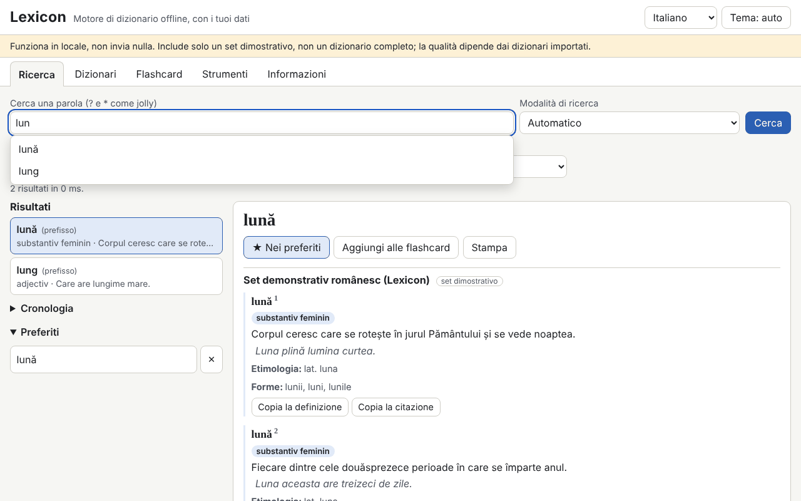

# Lexicon

[English](README.md) · [Română](README.ro.md) · [Français](README.fr.md) · **Italiano** · [Español](README.es.md) · [Português](README.pt.md) · [Deutsch](README.de.md) · [Magyar](README.hu.md)

**Versione:** 1.0.0 · **Ultimo aggiornamento:** 2026-10-14

Lingue dell'interfaccia: **Română, English, Français, Italiano, Español, Português (PT), Deutsch, Magyar**

Lexicon è un motore di dizionario che funziona interamente offline, in un unico file HTML. Non include un dizionario completo: porti tu i tuoi dizionari (TSV/CSV, JSON, StarDict, dictd, XDXF), li conservi in IndexedDB e li consulti all'istante: prefisso, esatto, senza segni diacritici, approssimato (Damerau–Levenshtein), forme flesse, testo integrale nelle definizioni e caratteri jolly (`?`, `*`). Ha cronologia, preferiti, parola del giorno, flashcard con ripetizione dilazionata, esportazione e controllo ortografico. Il set incluso (345 voci originali in romeno) è un **set dimostrativo, non un dizionario completo**.

**App online:** https://chiuta.github.io/apps/Lexicon/

## Come si usa
1. Apri la scheda **Dizionari** e scegli i file (se ne possono importare più d'uno alla volta). Per TSV/CSV/JSON vengono mostrati un'anteprima e la mappatura delle colonne.
2. Compila i metadati: titolo, lingue, fonte e **licenza** (obbligatoria; senza di essa compare un avviso).
3. Attiva/disattiva i dizionari e cambia l'ordine di visualizzazione.
4. In **Ricerca**, digita la parola: i suggerimenti compaiono in tempo reale; `[[parola]]` e i collegamenti interni degli articoli si aprono direttamente. Scorciatoia: `/` sposta il cursore nel campo di ricerca.
5. **Flashcard** (SM-2 semplificato), **Strumenti** (esportazione dei preferiti in CSV/JSON/Markdown, esportazione del sottoinsieme cercato, «Controlla l'ortografia di un testo», copia di sicurezza `.fff.json`, «Elimina tutto»).

## Porta il tuo dizionario
La cartella `exemple/` contiene `model.tsv` e `model.json` (formato minimo: parola, definizione, facoltativamente forme, categoria, esempi, etimologia).

**Verifica la licenza di ogni fonte (ad esempio, i dati pubblicati da dexonline hanno condizioni proprie di licenza e attribuzione; non ho verificato le condizioni attuali).** L'app non include né scarica alcun dizionario di licenza incerta; la responsabilità dei dati importati è tua.

## Formati supportati
- **TSV / CSV** con intestazione (delimitatore rilevato, campi tra virgolette, codifiche UTF-8, Windows-1250/1252, ISO-8859-2). I campi `forme` ed `exemple` sono separati da `|`.
- **JSON**: elenco di oggetti, oggetto parola→definizione, elenco di elenchi o formato nativo `lexicon-dict`.
- **StarDict**: `.ifo` + `.idx` (+ `.idx.gz`) + `.dict` o `.dict.dz` (gzip/dictzip, tramite `DecompressionStream`), `.syn` (diventano forme), offset a 32 o 64 bit, `sametypesequence`.
- **dictd**: `.index` + `.dict` / `.dict.dz`, offset in base 64.
- **XDXF** semplice (`<ar>`, `<k>`).

## Cosa NON fa e i suoi limiti
- Non ha contenuto lessicografico proprio al di fuori del set dimostrativo.
- Il file viene letto interamente in memoria all'importazione; i file molto grandi (centinaia di MB) possono superare la memoria del browser.
- La ricerca nelle definizioni scorre tutte le voci (senza indice invertito) e non ordina per pertinenza.
- I collegamenti esterni negli articoli non sono attivi: vengono mostrati come testo con l'indirizzo.
- XDXF è supportato solo nella forma semplice; l'HTML viene ripulito da un parser proprio con un elenco di tag consentiti, quindi le formattazioni complesse vanno perse.
- L'importazione di 300.000 voci è lenta (vedi sotto); la ricerca successiva è istantanea.
- Il controllo ortografico si basa solo sui dizionari attivi (parole e forme); non effettua analisi grammaticale.
- Senza IndexedDB (modalità privata) i dati restano solo in memoria e si perdono al ricaricamento; l'app ti avvisa.

## Privacy
Funziona in locale e non invia nulla. Non ci sono richieste di rete (`connect-src 'none'`). I dizionari sono in IndexedDB, mentre cronologia, preferiti, lingua e tema sono in `localStorage` (chiavi `fff.lexicon.*`). «Elimina tutto» rimuove tutto.

## Prestazioni misurate (nei test, Chromium headless, macchina sotto carico)
Set sintetico di 300.000 voci (TSV da 32,8 MB, 100.000 con forme):
- importazione e indicizzazione: 270–353 s (scrittura in IndexedDB; dipende molto dal carico della macchina);
- suggerimenti in tempo reale: media 0,02 ms, p95 0,1 ms, massimo 4 ms (708 interrogazioni; l'obiettivo era sotto i 50 ms);
- esatto 0,4 ms, prefisso 0,2 ms, carattere jolly `*` iniziale 37–427 ms, fuzzy completo 49–464 ms, suggerimenti fuzzy senza prefisso 0,2–1,9 s;
- testo integrale nelle definizioni: 2–3 s (5,7 s senza corrispondenze);
- ricaricamento con il set da 300.000 in IndexedDB: 150–250 ms; heap di circa 141 MB.

## Aspetti tecnici
Un unico `index.html`, script inline con hash nella CSP (`script-src 'sha256-…'`, `default-src 'none'`, `connect-src 'none'`, senza gestori inline, senza `eval`; `worker-src blob:` è ereditato dal modello). Indice in memoria (chiavi normalizzate ordinate, ricerca binaria), IndexedDB per le voci e il testo integrale. Il contenuto HTML passa attraverso un parser proprio e viene costruito con `createElement`/`textContent`. Rileva facoltativamente `window.FFF`; funziona pienamente anche senza. Test: `node tests/test.mjs` (Playwright; 292 verifiche: parsing StarDict/dictd con file generati nel test, interrogazioni, 28 payload XSS, persistenza, 300.000 voci, axe 0, overflow a 360×740 e 1280×800). La variabile `LEXICON_SKIP_PERF=1` salta il test grande.

## Terze parti
Non c'è codice di terze parti nell'app (axe-core è usato solo nei test).

## Traduzioni
L'interfaccia è in romeno (predefinito), inglese, francese, italiano, spagnolo, portoghese, ungherese e tedesco. Le traduzioni fr/it/es/pt/hu/de sono automatiche, non verificate da madrelingua.

## Licenza
MIT — vedi il file `LICENSE` nella radice del repository.

## Cronologia
- 1.0.0 — 2026-10-14: prima versione.
