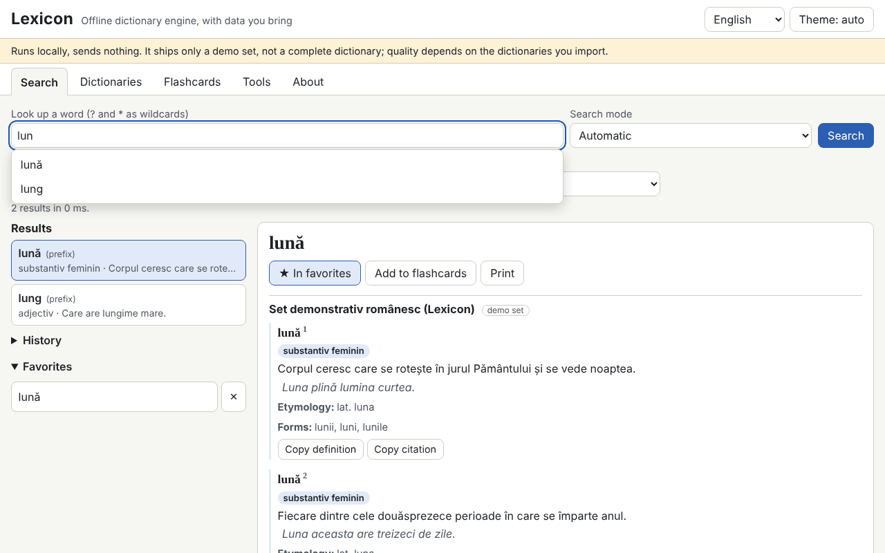

# Lexicon

**English** · [Română](README.ro.md) · [Français](README.fr.md) · [Italiano](README.it.md) · [Español](README.es.md) · [Português](README.pt.md) · [Deutsch](README.de.md) · [Magyar](README.hu.md)

**Version:** 1.0.4 · **Last updated:** 2026-10-23

Interface languages: **Română, English, Français, Italiano, Español, Português (PT), Deutsch, Magyar**

Lexicon is a dictionary engine that runs entirely offline, in a single HTML file. It does not ship a complete dictionary: you bring your own dictionaries (TSV/CSV, JSON, StarDict, dictd, XDXF), keep them in IndexedDB and search them instantly: prefix, exact, diacritic-insensitive, approximate (Damerau–Levenshtein), inflected forms, full text in definitions and wildcard (`?`, `*`). It has history, favourites, a word of the day, flashcards with spaced repetition, export and spell checking. The bundled set (345 original Romanian entries) is a **demo set, not a complete dictionary**.

**Live app:** https://chiuta.github.io/apps/Lexicon/

## How to use
1. Open the **Dictionaries** tab and choose the files (several can be imported at once). For TSV/CSV/JSON a preview and column mapping are shown.
2. Fill in the metadata: title, languages, source and **licence** (mandatory; without it a warning appears).
3. Enable/disable dictionaries and change the display order.
4. In **Search**, type the word: suggestions appear in real time; `[[word]]` and internal links in articles open directly. Shortcut: `/` moves the cursor to the search field.
5. **Flashcards** (simplified SM-2), **Tools** (export favourites as CSV/JSON/Markdown, export the searched subset, "Check the spelling of a text", `.fff.json` backup, "Delete everything").

## Bring your own dictionary
The `exemple/` folder contains `model.tsv` and `model.json` (minimal format: word, definition, optionally forms, category, examples, etymology).

**Check the licence of every source (for example, data published by dexonline has its own licence and attribution conditions; I have not verified the current conditions).** The app neither includes nor downloads any dictionary of uncertain licence; responsibility for the imported data is yours.

## Supported formats
- **TSV / CSV** with a header row (delimiter detected, quoted fields, UTF-8, Windows-1250/1252, ISO-8859-2 encodings). The `forme` and `exemple` fields are separated by `|`.
- **JSON**: a list of objects, a word→definition object, a list of lists, or the native `lexicon-dict` format.
- **StarDict**: `.ifo` + `.idx` (+ `.idx.gz`) + `.dict` or `.dict.dz` (gzip/dictzip, via `DecompressionStream`), `.syn` (become forms), 32- or 64-bit offsets, `sametypesequence`.
- **dictd**: `.index` + `.dict` / `.dict.dz`, base-64 offsets.
- Simple **XDXF** (`<ar>`, `<k>`).

## What it does NOT do, and its limits
- It has no lexicographic content of its own beyond the demo set.
- The file is read fully into memory on import; very large files (hundreds of MB) may exceed the browser's memory.
- Searching in definitions scans all entries (no inverted index) and does not sort by relevance.
- External links in articles are not active: they are shown as text with the address.
- XDXF is supported only in its simple form; HTML is sanitised by a custom parser with an allow-list of tags, so complex formatting is lost.
- Importing 300,000 entries is slow (see below); searching afterwards is instantaneous.
- Spell checking relies only on the active dictionaries (words and forms); it does no grammatical analysis.
- Without IndexedDB (private mode) data stays only in memory and is lost on reload; the app warns you.

## Privacy
It runs locally and sends nothing. There are no network requests (`connect-src 'none'`). Dictionaries are in IndexedDB, while history, favourites, language and theme are in `localStorage` (keys `fff.lexicon.*`). "Delete everything" removes it all.

## Measured performance (in testing, headless Chromium, loaded machine)
Synthetic set of 300,000 entries (32.8 MB TSV, 100,000 with forms):
- import and indexing: 270–353 s (written to IndexedDB; depends heavily on machine load);
- real-time suggestions: mean 0.02 ms, p95 0.1 ms, maximum 4 ms (708 queries; the target was under 50 ms);
- exact 0.4 ms, prefix 0.2 ms, wildcard with leading `*` 37–427 ms, full fuzzy 49–464 ms, fuzzy suggestions without prefix 0.2–1.9 s;
- full text in definitions: 2–3 s (5.7 s with no match);
- reload with the 300,000 set in IndexedDB: 150–250 ms; heap about 141 MB.

## Technical
A single `index.html`, inline script with a hash in the CSP (`script-src 'sha256-…'`, `default-src 'none'`, `connect-src 'none'`, no inline handlers, no `eval`; `worker-src blob:` is inherited from the template). In-memory index (sorted normalised keys, binary search), IndexedDB for entries and full text. HTML content goes through a custom parser and is built with `createElement`/`textContent`. Optionally detects `window.FFF`; it works fully without it. Tests: `node tests/test.mjs` (Playwright; 292 checks: StarDict/dictd parsing with files generated in the test, queries, 28 XSS payloads, persistence, 300,000 entries, axe 0, overflow at 360×740 and 1280×800). The `LEXICON_SKIP_PERF=1` variable skips the large test.

## Third parties
There is no third-party code in the app (axe-core is used only in tests).

## Translations
The interface is in Romanian (default), English, French, Italian, Spanish, Portuguese, Hungarian and German. The fr/it/es/pt/hu/de translations are automatic and not verified by native speakers.

## Licence
MIT — see the `LICENSE` file in the repository root.

## History
- 1.0.0 — 2026-10-14: first release.
- 1.0.1 — 2026-10-22: a failed search now says explicitly that the bundled set is only a demonstration (when the demo set is active); CSV export neutralises cells starting with = + - @ against spreadsheet formula injection and TSV/CSV import removes that apostrophe again; touch targets of at least 24 px; the technical label lists all 8 languages.
- 1.0.2 — 2026-10-22: fff-kit 1.1.2: PBKDF2 with 600,000 iterations, anti-clickjacking protection.
- 1.0.3 — 2026-10-22: fff-kit 1.1.4: touch targets and minimum text size in the shared interface.
