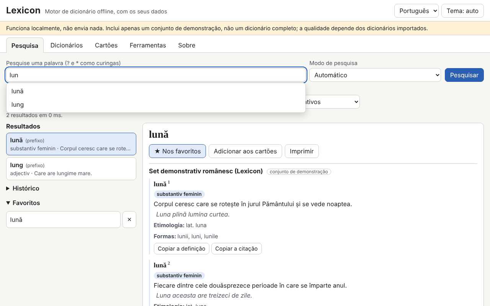

# Lexicon

[English](README.md) · [Română](README.ro.md) · [Français](README.fr.md) · [Italiano](README.it.md) · [Español](README.es.md) · **Português** · [Deutsch](README.de.md) · [Magyar](README.hu.md)

**Versão:** 1.0.0 · **Última atualização:** 2026-10-14

Idiomas da interface: **Română, English, Français, Italiano, Español, Português (PT), Deutsch, Magyar**

O Lexicon é um motor de dicionário que funciona totalmente offline, num único ficheiro HTML. Não inclui um dicionário completo: tu trazes os teus próprios dicionários (TSV/CSV, JSON, StarDict, dictd, XDXF), guardas-os no IndexedDB e pesquisas neles instantaneamente: prefixo, exata, sem diacríticos, aproximada (Damerau–Levenshtein), formas flexionadas, texto integral nas definições e carateres universais (`?`, `*`). Tem histórico, favoritos, palavra do dia, cartões de estudo com repetição espaçada, exportação e verificação ortográfica. O conjunto incluído (345 entradas originais em romeno) é um **conjunto de demonstração, não um dicionário completo**.

**Aplicação online:** https://chiuta.github.io/apps/Lexicon/

## Como se utiliza
1. Abre o separador **Dicionários** e escolhe os ficheiros (podem importar-se vários de uma só vez). Para TSV/CSV/JSON é mostrada uma pré-visualização e o mapeamento das colunas.
2. Preenche os metadados: título, línguas, fonte e **licença** (obrigatória; sem ela aparece um aviso).
3. Ativa/desativa os dicionários e altera a ordem de apresentação.
4. Em **Pesquisa**, escreve a palavra: as sugestões aparecem em tempo real; `[[palavra]]` e as ligações internas dos artigos abrem diretamente. Atalho: `/` coloca o cursor no campo de pesquisa.
5. **Cartões de estudo** (SM-2 simplificado), **Ferramentas** (exportação dos favoritos em CSV/JSON/Markdown, exportação do subconjunto pesquisado, «Verificar a ortografia de um texto», cópia de segurança `.fff.json`, «Apagar tudo»).

## Traz o teu próprio dicionário
A pasta `exemple/` contém `model.tsv` e `model.json` (formato mínimo: palavra, definição, opcionalmente formas, categoria, exemplos, etimologia).

**Verifica a licença de cada fonte (por exemplo, os dados publicados pelo dexonline têm condições próprias de licença e atribuição; não verifiquei as condições atuais).** A aplicação não inclui nem descarrega nenhum dicionário de licença incerta; a responsabilidade pelos dados importados é tua.

## Formatos suportados
- **TSV / CSV** com cabeçalho (delimitador detetado, campos entre aspas, codificações UTF-8, Windows-1250/1252, ISO-8859-2). Os campos `forme` e `exemple` separam-se com `|`.
- **JSON**: lista de objetos, objeto palavra→definição, lista de listas ou formato nativo `lexicon-dict`.
- **StarDict**: `.ifo` + `.idx` (+ `.idx.gz`) + `.dict` ou `.dict.dz` (gzip/dictzip, através de `DecompressionStream`), `.syn` (passam a formas), deslocamentos de 32 ou 64 bits, `sametypesequence`.
- **dictd**: `.index` + `.dict` / `.dict.dz`, deslocamentos em base 64.
- **XDXF** simples (`<ar>`, `<k>`).

## O que NÃO faz e os seus limites
- Não tem conteúdo lexicográfico próprio além do conjunto de demonstração.
- O ficheiro é lido integralmente para a memória na importação; ficheiros muito grandes (centenas de MB) podem exceder a memória do navegador.
- A pesquisa nas definições percorre todas as entradas (sem índice invertido) e não ordena por relevância.
- As ligações externas nos artigos não estão ativas: são apresentadas como texto com o endereço.
- O XDXF só é suportado na forma simples; o HTML é limpo por um analisador próprio com uma lista de etiquetas permitidas, pelo que as formatações complexas se perdem.
- A importação de 300 000 entradas é lenta (ver abaixo); a pesquisa depois disso é instantânea.
- A verificação ortográfica baseia-se apenas nos dicionários ativos (palavras e formas); não faz análise gramatical.
- Sem IndexedDB (modo privado) os dados ficam apenas em memória e perdem-se ao recarregar; a aplicação avisa.

## Privacidade
Funciona localmente e não envia nada. Não existem pedidos de rede (`connect-src 'none'`). Os dicionários estão no IndexedDB, enquanto o histórico, os favoritos, a língua e o tema estão no `localStorage` (chaves `fff.lexicon.*`). «Apagar tudo» remove tudo.

## Desempenho medido (em teste, Chromium headless, máquina carregada)
Conjunto sintético de 300 000 entradas (TSV de 32,8 MB, 100 000 com formas):
- importação e indexação: 270–353 s (escrita no IndexedDB; depende muito da carga da máquina);
- sugestões em tempo real: média 0,02 ms, p95 0,1 ms, máximo 4 ms (708 consultas; o objetivo era abaixo de 50 ms);
- exata 0,4 ms, prefixo 0,2 ms, caráter universal `*` no início 37–427 ms, difusa completa 49–464 ms, sugestões difusas sem prefixo 0,2–1,9 s;
- texto integral nas definições: 2–3 s (5,7 s sem correspondência);
- recarregamento com o conjunto de 300 000 no IndexedDB: 150–250 ms; heap de cerca de 141 MB.

## Técnica
Um único `index.html`, script inline com hash na CSP (`script-src 'sha256-…'`, `default-src 'none'`, `connect-src 'none'`, sem manipuladores inline, sem `eval`; `worker-src blob:` é herdado do modelo). Índice em memória (chaves normalizadas ordenadas, pesquisa binária), IndexedDB para as entradas e o texto integral. O conteúdo HTML passa por um analisador próprio e é construído com `createElement`/`textContent`. Deteta opcionalmente `window.FFF`; funciona por completo também sem ele. Testes: `node tests/test.mjs` (Playwright; 292 verificações: análise de StarDict/dictd com ficheiros gerados no teste, consultas, 28 payloads XSS, persistência, 300 000 entradas, axe 0, excesso de largura a 360×740 e 1280×800). A variável `LEXICON_SKIP_PERF=1` omite o teste grande.

## Terceiros
Não existe código de terceiros na aplicação (o axe-core é usado apenas nos testes).

## Traduções
A interface está em romeno (predefinição), inglês, francês, italiano, espanhol, português, húngaro e alemão. As traduções fr/it/es/pt/hu/de são automáticas, não verificadas por falantes nativos.

## Licença
MIT — ver o ficheiro `LICENSE` na raiz do repositório.

## Histórico
- 1.0.0 — 2026-10-14: primeira versão.
