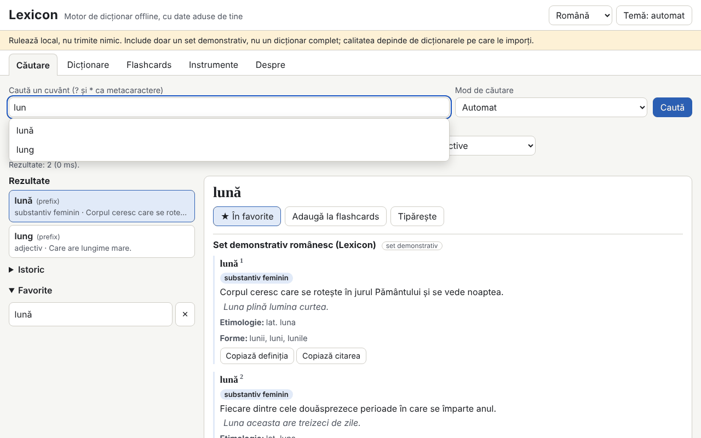

# Lexicon

[English](README.md) · **Română** · [Français](README.fr.md) · [Italiano](README.it.md) · [Español](README.es.md) · [Português](README.pt.md) · [Deutsch](README.de.md) · [Magyar](README.hu.md)

**Versiune:** 2.0.0 · **Ultima actualizare:** 2026-10-26

Limbile interfeței: **Română, English, Français, Italiano, Español, Português (PT), Deutsch, Magyar**

Lexicon este un motor de dicționar care rulează complet offline, într-un singur fișier HTML. Nu include un dicționar complet: aduci tu propriile dicționare (TSV/CSV, JSON, StarDict, dictd, XDXF), le păstrezi în IndexedDB și le cauți instant: prefix, exact, fără diacritice, aproximativ (Damerau–Levenshtein), forme flexionare, text integral în definiții și wildcard (`?`, `*`). Are istoric, favorite, cuvântul zilei, flashcards cu repetiție spațiată, export și verificare ortografică. Setul inclus (345 de intrări originale în română) este **set demonstrativ, nu un dicționar complet**.

**Live:** https://chiuta.github.io/apps/Lexicon/

## Nou în 2.0.0: fișa unificată și indexul unificat

Când un cuvânt apare în mai multe dicționare active (sau are sinonime), articolul începe cu o **fișă unificată**: pe scurt, câte o linie per dicționar; **echivalente din alte dicționare** (sensurile scurte sunt căutate ca și cuvinte-titlu în celelalte dicționare locale, deci un dicționar RO→EN și unul EN→RO se completează reciproc); **sinonime** (câmp nou la import, `synonyms`/`sinonime`, păstrat și la export) și exemple din toate dicționarele, cu buton „Copiază fișa”. În fila **Dicționare**, „Index unificat” calculează o singură dată cuvintele-titlu comune mai multor dicționare și le păstrează în IndexedDB; se reconstruiește automat doar când se schimbă setul de dicționare. Limite: legăturile între dicționare se bazează pe potrivirea exactă a sensurilor scurte (fără analiză lingvistică); căutarea aproximativă (fuzzy) și căutarea simultană în toate dicționarele existau deja, iar exportul de vocabular spre flashcards rămâne cel din versiunile anterioare.

## Cum se folosește
1. Deschide fila **Dicționare** și alege fișierele (se pot importa mai multe odată). Pentru TSV/CSV/JSON se arată o previzualizare și maparea coloanelor.
2. Completează metadatele: titlu, limbi, sursă și **licență** (obligatorie; fără ea apare un avertisment).
3. Activează/dezactivează dicționarele și schimbă ordinea de afișare.
4. În **Căutare**, scrie cuvântul: sugestiile apar în timp real; `[[cuvânt]]` și legăturile interne din articole se deschid direct. Scurtătură: `/` mută cursorul în câmpul de căutare.
5. **Flashcards** (SM-2 simplificat), **Instrumente** (export favorite CSV/JSON/Markdown, export subset căutat, „Verifică ortografia unui text”, copie de rezervă `.fff.json`, „Șterge tot”).

## Aduce-ți propriul dicționar
Folderul `exemple/` conține `model.tsv` și `model.json` (formatul minim: cuvânt, definiție, opțional forme, categorie, exemple, etimologie).

**Verifică licența fiecărei surse (de exemplu datele publicate de dexonline au condiții proprii de licență și atribuire; nu am verificat condițiile actuale).** Aplicația nu include și nu descarcă niciun dicționar de licență incertă; răspunderea pentru datele importate îți aparține.

## Formate acceptate
- **TSV / CSV** cu antet (delimitator detectat, câmpuri între ghilimele, codare UTF-8, Windows-1250/1252, ISO-8859-2). Câmpurile `forme` și `exemple` se separă cu `|`.
- **JSON**: listă de obiecte, obiect cuvânt→definiție, listă de liste sau formatul nativ `lexicon-dict`.
- **StarDict**: `.ifo` + `.idx` (+ `.idx.gz`) + `.dict` sau `.dict.dz` (gzip/dictzip, prin `DecompressionStream`), `.syn` (devin forme), offseturi pe 32 sau 64 de biți, `sametypesequence`.
- **dictd**: `.index` + `.dict` / `.dict.dz`, offseturi în baza 64.
- **XDXF** simplu (`<ar>`, `<k>`).

## Ce NU face și limitele
- Nu are conținut lexicografic propriu în afara setului demonstrativ.
- Fișierul se citește integral în memorie la import; fișierele foarte mari (sute de MB) pot depăși memoria browserului.
- Căutarea în definiții parcurge toate intrările (fără index inversat) și nu ordonează după relevanță.
- Legăturile externe din articole nu sunt active: se afișează ca text cu adresa.
- XDXF este acceptat doar în forma simplă; HTML-ul este curățat de un parser propriu cu listă de etichete permise, deci formatările complexe se pierd.
- Importul a 300.000 de intrări este lent (vezi mai jos); căutarea după aceea este instantanee.
- Verificarea ortografică se bazează doar pe dicționarele active (cuvinte și forme); nu analizează gramatical.
- Fără IndexedDB (mod privat) datele rămân doar în memorie și se pierd la reîncărcare; aplicația avertizează.

## Confidențialitate
Rulează local, nu trimite nimic. Nu există cereri de rețea (`connect-src 'none'`). Dicționarele sunt în IndexedDB, iar istoricul, favoritele, limba și tema în `localStorage` (chei `fff.lexicon.*`). „Șterge tot” elimină totul.

## Performanță măsurată (în test, Chromium headless, mașină încărcată)
Set sintetic de 300.000 de intrări (32,8 MB TSV, 100.000 cu forme):
- import și indexare: 270–353 s (scris în IndexedDB; depinde mult de încărcarea mașinii);
- sugestii în timp real: medie 0,02 ms, p95 0,1 ms, maxim 4 ms (708 interogări; ținta era sub 50 ms);
- exact 0,4 ms, prefix 0,2 ms, wildcard cu `*` în față 37–427 ms, fuzzy complet 49–464 ms, sugestii fuzzy fără prefix 0,2–1,9 s;
- text integral în definiții: 2–3 s (5,7 s fără potrivire);
- reîncărcare cu setul de 300.000 în IndexedDB: 150–250 ms; heap aproximativ 141 MB.

## Tehnic
Un singur `index.html`, script inline cu hash în CSP (`script-src 'sha256-…'`, `default-src 'none'`, `connect-src 'none'`, fără handlere inline, fără `eval`; `worker-src blob:` este moștenit din șablon). Index în memorie (chei normalizate sortate, căutare binară), IndexedDB pentru intrări și text integral. Conținutul HTML trece printr-un parser propriu și se construiește cu `createElement`/`textContent`. Detectează opțional `window.FFF`; funcționează complet și fără. Teste: `node tests/test.mjs` (Playwright; 292 de verificări: parsare StarDict/dictd cu fișiere generate în test, interogări, 28 de payload-uri XSS, persistență, 300.000 de intrări, axe 0, depășire 360×740 și 1280×800). Variabila `LEXICON_SKIP_PERF=1` omite testul mare.

## Terți
Nu există cod terț în aplicație (axe-core este folosit doar în teste).

## Traduceri
Interfața este în română (implicit), engleză, franceză, italiană, spaniolă, portugheză, maghiară și germană. Traducerile fr/it/es/pt/hu/de sunt automate, neverificate nativ.

## Licență
MIT — vezi fișierul `LICENSE` din rădăcina depozitului.

## Istoric
- 1.0.0 — 2026-10-14: prima versiune.
- 1.0.1 — 2026-10-22: o căutare fără rezultat spune acum explicit că setul inclus e doar demonstrativ (când setul demo e activ); exportul CSV neutralizează celulele care încep cu = + - @ împotriva injecției de formule, iar importul TSV/CSV scoate din nou apostroful; ținte tactile de cel puțin 24 px; eticheta tehnică listează cele 8 limbi.
- 1.0.2 — 2026-10-22: fff-kit 1.1.2: PBKDF2 cu 600.000 de iterații, protecție anti-clickjacking.
- 1.0.3 — 2026-10-22: fff-kit 1.1.4: ținte tactile și text minim în interfața comună.
- 1.0.5 — 2026-10-23: mesaj de rezervă când JavaScript este dezactivat (noscript).
