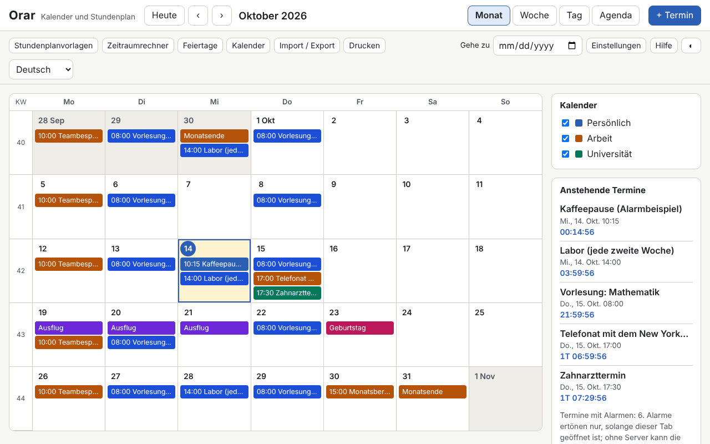

# Orar

[English](README.md) · [Română](README.ro.md) · [Français](README.fr.md) · [Italiano](README.it.md) · [Español](README.es.md) · [Português](README.pt.md) · **Deutsch** · [Magyar](README.hu.md)

**Version:** 1.0.0 · **Zuletzt aktualisiert:** 2026-10-14

Oberflächensprachen: **Română, English, Français, Italiano, Español, Português (PT), Deutsch, Magyar**

Orar ist ein Kalender und Wochenplan, der in einer einzigen HTML-Datei läuft, ohne Server und ohne Konto. Er bietet Monats- / Wochen- / Tages- / Agenda-Ansichten, ISO-8601-Wochen, Termine mit Zeitzone (standardmäßig Europe/Bucharest), Wiederholungen im Stil von RFC 5545 mit einem visuellen Editor, Alarme, solange der Tab geöffnet ist, berechnete rumänische gesetzliche Feiertage (einschließlich der beweglichen, ausgehend vom orthodoxen Ostern), `.ics`-Import und -Export, Planvorlagen (Schichten, Vorlesung/Labor), einen Intervallrechner und einen Countdown.

**Online-Anwendung:** https://chiuta.github.io/apps/Orar/

## So wird es verwendet

- **Navigation:** die Schaltflächen Heute / ‹ / ›, das Feld „Gehe zu“ oder die Tastatur: `m` `w` `d` `a` (Monat, Woche, Tag, Agenda), `t` (heute), `n` (neuer Termin), Pfeiltasten (tageweise), `Page Up` / `Page Down` (vorheriger oder nächster Monat/Woche/Tag), `Home` / `End` (Wochenanfang/-ende), `Enter` (öffnet den Tag oder den Termin), `?` (Hilfe), `Esc` (schließt den Dialog).
- **Neuer Termin:** „+ Termin“. Titel, Beginn/Ende oder ganztägig, Zeitzone, Ort, Beschreibung, Kalender und Kategorie (die Textfarbe wird automatisch gewählt, mit AA-Kontrast), Alarme (Vorlaufzeit vor dem Termin) und Wiederholung.
- **Wiederholung:** täglich / wöchentlich / monatlich / jährlich, Intervall, Wochentage, „2. Dienstag“, „letzter Freitag“, „letzter Tag des Monats“, Ende nach Anzahl der Vorkommen oder Datum (`COUNT` / `UNTIL`), ausgeschlossene Daten (`EXDATE`) und hinzugefügte Daten (`RDATE`). Der Editor zeigt die nächsten 10 Vorkommen. Beim Bearbeiten oder Löschen wählen Sie: nur dieses Vorkommen, dieses und die folgenden oder die ganze Serie.
- **Kalender:** mehrere Kalender, jeder mit einer Farbe, über die Seitenleiste ein-/ausschaltbar.
- **Feiertage:** die gesetzliche Liste für jedes Jahr, mit den freien Tagen und möglichen Brückentagen (nur zur Information). Es lässt sich auch ein orthodoxer Kalender aktivieren (Palmsonntag, Gründonnerstag, Christi Himmelfahrt usw.) und eigene freie Tage können hinzugefügt werden.
- **Planvorlagen:** 2-2-4-Schichten, drei rotierende Schichten, Vorlesung/Labor in geraden/ungeraden Wochen; sie erzeugen Terminserien bis zu einem Enddatum.
- **Rechner:** Tage zwischen zwei Daten, Arbeitstage (ohne die gesetzlichen Feiertage in RO, optional ohne die eigenen freien Tage) und Addition von Arbeitstagen.
- **Import / Export:** `.ics` (Import mit Erkennung von Duplikaten: überspringen / überschreiben / trotzdem importieren; Export für alle Kalender oder für einen), Sicherungskopie `.fff.json`, Import aus CLEPSIDRA, Schaltflächen „Beispiel laden“ und „Alles löschen“.
- **Drucken:** Die Schaltfläche „Drucken“ (Woche, Monat oder Agenda) verwendet ein Druck-CSS ohne Seitenleisten.
- **Alarme:** siehe unten, bei den Einschränkungen.

## Was es NICHT tut, und die Einschränkungen

- **Alarme ertönen nur, solange der Orar-Tab geöffnet ist** (ein mit WebAudio erzeugter Ton und, nur wenn Sie ausdrücklich zustimmen, eine Browser-Benachrichtigung). **Es gibt keine Alarme, wenn die Anwendung geschlossen ist, auch nicht, wenn Sie sie als PWA installieren**: Ohne Benachrichtigungsserver kann sich eine lokale Datei nicht selbst aufwecken. Beim Neustart erscheinen die Alarme, die während des Geschlossenseins verpasst wurden, in einem Informationsband, ohne Ton.
- Feiertage und freie Tage sind **zur Information berechnet und keine offizielle Quelle**. Die offizielle Liste ist die in den Rechtsvorschriften und in den Regierungsbeschlüssen (gewährte freie Tage, Brückentage). Prüfen Sie sie dort vor jeder Entscheidung.
- Es synchronisiert nicht zwischen Geräten und abonniert keine Online-Kalender (es führt keine Netzwerkaufrufe aus). Nutzen Sie den Export/Import als `.ics` oder `.fff.json`.
- Es versendet keine Einladungen: Die Felder `ATTENDEE` / `ORGANIZER` in importierten Dateien werden ignoriert (ihre Anzahl wird gemeldet). `VTODO`, `VJOURNAL` und abgesagte Termine werden nicht importiert.
- Wiederholungen: unterstützt werden `FREQ` DAILY/WEEKLY/MONTHLY/YEARLY, `INTERVAL`, `BYDAY` (mit Positionen, z. B. `-1FR`), `BYMONTHDAY`, `BYMONTH`, `BYSETPOS`, `WKST`, `COUNT`, `UNTIL`, `EXDATE`, `RDATE`. `BYHOUR`, `BYMINUTE`, `BYWEEKNO`, `BYYEARDAY`, `HOURLY`/`MINUTELY`/`SECONDLY` werden beim Import mit einer Warnung ignoriert. Komplexere Regeln bleiben als Text editierbar (rohe `RRULE`).
- Termine zu einer nicht existierenden Uhrzeit (Umstellung auf Sommerzeit) werden um den Versatz vor der Umstellung verschoben; bei der mehrdeutigen Uhrzeit (Umstellung auf Winterzeit) wird das erste Vorkommen genommen. „Schwebende“ Termine (ohne Zeitzone) bleiben zur selben Ortszeit.
- `DTSTART` ist immer das erste Vorkommen, wie in RFC 5545, auch wenn es nicht zur Regel passt.
- Zeitzonen aus `VTIMEZONE`, die keine IANA-Namen sind, werden über Regeln einer IANA-Zone zugeordnet, andernfalls werden sie zu einem festen Versatz. Der Export erzeugt `VTIMEZONE` aus den Übergängen des Browsers (gültig für den Zeitraum der Termine).
- Import aus CLEPSIDRA: Er akzeptiert den Plan (Schlüssel `clepsidra.schedule`: `{"weekday":[{"start":"HH:MM","end":"HH:MM","cat":"somn"}],"weekend":[…]}`) und die Countdowns (`clepsidra.events`: `[{"name":"…","ts":ms}]`). Das direkte Lesen aus dem Browser funktioniert nur, wenn CLEPSIDRA auf demselben Origin gelaufen ist; andernfalls wird das JSON in den Dialog eingefügt. CLEPSIDRA wird nicht verändert.
- Gemessene Leistung: Eine 1,2 MB große `.ics`-Datei mit 5000 Terminen wird in wenigen Sekunden importiert, und das Rendern dauert weniger als 150 ms; jenseits einiger Zehntausend Termine wird `localStorage` (≈5 MB) zur Grenze.

## Datenschutz

Es läuft lokal und sendet nichts. Die Daten (Termine, Kalender, Einstellungen) bleiben im `localStorage`, in Ihrem Browser, mit dem Präfix `fff.orar.`. Es gibt keine Analyse, keine Cookies und keine Netzwerkanfragen (CSP `connect-src 'none'`). Browser-Benachrichtigungen werden nur angefordert, wenn Sie ausdrücklich die Schaltfläche in den Einstellungen drücken.

## Formate

- **`.ics`-Import** (RFC 5545): `VEVENT`, `VTIMEZONE` (Grundlagen), `RRULE`, `EXDATE`, `RDATE`, `RECURRENCE-ID`, `VALARM`, `LOCATION`, `CATEGORIES`, `DURATION`, `DTSTART;VALUE=DATE`, `TZID` (IANA-Namen, Windows-Namen, Präfix `/mozilla.org/…`, `X-LIC-LOCATION`), gefaltete Zeilen, Escape-Sequenzen, UTF-8 (mit BOM) oder windows-1252, Zeilenenden CRLF oder LF. Geprüft mit Dateien im Stil von Google Calendar, Outlook und Thunderbird.
- **`.ics`-Export:** stabile `UID`, `DTSTAMP`, Faltung bei 75 Bytes ohne UTF-8-Zeichen zu zerreißen, `VTIMEZONE`, `VALARM`, geänderte Vorkommen als `RECURRENCE-ID`. Die Datei ist bei aufeinanderfolgenden Exporten identisch.
- **Sicherungskopie `.fff.json`:** `{"format":"fff-bundle","schema":1,"app":"orar","version":"1.0.0","updated":"2026-10-14","data":{…}}`.

## Technik

- Eine einzige `index.html`, ohne externe Bibliotheken, ohne `eval` und ohne Inline-Handler. CSP: `default-src 'none'; script-src 'sha256-…'` (der Hash des Skripts), `style-src 'unsafe-inline'` (die dynamischen Stile der Terminfarben), `img-src`/`media-src data: blob:` und `worker-src blob:` (nur für den Download lokal erzeugter Dateien), `connect-src 'none'`.
- Die Wiederholungs-Engine arbeitet in der Wanduhrzeit der Zeitzone des Termins und rechnet mit `Intl.DateTimeFormat` in die Anzeigezeitzone um (einschließlich Sommerzeit). Orthodoxes Ostern: Meeus-Algorithmus (julianischer Kalender), in den gregorianischen umgerechnet.
- Tests: `node tests/test.mjs` (Playwright, Chromium, Netzwerk gesperrt). Sie decken Ostern und die Feiertage 2024–2035 ab, 420 RRULE-Regeln im Vergleich mit `python-dateutil` (vorab berechnetes Orakel in `tests/oracle_rrule.json`), Wiederholungen in Monaten mit 31 Tagen, Schaltjahr und Sommerzeit, `.ics`-Round-Trip mit realistischen Dateien, unabhängige Validierung des Exports (ein separat im Test geschriebener Parser, dazu `tests/ics_check.py` mit `icalendar` und `dateutil`, optional), 5000 Termine, die Oberfläche in 8 Sprachen, axe-core, horizontalen Überlauf, Druck, Designs.

## Drittanbieter

Es enthält keinen Drittanbieter-Code. In den Tests werden Playwright, axe-core (nur in Tests injiziert) und optional `icalendar` und `python-dateutil` (BSD) für unabhängige Prüfungen verwendet.

## Übersetzungen

Rumänisch ist die Referenzsprache. Englisch wurde zusammen mit dem Rumänischen geschrieben, ist aber nicht von einem Muttersprachler geprüft; **Französisch, Italienisch, Spanisch, Portugiesisch, Ungarisch und Deutsch sind maschinelle Übersetzungen, die nicht von Muttersprachlern geprüft wurden.** Korrekturen sind willkommen.

## Lizenz

Lizenz: MIT — siehe die Datei `LICENSE` im Stammverzeichnis des Repositorys.

## Verlauf

- 1.0.0 — 2026-10-14: erste Version.
