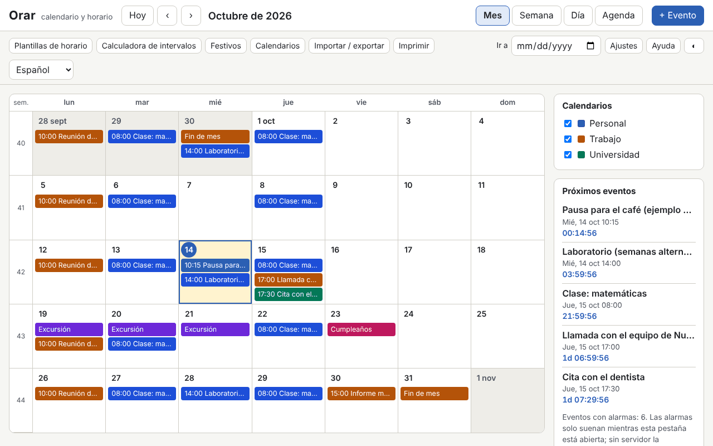

# Orar

[English](README.md) · [Română](README.ro.md) · [Français](README.fr.md) · [Italiano](README.it.md) · **Español** · [Português](README.pt.md) · [Deutsch](README.de.md) · [Magyar](README.hu.md)

**Versión:** 1.0.0 · **Última actualización:** 2026-10-14

Idiomas de la interfaz: **Română, English, Français, Italiano, Español, Português (PT), Deutsch, Magyar**

Orar es un calendario y un horario semanal que funcionan en un único archivo HTML, sin servidor y sin cuenta. Tiene vistas de mes / semana / día / agenda, semanas ISO 8601, eventos con zona horaria (Europe/Bucharest por defecto), recurrencias al estilo RFC 5545 con un editor visual, alarmas mientras la pestaña está abierta, los festivos legales rumanos calculados (incluidos los móviles, a partir de la Pascua ortodoxa), importación y exportación `.ics`, plantillas de horario (turnos, clase/laboratorio), una calculadora de intervalos y una cuenta atrás.

**Aplicación en línea:** https://chiuta.github.io/apps/Orar/

## Cómo se usa

- **Navegación:** los botones Hoy / ‹ / ›, el campo «Ir a», o el teclado: `m` `w` `d` `a` (mes, semana, día, agenda), `t` (hoy), `n` (evento nuevo), flechas (día a día), `Page Up` / `Page Down` (mes/semana/día anterior o siguiente), `Home` / `End` (inicio/fin de semana), `Enter` (abre el día o el evento), `?` (ayuda), `Esc` (cierra el cuadro de diálogo).
- **Evento nuevo:** «+ Evento». Título, inicio/fin o todo el día, zona horaria, lugar, descripción, calendario y categoría (el color del texto se elige automáticamente, con contraste AA), alarmas (antelación respecto al evento) y recurrencia.
- **Recurrencia:** diaria / semanal / mensual / anual, intervalo, días de la semana, «2.º martes», «último viernes», «último día del mes», fin por número de apariciones o por fecha (`COUNT` / `UNTIL`), fechas excluidas (`EXDATE`) y fechas añadidas (`RDATE`). El editor muestra las siguientes 10 apariciones. Al editar o borrar se elige: solo esta aparición, esta y las siguientes, o toda la serie.
- **Calendarios:** varios calendarios, cada uno con un color, activados/desactivados desde el panel lateral.
- **Festivos:** la lista legal para cualquier año, con los días libres y los posibles puentes (solo informativo). También se puede activar un calendario ortodoxo (Domingo de Ramos, Jueves Santo, Ascensión, etc.) y añadir días libres propios.
- **Plantillas de horario:** turnos 2-2-4, tres turnos rotativos, clase/laboratorio en semanas pares/impares; generan series de eventos hasta una fecha de fin.
- **Calculadora:** días entre dos fechas, días laborables (sin los festivos legales de RO, opcionalmente sin los días libres propios) y suma de días laborables.
- **Importación / exportación:** `.ics` (importación con detección de duplicados: omitir / sobrescribir / importar de todos modos; exportación de todos los calendarios o de uno), copia de seguridad `.fff.json`, importación desde CLEPSIDRA, botones «Cargar ejemplo» y «Borrar todo».
- **Impresión:** el botón «Imprimir» (semana, mes o agenda) usa un CSS de impresión sin paneles laterales.
- **Alarmas:** véase más abajo, en los límites.

## Lo que NO hace, y los límites

- **Las alarmas suenan solo mientras la pestaña Orar está abierta** (un sonido generado con WebAudio y, solo si lo aceptas explícitamente, una notificación del navegador). **No hay alarmas cuando la aplicación está cerrada, ni siquiera si la instalas como PWA**: sin un servidor de notificaciones, un archivo local no puede despertarse solo. Al reiniciar, las alarmas perdidas mientras estuvo cerrada aparecen en una banda informativa, sin sonido.
- Los festivos y los días libres están **calculados con carácter informativo y no son una fuente oficial**. La lista oficial es la de la legislación y la de los acuerdos del Gobierno (días libres concedidos, puentes). Compruébalos ahí antes de tomar cualquier decisión.
- No sincroniza entre dispositivos y no se suscribe a calendarios en línea (no hace ninguna llamada de red). Usa la exportación/importación `.ics` o `.fff.json`.
- No envía invitaciones: los campos `ATTENDEE` / `ORGANIZER` de los archivos importados se ignoran (se informa de su número). `VTODO`, `VJOURNAL` y los eventos cancelados no se importan.
- Recurrencias: se admiten `FREQ` DAILY/WEEKLY/MONTHLY/YEARLY, `INTERVAL`, `BYDAY` (con posiciones, p. ej. `-1FR`), `BYMONTHDAY`, `BYMONTH`, `BYSETPOS`, `WKST`, `COUNT`, `UNTIL`, `EXDATE`, `RDATE`. `BYHOUR`, `BYMINUTE`, `BYWEEKNO`, `BYYEARDAY`, `HOURLY`/`MINUTELY`/`SECONDLY` se ignoran al importar, con una advertencia. Las reglas más complejas siguen siendo editables como texto (`RRULE` en bruto).
- Los eventos con una hora inexistente (cambio al horario de verano) se desplazan con el desfase anterior al cambio; en la hora ambigua (cambio al horario de invierno) se toma la primera aparición. Los eventos «flotantes» (sin zona) permanecen a la misma hora local.
- `DTSTART` es siempre la primera aparición, como en la RFC 5545, aunque no coincida con la regla.
- Las zonas de `VTIMEZONE` que no son nombres IANA se asocian mediante reglas a una zona IANA; de lo contrario, pasan a ser un desfase fijo. La exportación genera `VTIMEZONE` a partir de las transiciones del navegador (válido para el intervalo de los eventos).
- Importación desde CLEPSIDRA: acepta el horario (clave `clepsidra.schedule`: `{"weekday":[{"start":"HH:MM","end":"HH:MM","cat":"somn"}],"weekend":[…]}`) y las cuentas atrás (`clepsidra.events`: `[{"name":"…","ts":ms}]`). La lectura directa desde el navegador solo funciona si CLEPSIDRA se ejecutó en el mismo origen; en caso contrario, se pega el JSON en el cuadro de diálogo. CLEPSIDRA no se modifica.
- Rendimiento medido: un archivo `.ics` de 1,2 MB con 5000 eventos se importa en unos segundos y los renderizados tardan menos de 150 ms; más allá de varias decenas de miles de eventos, `localStorage` (≈5 MB) pasa a ser el límite.

## Privacidad

Se ejecuta en local y no envía nada. Los datos (eventos, calendarios, ajustes) permanecen en `localStorage`, en tu navegador, con el prefijo `fff.orar.`. No hay analítica, cookies ni solicitudes de red (CSP `connect-src 'none'`). Las notificaciones del navegador solo se piden si pulsas explícitamente el botón de Ajustes.

## Formatos

- **Importación `.ics`** (RFC 5545): `VEVENT`, `VTIMEZONE` (básico), `RRULE`, `EXDATE`, `RDATE`, `RECURRENCE-ID`, `VALARM`, `LOCATION`, `CATEGORIES`, `DURATION`, `DTSTART;VALUE=DATE`, `TZID` (nombres IANA, nombres de Windows, prefijo `/mozilla.org/…`, `X-LIC-LOCATION`), líneas plegadas, secuencias de escape, UTF-8 (con BOM) o windows-1252, terminadores de línea CRLF o LF. Verificado con archivos al estilo de Google Calendar, Outlook y Thunderbird.
- **Exportación `.ics`:** `UID` estable, `DTSTAMP`, plegado a 75 bytes sin romper caracteres UTF-8, `VTIMEZONE`, `VALARM`, apariciones modificadas como `RECURRENCE-ID`. El archivo es idéntico en exportaciones sucesivas.
- **Copia de seguridad `.fff.json`:** `{"format":"fff-bundle","schema":1,"app":"orar","version":"1.0.0","updated":"2026-10-14","data":{…}}`.

## Técnica

- Un único `index.html`, sin bibliotecas externas, sin `eval` y sin manejadores en línea. CSP: `default-src 'none'; script-src 'sha256-…'` (el hash del script), `style-src 'unsafe-inline'` (los estilos dinámicos de los colores de los eventos), `img-src`/`media-src data: blob:` y `worker-src blob:` (solo para la descarga de archivos generados localmente), `connect-src 'none'`.
- El motor de recurrencias trabaja en la hora de pared de la zona del evento y convierte a la zona de visualización con `Intl.DateTimeFormat` (incluido el horario de verano). Pascua ortodoxa: algoritmo de Meeus (calendario juliano) convertido a gregoriano.
- Pruebas: `node tests/test.mjs` (Playwright, Chromium, red bloqueada). Cubren la Pascua y los festivos 2024–2035, 420 reglas RRULE comparadas con `python-dateutil` (oráculo precalculado en `tests/oracle_rrule.json`), recurrencias en meses de 31 días, año bisiesto y horario de verano, ida y vuelta `.ics` con archivos realistas, validación independiente de la exportación (un analizador escrito aparte en la prueba, más `tests/ics_check.py` con `icalendar` y `dateutil`, opcional), 5000 eventos, la interfaz en 8 idiomas, axe-core, desbordamiento horizontal, impresión, temas.

## Terceros

No contiene código de terceros. En las pruebas se usan Playwright, axe-core (inyectado solo en las pruebas) y, opcionalmente, `icalendar` y `python-dateutil` (BSD) para comprobaciones independientes.

## Traducciones

El rumano es el idioma de referencia. El inglés está escrito junto con el rumano, pero no lo ha verificado un hablante nativo; **el francés, el italiano, el español, el portugués, el húngaro y el alemán son traducciones automáticas, no verificadas por hablantes nativos.** Se agradecen las correcciones.

## Licencia

Licencia: MIT — consulta el archivo `LICENSE` en la raíz del repositorio.

## Historial

- 1.0.0 — 2026-10-14: primera versión.
