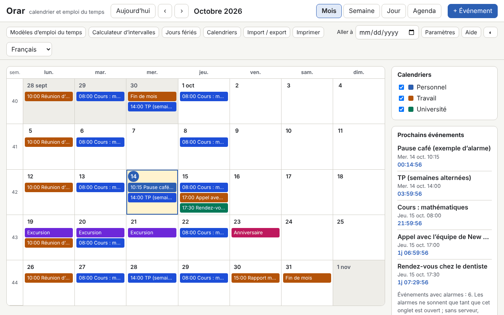

# Orar

[English](README.md) · [Română](README.ro.md) · **Français** · [Italiano](README.it.md) · [Español](README.es.md) · [Português](README.pt.md) · [Deutsch](README.de.md) · [Magyar](README.hu.md)

**Version :** 1.0.0 · **Dernière mise à jour :** 2026-10-14

Langues de l'interface : **Română, English, Français, Italiano, Español, Português (PT), Deutsch, Magyar**

Orar est un calendrier et un emploi du temps hebdomadaire qui fonctionnent dans un seul fichier HTML, sans serveur et sans compte. Il propose des vues mois / semaine / jour / agenda, les semaines ISO 8601, des événements avec fuseau horaire (Europe/Bucharest par défaut), des récurrences de type RFC 5545 avec un éditeur visuel, des alarmes tant que l'onglet est ouvert, les jours fériés légaux roumains calculés (y compris les fêtes mobiles, à partir de Pâques orthodoxe), l'import et l'export `.ics`, des modèles d'emploi du temps (équipes, cours/travaux pratiques), un calculateur d'intervalles et un compte à rebours.

**Application en ligne :** https://chiuta.github.io/apps/Orar/

## Comment l'utiliser

- **Navigation :** les boutons Aujourd'hui / ‹ / ›, le champ « Aller à », ou le clavier : `m` `w` `d` `a` (mois, semaine, jour, agenda), `t` (aujourd'hui), `n` (nouvel événement), flèches (jour par jour), `Page Up` / `Page Down` (mois/semaine/jour précédent ou suivant), `Home` / `End` (début/fin de semaine), `Enter` (ouvre le jour ou l'événement), `?` (aide), `Esc` (ferme la boîte de dialogue).
- **Nouvel événement :** « + Événement ». Titre, début/fin ou toute la journée, fuseau horaire, lieu, description, calendrier et catégorie (la couleur du texte est choisie automatiquement, avec un contraste AA), alarmes (décalage avant l'événement) et récurrence.
- **Récurrence :** quotidienne / hebdomadaire / mensuelle / annuelle, intervalle, jours de la semaine, « 2e mardi », « dernier vendredi », « dernier jour du mois », fin par nombre d'occurrences ou par date (`COUNT` / `UNTIL`), dates exclues (`EXDATE`) et dates ajoutées (`RDATE`). L'éditeur affiche les 10 occurrences suivantes. Lors de la modification ou de la suppression, vous choisissez : uniquement cette occurrence, celle-ci et les suivantes, ou toute la série.
- **Calendriers :** plusieurs calendriers, chacun avec une couleur, activés/désactivés depuis le panneau latéral.
- **Jours fériés :** la liste légale pour n'importe quelle année, avec les jours de congé et les ponts possibles (à titre informatif uniquement). Un calendrier orthodoxe (Rameaux, Jeudi saint, Ascension, etc.) peut aussi être activé, et vous pouvez ajouter vos propres jours de congé.
- **Modèles d'emploi du temps :** équipes 2-2-4, trois équipes tournantes, cours/travaux pratiques en semaines paires/impaires ; ils génèrent des séries d'événements jusqu'à une date de fin.
- **Calculateur :** jours entre deux dates, jours ouvrables (hors jours fériés légaux roumains, éventuellement hors vos propres jours de congé) et ajout de jours ouvrables.
- **Import / export :** `.ics` (import avec détection des doublons : ignorer / écraser / importer quand même ; export pour tous les calendriers ou pour un seul), copie de sauvegarde `.fff.json`, import depuis CLEPSIDRA, boutons « Charger un exemple » et « Tout supprimer ».
- **Impression :** le bouton « Imprimer » (semaine, mois ou agenda) utilise un CSS d'impression sans panneaux latéraux.
- **Alarmes :** voir ci-dessous, dans les limites.

## Ce qu'il ne fait PAS, et les limites

- **Les alarmes ne sonnent que tant que l'onglet Orar est ouvert** (un son généré avec WebAudio et, seulement si vous l'acceptez explicitement, une notification du navigateur). **Il n'y a pas d'alarmes lorsque l'application est fermée, même si vous l'installez comme PWA** : sans serveur de notifications, un fichier local ne peut pas se réveiller tout seul. Au redémarrage, les alarmes manquées pendant la fermeture apparaissent dans une bande informative, sans son.
- Les jours fériés et jours de congé sont **calculés à titre informatif et ne constituent pas une source officielle**. La liste officielle est celle de la législation et des décisions du Gouvernement (jours de congé accordés, ponts). Vérifiez-les à cet endroit avant toute décision.
- Il ne se synchronise pas entre appareils et ne s'abonne pas à des calendriers en ligne (il ne fait aucun appel réseau). Utilisez l'export/import `.ics` ou `.fff.json`.
- Il n'envoie pas d'invitations : les champs `ATTENDEE` / `ORGANIZER` des fichiers importés sont ignorés (leur nombre est signalé). `VTODO`, `VJOURNAL` et les événements annulés ne sont pas importés.
- Récurrences : sont pris en charge `FREQ` DAILY/WEEKLY/MONTHLY/YEARLY, `INTERVAL`, `BYDAY` (avec positions, p. ex. `-1FR`), `BYMONTHDAY`, `BYMONTH`, `BYSETPOS`, `WKST`, `COUNT`, `UNTIL`, `EXDATE`, `RDATE`. `BYHOUR`, `BYMINUTE`, `BYWEEKNO`, `BYYEARDAY`, `HOURLY`/`MINUTELY`/`SECONDLY` sont ignorés à l'import, avec un avertissement. Les règles plus complexes restent modifiables sous forme de texte (`RRULE` brute).
- Les événements à une heure inexistante (passage à l'heure d'été) sont décalés avec le décalage d'avant le passage ; à l'heure ambiguë (passage à l'heure d'hiver), la première occurrence est retenue. Les événements « flottants » (sans fuseau) restent à la même heure locale.
- `DTSTART` est toujours la première occurrence, comme dans la RFC 5545, même s'il ne correspond pas à la règle.
- Les fuseaux de `VTIMEZONE` qui ne sont pas des noms IANA sont associés par des règles à une zone IANA, sinon ils deviennent un décalage fixe. L'export génère `VTIMEZONE` à partir des transitions du navigateur (valable pour l'intervalle des événements).
- Import depuis CLEPSIDRA : il accepte l'emploi du temps (clé `clepsidra.schedule` : `{"weekday":[{"start":"HH:MM","end":"HH:MM","cat":"somn"}],"weekend":[…]}`) et les comptes à rebours (`clepsidra.events` : `[{"name":"…","ts":ms}]`). La lecture directe depuis le navigateur ne fonctionne que si CLEPSIDRA a été exécutée sur la même origine ; sinon on colle le JSON dans la boîte de dialogue. CLEPSIDRA n'est pas modifiée.
- Performances mesurées : un fichier `.ics` de 1,2 Mo contenant 5000 événements s'importe en quelques secondes, et les rendus prennent moins de 150 ms ; au-delà de quelques dizaines de milliers d'événements, `localStorage` (≈5 Mo) devient la limite.

## Confidentialité

Il s'exécute localement et n'envoie rien. Les données (événements, calendriers, paramètres) restent dans `localStorage`, dans votre navigateur, avec le préfixe `fff.orar.`. Il n'y a ni outil d'analyse, ni cookies, ni requêtes réseau (CSP `connect-src 'none'`). Les notifications du navigateur ne sont demandées que si vous appuyez explicitement sur le bouton dans les Paramètres.

## Formats

- **Import `.ics`** (RFC 5545) : `VEVENT`, `VTIMEZONE` (de base), `RRULE`, `EXDATE`, `RDATE`, `RECURRENCE-ID`, `VALARM`, `LOCATION`, `CATEGORIES`, `DURATION`, `DTSTART;VALUE=DATE`, `TZID` (noms IANA, noms Windows, préfixe `/mozilla.org/…`, `X-LIC-LOCATION`), lignes repliées, séquences d'échappement, UTF-8 (avec BOM) ou windows-1252, fins de ligne CRLF ou LF. Vérifié avec des fichiers dans le style de Google Calendar, Outlook et Thunderbird.
- **Export `.ics` :** `UID` stable, `DTSTAMP`, repliement à 75 octets sans couper les caractères UTF-8, `VTIMEZONE`, `VALARM`, occurrences modifiées sous forme de `RECURRENCE-ID`. Le fichier est identique lors d'exports successifs.
- **Copie de sauvegarde `.fff.json` :** `{"format":"fff-bundle","schema":1,"app":"orar","version":"1.0.0","updated":"2026-10-14","data":{…}}`.

## Technique

- Un seul `index.html`, sans bibliothèques externes, sans `eval` et sans gestionnaires en ligne. CSP : `default-src 'none'; script-src 'sha256-…'` (l'empreinte du script), `style-src 'unsafe-inline'` (les styles dynamiques des couleurs d'événements), `img-src`/`media-src data: blob:` et `worker-src blob:` (uniquement pour le téléchargement de fichiers générés localement), `connect-src 'none'`.
- Le moteur de récurrence travaille en heure murale du fuseau de l'événement et convertit vers le fuseau d'affichage avec `Intl.DateTimeFormat` (y compris l'heure d'été). Pâques orthodoxe : algorithme de Meeus (calendrier julien) converti en grégorien.
- Tests : `node tests/test.mjs` (Playwright, Chromium, réseau bloqué). Ils couvrent Pâques et les jours fériés 2024–2035, 420 règles RRULE comparées avec `python-dateutil` (oracle précalculé dans `tests/oracle_rrule.json`), les récurrences dans les mois de 31 jours, l'année bissextile et l'heure d'été, l'aller-retour `.ics` avec des fichiers réalistes, la validation indépendante de l'export (un analyseur écrit séparément dans le test, plus `tests/ics_check.py` avec `icalendar` et `dateutil`, facultatif), 5000 événements, l'interface en 8 langues, axe-core, le débordement horizontal, l'impression, les thèmes.

## Tiers

Il ne contient aucun code tiers. Les tests utilisent Playwright, axe-core (injecté uniquement dans les tests) et, facultativement, `icalendar` et `python-dateutil` (BSD) pour des vérifications indépendantes.

## Traductions

Le roumain est la langue de référence. L'anglais est rédigé en même temps que le roumain, mais n'est pas vérifié par un locuteur natif ; **le français, l'italien, l'espagnol, le portugais, le hongrois et l'allemand sont des traductions automatiques, non vérifiées par des locuteurs natifs.** Les corrections sont les bienvenues.

## Licence

Licence : MIT — voir le fichier `LICENSE` à la racine du dépôt.

## Historique

- 1.0.0 — 2026-10-14 : première version.
