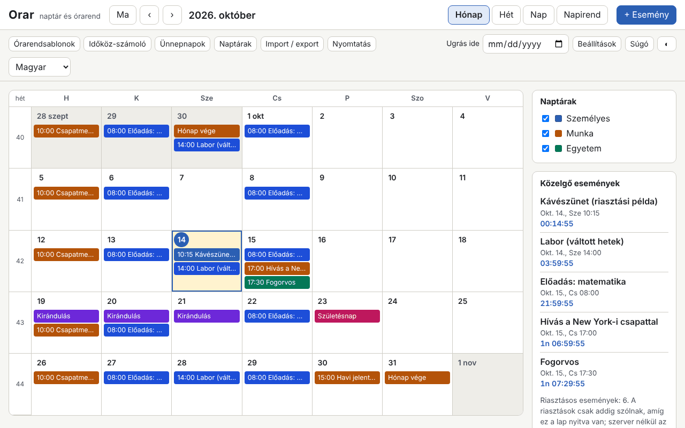

# Orar

[English](README.md) · [Română](README.ro.md) · [Français](README.fr.md) · [Italiano](README.it.md) · [Español](README.es.md) · [Português](README.pt.md) · [Deutsch](README.de.md) · **Magyar**

**Verzió:** 1.0.0 · **Utolsó frissítés:** 2026-10-14

A felület nyelvei: **Română, English, Français, Italiano, Español, Português (PT), Deutsch, Magyar**

Az Orar egy naptár és heti órarend, amely egyetlen HTML-fájlban fut, szerver és fiók nélkül. Hónap / hét / nap / napirend nézetei vannak, ISO 8601 szerinti hetek, időzónával rendelkező események, RFC 5545 stílusú ismétlődések vizuális szerkesztővel, riasztások, amíg a lap nyitva van, kiszámított román törvényes ünnepnapok (a mozgóakat is beleértve, az ortodox húsvétból kiindulva), `.ics` import és export, órarendsablonok (műszakok, előadás/labor), intervallumszámoló és visszaszámláló.

**Online alkalmazás:** https://chiuta.github.io/apps/Orar/

## Hogyan kell használni

- **Navigáció:** a Ma / ‹ / › gombok, az „Ugrás ide” mező vagy a billentyűzet: `m` `w` `d` `a` (hónap, hét, nap, napirend), `t` (ma), `n` (új esemény), nyilak (napról napra), `Page Up` / `Page Down` (előző vagy következő hónap/hét/nap), `Home` / `End` (a hét eleje/vége), `Enter` (megnyitja a napot vagy az eseményt), `?` (súgó), `Esc` (bezárja a párbeszédablakot).
- **Új esemény:** „+ Esemény”. Cím, kezdet/vég vagy egész nap, időzóna, hely, leírás, naptár és kategória (a szöveg színét automatikusan választja, AA kontraszttal), riasztások (az esemény előtti eltolás) és ismétlődés.
- **Ismétlődés:** napi / heti / havi / éves, intervallum, a hét napjai, „2. kedd”, „utolsó péntek”, „a hónap utolsó napja”, vége előfordulások számával vagy dátummal (`COUNT` / `UNTIL`), kizárt dátumok (`EXDATE`) és hozzáadott dátumok (`RDATE`). A szerkesztő megmutatja a következő 10 előfordulást. Szerkesztéskor vagy törléskor választhatsz: csak ez az előfordulás, ez és a következők, vagy az egész sorozat.
- **Naptárak:** több naptár, mindegyik saját színnel, az oldalsó panelről be-/kikapcsolható.
- **Ünnepnapok:** a törvényes lista bármely évre, a szabadnapokkal és a lehetséges áthidaló napokkal (kizárólag tájékoztató jelleggel). Ortodox naptár is bekapcsolható (Virágvasárnap, Nagycsütörtök, Áldozócsütörtök stb.), és saját szabadnapok is hozzáadhatók.
- **Órarendsablonok:** 2-2-4 műszakok, három váltakozó műszak, előadás/labor páros/páratlan heteken; eseménysorozatokat generálnak egy záró dátumig.
- **Számológép:** napok két dátum között, munkanapok (a román törvényes ünnepnapok nélkül, opcionálisan a saját szabadnapok nélkül) és munkanapok hozzáadása.
- **Import / export:** `.ics` (import duplikátumok felismerésével: kihagyás / felülírás / mindenképp importálás; export az összes naptárra vagy egyre), `.fff.json` biztonsági másolat, import a CLEPSIDRA-ból, „Példa betöltése” és „Összes törlése” gombok.
- **Nyomtatás:** a „Nyomtatás” gomb (hét, hónap vagy napirend) oldalsó panelek nélküli nyomtatási CSS-t használ.
- **Riasztások:** lásd lent, a korlátoknál.

## Mit NEM csinál, és a korlátok

- **A riasztások csak addig szólnak, amíg az Orar lap nyitva van** (WebAudióval generált hang, és csak ha kifejezetten elfogadod, böngészőértesítés). **Zárt alkalmazásnál nincsenek riasztások, még akkor sem, ha PWA-ként telepíted**: értesítési szerver nélkül egy helyi fájl nem tud magától felébredni. Újraindításkor a zárt állapot alatt elmaradt riasztások egy tájékoztató sávban jelennek meg, hang nélkül.
- Az ünnepnapok és szabadnapok **tájékoztató jelleggel vannak kiszámítva, és nem hivatalos forrás**. A hivatalos lista a jogszabályokban és a kormányhatározatokban szerepel (megadott szabadnapok, áthidaló napok). Minden döntés előtt ott ellenőrizd őket.
- Nem szinkronizál az eszközök között, és nem iratkozik fel online naptárakra (nem végez hálózati hívást). Használd az `.ics` vagy `.fff.json` exportot/importot.
- Nem küld meghívókat: az importált fájlok `ATTENDEE` / `ORGANIZER` mezőit figyelmen kívül hagyja (számukat jelzi). A `VTODO`, a `VJOURNAL` és a lemondott események nem kerülnek importálásra.
- Ismétlődések: támogatott a `FREQ` DAILY/WEEKLY/MONTHLY/YEARLY, `INTERVAL`, `BYDAY` (pozíciókkal, pl. `-1FR`), `BYMONTHDAY`, `BYMONTH`, `BYSETPOS`, `WKST`, `COUNT`, `UNTIL`, `EXDATE`, `RDATE`. A `BYHOUR`, `BYMINUTE`, `BYWEEKNO`, `BYYEARDAY`, `HOURLY`/`MINUTELY`/`SECONDLY` importáláskor figyelmeztetéssel figyelmen kívül marad. A bonyolultabb szabályok szövegként továbbra is szerkeszthetők (nyers `RRULE`).
- A nem létező időpontú események (nyári időszámításra váltás) az átállás előtti eltolással mozdulnak el; kétértelmű időpontnál (téli időszámításra váltás) az első előfordulást veszi. A „lebegő” események (időzóna nélkül) ugyanazon a helyi időponton maradnak.
- A `DTSTART` mindig az első előfordulás, mint az RFC 5545-ben, akkor is, ha nem felel meg a szabálynak.
- A `VTIMEZONE` azon időzónáit, amelyek nem IANA-nevek, szabályok alapján egy IANA-zónához illeszti, különben fix eltolássá válnak. Az export a böngésző átmeneteiből generálja a `VTIMEZONE`-t (az események tartományára érvényes).
- Import a CLEPSIDRA-ból: elfogadja az órarendet (`clepsidra.schedule` kulcs: `{"weekday":[{"start":"HH:MM","end":"HH:MM","cat":"somn"}],"weekend":[…]}`) és a visszaszámlálókat (`clepsidra.events`: `[{"name":"…","ts":ms}]`). A böngészőből való közvetlen olvasás csak akkor működik, ha a CLEPSIDRA ugyanazon az origin-en futott; különben a JSON-t be kell illeszteni a párbeszédablakba. A CLEPSIDRA nem módosul.
- Mért teljesítmény: egy 1,2 MB-os, 5000 eseményt tartalmazó `.ics` fájl néhány másodperc alatt importálható, a megjelenítés 150 ms alatt van; néhány tízezer esemény fölött a `localStorage` (≈5 MB) válik korláttá.

## Adatvédelem

Helyben fut, és nem küld semmit. Az adatok (események, naptárak, beállítások) a `localStorage`-ban maradnak, a böngésződben, az `fff.orar.` előtaggal. Nincs analitika, süti vagy hálózati kérés (CSP `connect-src 'none'`). A böngészőértesítéseket csak akkor kéri, ha kifejezetten megnyomod a gombot a Beállításokban.

## Formátumok

- **`.ics` import** (RFC 5545): `VEVENT`, `VTIMEZONE` (alap), `RRULE`, `EXDATE`, `RDATE`, `RECURRENCE-ID`, `VALARM`, `LOCATION`, `CATEGORIES`, `DURATION`, `DTSTART;VALUE=DATE`, `TZID` (IANA-nevek, Windows-nevek, `/mozilla.org/…` előtag, `X-LIC-LOCATION`), hajtogatott sorok, escape-szekvenciák, UTF-8 (BOM-mal) vagy windows-1252, CRLF vagy LF sorvégek. Google Calendar, Outlook és Thunderbird stílusú fájlokkal ellenőrizve.
- **`.ics` export:** stabil `UID`, `DTSTAMP`, hajtogatás 75 bájtnál az UTF-8 karakterek megtörése nélkül, `VTIMEZONE`, `VALARM`, módosított előfordulások `RECURRENCE-ID`-ként. A fájl egymást követő exportoknál azonos.
- **`.fff.json` biztonsági másolat:** `{"format":"fff-bundle","schema":1,"app":"orar","version":"1.0.0","updated":"2026-10-14","data":{…}}`.

## Műszaki rész

- Egyetlen `index.html`, külső könyvtárak, `eval` és beágyazott eseménykezelők nélkül. CSP: `default-src 'none'; script-src 'sha256-…'` (a szkript ellenőrzőösszege), `style-src 'unsafe-inline'` (az eseményszínek dinamikus stílusai), `img-src`/`media-src data: blob:` és `worker-src blob:` (csak a helyben generált fájlok letöltéséhez), `connect-src 'none'`.
- Az ismétlődési motor az esemény időzónájának falióra-idejében dolgozik, és az `Intl.DateTimeFormat` segítségével váltja át a megjelenítési időzónára (a nyári időszámítást is beleértve). Ortodox húsvét: Meeus-algoritmus (Julián-naptár), gregoriánra átszámítva.
- Tesztek: `node tests/test.mjs` (Playwright, Chromium, hálózat letiltva). Lefedik a húsvétot és az ünnepnapokat 2024–2035, 420 RRULE-szabályt a `python-dateutil`-lal összevetve (előre kiszámított orákulum a `tests/oracle_rrule.json` fájlban), ismétlődéseket 31 napos hónapokban, szökőévet és nyári időszámítást, `.ics` körbejárást valósághű fájlokkal, az export független ellenőrzését (a tesztben külön megírt elemző, valamint a `tests/ics_check.py` az `icalendar` és a `dateutil` használatával, opcionális), 5000 eseményt, a felületet 8 nyelven, az axe-core-t, a vízszintes túlcsordulást, a nyomtatást és a témákat.

## Harmadik felek

Nem tartalmaz harmadik féltől származó kódot. A tesztekben a Playwright, az axe-core (csak a tesztekbe injektálva) és opcionálisan az `icalendar` és a `python-dateutil` (BSD) szolgál független ellenőrzésekhez.

## Fordítások

A román a referencianyelv. Az angol a románnal együtt készült, de anyanyelvi beszélő nem ellenőrizte; **a francia, olasz, spanyol, portugál, magyar és német gépi fordítás, anyanyelvi beszélők nem ellenőrizték.** A javításokat szívesen fogadjuk.

## Licenc

Licenc: MIT — lásd a `LICENSE` fájlt az adattár gyökérkönyvtárában.

## Előzmények

- 1.0.0 — 2026-10-14: első verzió.
