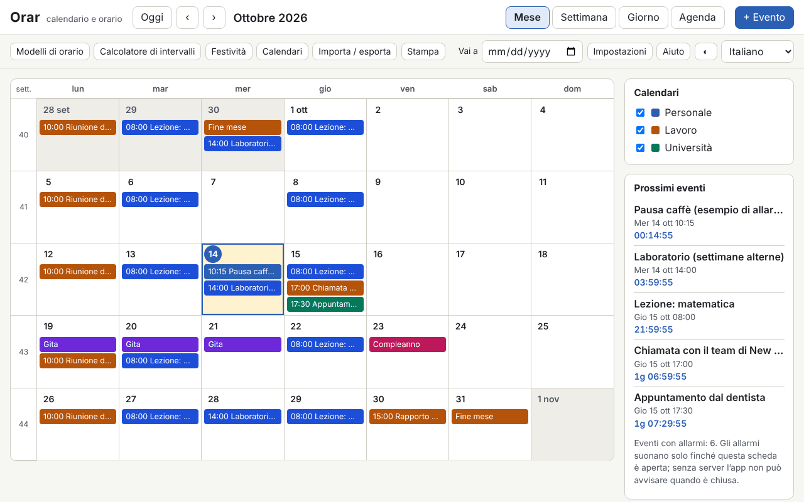

# Orar

[English](README.md) · [Română](README.ro.md) · [Français](README.fr.md) · **Italiano** · [Español](README.es.md) · [Português](README.pt.md) · [Deutsch](README.de.md) · [Magyar](README.hu.md)

**Versione:** 1.0.0 · **Ultimo aggiornamento:** 2026-10-14

Lingue dell'interfaccia: **Română, English, Français, Italiano, Español, Português (PT), Deutsch, Magyar**

Orar è un calendario e un orario settimanale che funzionano in un unico file HTML, senza server e senza account. Offre le viste mese / settimana / giorno / agenda, le settimane ISO 8601, eventi con fuso orario (Europe/Bucharest per impostazione predefinita), ricorrenze in stile RFC 5545 con un editor visuale, sveglie finché la scheda è aperta, le festività legali romene calcolate (comprese quelle mobili, a partire dalla Pasqua ortodossa), importazione ed esportazione `.ics`, modelli di orario (turni, lezione/laboratorio), un calcolatore di intervalli e un conto alla rovescia.

**Applicazione online:** https://chiuta.github.io/apps/Orar/

## Come si usa

- **Navigazione:** i pulsanti Oggi / ‹ / ›, il campo «Vai a», oppure la tastiera: `m` `w` `d` `a` (mese, settimana, giorno, agenda), `t` (oggi), `n` (nuovo evento), frecce (giorno per giorno), `Page Up` / `Page Down` (mese/settimana/giorno precedente o successivo), `Home` / `End` (inizio/fine settimana), `Enter` (apre il giorno o l'evento), `?` (aiuto), `Esc` (chiude la finestra di dialogo).
- **Nuovo evento:** «+ Evento». Titolo, inizio/fine o tutto il giorno, fuso orario, luogo, descrizione, calendario e categoria (il colore del testo viene scelto automaticamente, con contrasto AA), sveglie (anticipo rispetto all'evento) e ricorrenza.
- **Ricorrenza:** giornaliera / settimanale / mensile / annuale, intervallo, giorni della settimana, «2º martedì», «ultimo venerdì», «ultimo giorno del mese», fine per numero di occorrenze o per data (`COUNT` / `UNTIL`), date escluse (`EXDATE`) e date aggiunte (`RDATE`). L'editor mostra le successive 10 occorrenze. Durante la modifica o l'eliminazione si sceglie: solo questa occorrenza, questa e le successive, oppure l'intera serie.
- **Calendari:** più calendari, ciascuno con un colore, attivati/disattivati dal pannello laterale.
- **Festività:** l'elenco legale per qualsiasi anno, con i giorni liberi e i possibili ponti (solo a scopo informativo). Si può attivare anche un calendario ortodosso (Domenica delle Palme, Giovedì Santo, Ascensione ecc.) e aggiungere giorni liberi personali.
- **Modelli di orario:** turni 2-2-4, tre turni a rotazione, lezione/laboratorio su settimane pari/dispari; generano serie di eventi fino a una data di fine.
- **Calcolatore:** giorni tra due date, giorni lavorativi (senza le festività legali RO, facoltativamente senza i giorni liberi personali) e aggiunta di giorni lavorativi.
- **Importazione / esportazione:** `.ics` (importazione con rilevamento dei duplicati: salta / sovrascrivi / importa comunque; esportazione per tutti i calendari o per uno solo), copia di riserva `.fff.json`, importazione da CLEPSIDRA, pulsanti «Carica esempio» e «Elimina tutto».
- **Stampa:** il pulsante «Stampa» (settimana, mese o agenda) usa un CSS di stampa senza pannelli laterali.
- **Sveglie:** vedi sotto, nei limiti.

## Cosa NON fa, e i limiti

- **Le sveglie suonano solo finché la scheda Orar è aperta** (un suono generato con WebAudio e, solo se lo accetti esplicitamente, una notifica del browser). **Non ci sono sveglie quando l'applicazione è chiusa, nemmeno se la installi come PWA**: senza un server di notifiche, un file locale non può risvegliarsi da solo. Al riavvio, le sveglie mancate mentre era chiusa compaiono in una banda informativa, senza suono.
- Le festività e i giorni liberi sono **calcolati a scopo informativo e non sono una fonte ufficiale**. L'elenco ufficiale è quello della legislazione e delle decisioni del Governo (giorni liberi concessi, ponti). Verificali lì prima di qualsiasi decisione.
- Non sincronizza tra dispositivi e non si abbona a calendari online (non effettua alcuna chiamata di rete). Usa l'esportazione/importazione `.ics` o `.fff.json`.
- Non invia inviti: i campi `ATTENDEE` / `ORGANIZER` dei file importati vengono ignorati (il loro numero viene segnalato). `VTODO`, `VJOURNAL` e gli eventi annullati non vengono importati.
- Ricorrenze: sono supportati `FREQ` DAILY/WEEKLY/MONTHLY/YEARLY, `INTERVAL`, `BYDAY` (con posizioni, ad es. `-1FR`), `BYMONTHDAY`, `BYMONTH`, `BYSETPOS`, `WKST`, `COUNT`, `UNTIL`, `EXDATE`, `RDATE`. `BYHOUR`, `BYMINUTE`, `BYWEEKNO`, `BYYEARDAY`, `HOURLY`/`MINUTELY`/`SECONDLY` vengono ignorati all'importazione, con un avviso. Le regole più complesse restano modificabili come testo (`RRULE` grezza).
- Gli eventi con un'ora inesistente (passaggio all'ora legale) vengono spostati con lo scarto precedente al passaggio; nell'ora ambigua (passaggio all'ora solare) si prende la prima occorrenza. Gli eventi «flottanti» (senza fuso) restano alla stessa ora locale.
- `DTSTART` è sempre la prima occorrenza, come nella RFC 5545, anche se non corrisponde alla regola.
- I fusi di `VTIMEZONE` che non sono nomi IANA vengono associati tramite regole a una zona IANA, altrimenti diventano uno scarto fisso. L'esportazione genera `VTIMEZONE` dalle transizioni del browser (valido per l'intervallo degli eventi).
- Importazione da CLEPSIDRA: accetta l'orario (chiave `clepsidra.schedule`: `{"weekday":[{"start":"HH:MM","end":"HH:MM","cat":"somn"}],"weekend":[…]}`) e i conti alla rovescia (`clepsidra.events`: `[{"name":"…","ts":ms}]`). La lettura diretta dal browser funziona solo se CLEPSIDRA è stata eseguita sulla stessa origine; altrimenti si incolla il JSON nella finestra di dialogo. CLEPSIDRA non viene modificata.
- Prestazioni misurate: un file `.ics` di 1,2 MB con 5000 eventi si importa in pochi secondi e i rendering richiedono meno di 150 ms; oltre alcune decine di migliaia di eventi il limite diventa `localStorage` (≈5 MB).

## Riservatezza

Funziona in locale e non invia nulla. I dati (eventi, calendari, impostazioni) restano in `localStorage`, nel tuo browser, con il prefisso `fff.orar.`. Non ci sono analisi statistiche, cookie o richieste di rete (CSP `connect-src 'none'`). Le notifiche del browser vengono richieste solo se premi esplicitamente il pulsante nelle Impostazioni.

## Formati

- **Importazione `.ics`** (RFC 5545): `VEVENT`, `VTIMEZONE` (di base), `RRULE`, `EXDATE`, `RDATE`, `RECURRENCE-ID`, `VALARM`, `LOCATION`, `CATEGORIES`, `DURATION`, `DTSTART;VALUE=DATE`, `TZID` (nomi IANA, nomi Windows, prefisso `/mozilla.org/…`, `X-LIC-LOCATION`), righe ripiegate, sequenze di escape, UTF-8 (con BOM) o windows-1252, terminatori di riga CRLF o LF. Verificato con file nello stile di Google Calendar, Outlook e Thunderbird.
- **Esportazione `.ics`:** `UID` stabile, `DTSTAMP`, ripiegamento a 75 byte senza spezzare i caratteri UTF-8, `VTIMEZONE`, `VALARM`, occorrenze modificate come `RECURRENCE-ID`. Il file è identico in esportazioni successive.
- **Copia di riserva `.fff.json`:** `{"format":"fff-bundle","schema":1,"app":"orar","version":"1.0.0","updated":"2026-10-14","data":{…}}`.

## Tecnica

- Un unico `index.html`, senza librerie esterne, senza `eval` e senza gestori inline. CSP: `default-src 'none'; script-src 'sha256-…'` (l'hash dello script), `style-src 'unsafe-inline'` (gli stili dinamici dei colori degli eventi), `img-src`/`media-src data: blob:` e `worker-src blob:` (solo per lo scaricamento di file generati localmente), `connect-src 'none'`.
- Il motore delle ricorrenze lavora nell'ora a muro del fuso dell'evento e converte nel fuso di visualizzazione con `Intl.DateTimeFormat` (compreso l'ora legale). Pasqua ortodossa: algoritmo di Meeus (calendario giuliano) convertito in gregoriano.
- Test: `node tests/test.mjs` (Playwright, Chromium, rete bloccata). Coprono la Pasqua e le festività 2024–2035, 420 regole RRULE confrontate con `python-dateutil` (oracolo precalcolato in `tests/oracle_rrule.json`), ricorrenze nei mesi di 31 giorni, anno bisestile e ora legale, round-trip `.ics` con file realistici, validazione indipendente dell'esportazione (un parser scritto separatamente nel test, più `tests/ics_check.py` con `icalendar` e `dateutil`, facoltativo), 5000 eventi, l'interfaccia in 8 lingue, axe-core, overflow orizzontale, stampa, temi.

## Terze parti

Non contiene codice di terze parti. Nei test si usano Playwright, axe-core (iniettato solo nei test) e, facoltativamente, `icalendar` e `python-dateutil` (BSD) per verifiche indipendenti.

## Traduzioni

Il rumeno è la lingua di riferimento. L'inglese è scritto insieme al rumeno, ma non è verificato da un madrelingua; **francese, italiano, spagnolo, portoghese, ungherese e tedesco sono traduzioni automatiche, non verificate da madrelingua.** Le correzioni sono benvenute.

## Licenza

Licenza: MIT — vedi il file `LICENSE` nella radice del repository.

## Cronologia

- 1.0.0 — 2026-10-14: prima versione.
