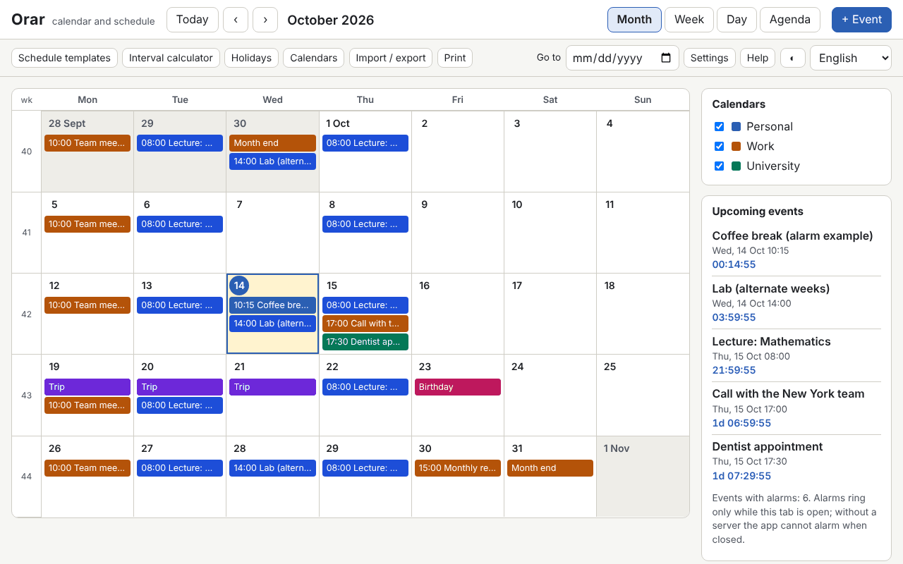

# Orar

**English** · [Română](README.ro.md) · [Français](README.fr.md) · [Italiano](README.it.md) · [Español](README.es.md) · [Português](README.pt.md) · [Deutsch](README.de.md) · [Magyar](README.hu.md)

**Version:** 1.0.0 · **Last updated:** 2026-10-14

Interface languages: **Română, English, Français, Italiano, Español, Português (PT), Deutsch, Magyar**

Orar is a calendar and weekly schedule that runs in a single HTML file, with no server and no account. It has month / week / day / agenda views, ISO 8601 weeks, events with time zones (Europe/Bucharest by default), RFC 5545-style recurrences with a visual editor, alarms while the tab is open, calculated Romanian public holidays (including the movable ones, from Orthodox Easter), `.ics` import and export, schedule templates (shifts, lecture/lab), an interval calculator and a countdown.

**Live app:** https://chiuta.github.io/apps/Orar/

## How to use it

- **Navigation:** the Today / ‹ / › buttons, the "Go to" field, or the keyboard: `m` `w` `d` `a` (month, week, day, agenda), `t` (today), `n` (new event), arrows (day by day), `Page Up` / `Page Down` (previous or next month/week/day), `Home` / `End` (start/end of week), `Enter` (open the day or the event), `?` (help), `Esc` (close the dialog).
- **New event:** "+ Event". Title, start/end or all day, time zone, place, description, calendar and category (the text colour is chosen automatically, with AA contrast), alarms (offset before the event) and recurrence.
- **Recurrence:** daily / weekly / monthly / yearly, interval, days of the week, "2nd Tuesday", "last Friday", "last day of the month", end by number of occurrences or by date (`COUNT` / `UNTIL`), excluded dates (`EXDATE`) and added dates (`RDATE`). The editor shows the next 10 occurrences. When editing or deleting you choose: only this occurrence, this and the following ones, or the whole series.
- **Calendars:** several calendars, each with a colour, switched on/off from the side panel.
- **Holidays:** the legal list for any year, with the days off and the possible bridge days (informational only). An Orthodox calendar (Palm Sunday, Maundy Thursday, Ascension, etc.) can also be switched on, and your own days off can be added.
- **Schedule templates:** 2-2-4 shifts, three rotating shifts, lecture/lab on even/odd weeks; they generate series of events up to an end date.
- **Calculator:** days between two dates, working days (without the Romanian public holidays, optionally without your own days off) and adding working days.
- **Import / export:** `.ics` (import with duplicate detection: skip / overwrite / import anyway; export for all calendars or for one), `.fff.json` backup copy, import from CLEPSIDRA, a "Load example" button and "Delete all".
- **Printing:** the "Print" button (week, month or agenda) uses a print CSS without side panels.
- **Alarms:** see below, under the limits.

## What it does NOT do, and the limits

- **Alarms ring only while the Orar tab is open** (a sound generated with WebAudio and, only if you explicitly accept it, a browser notification). **There are no alarms when the app is closed, not even if you install it as a PWA**: without a notification server, a local file cannot wake itself up. On restart, the alarms missed while it was closed appear in an informational banner, without sound.
- Holidays and days off are **calculated for information and are not an official source**. The official list is the one in the legislation and in the Government decisions (granted days off, bridge days). Check them there before any decision.
- It does not sync between devices and does not subscribe to online calendars (it makes no network calls). Use `.ics` or `.fff.json` export/import.
- It does not send invitations: the `ATTENDEE` / `ORGANIZER` fields in imported files are ignored (their number is reported). `VTODO`, `VJOURNAL` and cancelled events are not imported.
- Recurrences: `FREQ` DAILY/WEEKLY/MONTHLY/YEARLY, `INTERVAL`, `BYDAY` (with positions, e.g. `-1FR`), `BYMONTHDAY`, `BYMONTH`, `BYSETPOS`, `WKST`, `COUNT`, `UNTIL`, `EXDATE`, `RDATE` are supported. `BYHOUR`, `BYMINUTE`, `BYWEEKNO`, `BYYEARDAY`, `HOURLY`/`MINUTELY`/`SECONDLY` are ignored on import, with a warning. More complex rules remain editable as text (raw `RRULE`).
- Events at a non-existent time (the switch to summer time) are moved by the offset in effect before the switch; at an ambiguous time (the switch to winter time) the first occurrence is taken. "Floating" events (without a time zone) stay at the same local time.
- `DTSTART` is always the first occurrence, as in RFC 5545, even if it does not match the rule.
- Time zones in `VTIMEZONE` that are not IANA names are matched by rules with an IANA zone, otherwise they become a fixed offset. The export generates `VTIMEZONE` from the browser's transitions (valid for the range of the events).
- Import from CLEPSIDRA: it accepts the schedule (key `clepsidra.schedule`: `{"weekday":[{"start":"HH:MM","end":"HH:MM","cat":"somn"}],"weekend":[…]}`) and the countdowns (`clepsidra.events`: `[{"name":"…","ts":ms}]`). Direct reading from the browser works only if CLEPSIDRA has run on the same origin; otherwise the JSON is pasted into the dialog. CLEPSIDRA is not modified.
- Measured performance: a 1.2 MB `.ics` file with 5000 events is imported in a few seconds, and renders take under 150 ms; beyond a few tens of thousands of events, `localStorage` (≈5 MB) becomes the limit.

## Privacy

It runs locally and sends nothing. The data (events, calendars, settings) stays in `localStorage`, in your browser, with the prefix `fff.orar.`. There are no analytics, cookies or network requests (CSP `connect-src 'none'`). Browser notifications are requested only if you explicitly press the button in Settings.

## Formats

- **`.ics` import** (RFC 5545): `VEVENT`, `VTIMEZONE` (basic), `RRULE`, `EXDATE`, `RDATE`, `RECURRENCE-ID`, `VALARM`, `LOCATION`, `CATEGORIES`, `DURATION`, `DTSTART;VALUE=DATE`, `TZID` (IANA names, Windows names, prefix `/mozilla.org/…`, `X-LIC-LOCATION`), folded lines, escapes, UTF-8 (with BOM) or windows-1252, CRLF or LF line terminators. Verified with files in the style of Google Calendar, Outlook and Thunderbird.
- **`.ics` export:** stable `UID`, `DTSTAMP`, folding at 75 bytes without breaking UTF-8 characters, `VTIMEZONE`, `VALARM`, modified occurrences as `RECURRENCE-ID`. The file is identical across successive exports.
- **`.fff.json` backup copy:** `{"format":"fff-bundle","schema":1,"app":"orar","version":"1.0.0","updated":"2026-10-14","data":{…}}`.

## Technical

- A single `index.html`, with no external libraries, no `eval` and no inline handlers. CSP: `default-src 'none'; script-src 'sha256-…'` (the script's hash), `style-src 'unsafe-inline'` (the dynamic styles of event colours), `img-src`/`media-src data: blob:` and `worker-src blob:` (only for downloading locally generated files), `connect-src 'none'`.
- The recurrence engine works in the wall-clock time of the event's time zone and converts to the display time zone with `Intl.DateTimeFormat` (including DST). Orthodox Easter: the Meeus algorithm (Julian calendar) converted to Gregorian.
- Tests: `node tests/test.mjs` (Playwright, Chromium, network blocked). They cover Easter and the holidays 2024–2035, 420 RRULE rules compared with `python-dateutil` (precomputed oracle in `tests/oracle_rrule.json`), recurrences in 31-day months, leap year and DST, `.ics` round-trip with realistic files, independent validation of the export (a parser written separately in the test, plus `tests/ics_check.py` with `icalendar` and `dateutil`, optional), 5000 events, the interface in 8 languages, axe-core, horizontal overflow, printing, themes.

## Third parties

It contains no third-party code. The tests use Playwright, axe-core (injected only in tests) and, optionally, `icalendar` and `python-dateutil` (BSD) for independent checks.

## Translations

Romanian is the reference language. English is written together with Romanian, but is not verified by a native speaker; **French, Italian, Spanish, Portuguese, Hungarian and German are machine translations, not verified by native speakers.** Corrections are welcome.

## Licence

Licence: MIT — see the `LICENSE` file in the repository root.

## History

- 1.0.0 — 2026-10-14: first version.
