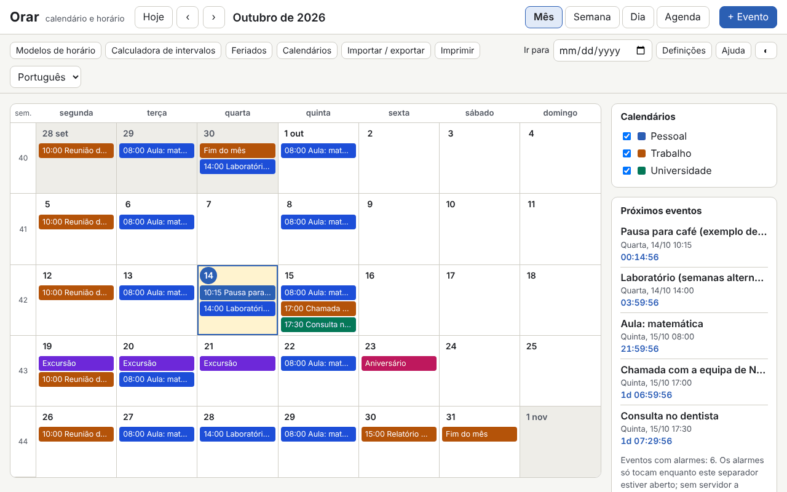

# Orar

[English](README.md) · [Română](README.ro.md) · [Français](README.fr.md) · [Italiano](README.it.md) · [Español](README.es.md) · **Português** · [Deutsch](README.de.md) · [Magyar](README.hu.md)

**Versão:** 1.0.0 · **Última atualização:** 2026-10-14

Idiomas da interface: **Română, English, Français, Italiano, Español, Português (PT), Deutsch, Magyar**

O Orar é um calendário e um horário semanal que funcionam num único ficheiro HTML, sem servidor e sem conta. Tem vistas de mês / semana / dia / agenda, semanas ISO 8601, eventos com fuso horário (Europe/Bucharest por predefinição), recorrências ao estilo RFC 5545 com um editor visual, alarmes enquanto o separador está aberto, os feriados legais romenos calculados (incluindo os móveis, a partir da Páscoa ortodoxa), importação e exportação `.ics`, modelos de horário (turnos, aula/laboratório), uma calculadora de intervalos e uma contagem decrescente.

**Aplicação online:** https://chiuta.github.io/apps/Orar/

## Como se utiliza

- **Navegação:** os botões Hoje / ‹ / ›, o campo «Ir para», ou o teclado: `m` `w` `d` `a` (mês, semana, dia, agenda), `t` (hoje), `n` (evento novo), setas (dia a dia), `Page Up` / `Page Down` (mês/semana/dia anterior ou seguinte), `Home` / `End` (início/fim da semana), `Enter` (abre o dia ou o evento), `?` (ajuda), `Esc` (fecha a caixa de diálogo).
- **Evento novo:** «+ Evento». Título, início/fim ou dia inteiro, fuso horário, local, descrição, calendário e categoria (a cor do texto é escolhida automaticamente, com contraste AA), alarmes (antecedência em relação ao evento) e recorrência.
- **Recorrência:** diária / semanal / mensal / anual, intervalo, dias da semana, «2.ª terça-feira», «última sexta-feira», «último dia do mês», fim por número de ocorrências ou por data (`COUNT` / `UNTIL`), datas excluídas (`EXDATE`) e datas adicionadas (`RDATE`). O editor mostra as 10 ocorrências seguintes. Ao editar ou eliminar, escolhe-se: apenas esta ocorrência, esta e as seguintes, ou toda a série.
- **Calendários:** vários calendários, cada um com uma cor, ligados/desligados a partir do painel lateral.
- **Feriados:** a lista legal para qualquer ano, com os dias de folga e as possíveis pontes (apenas a título informativo). Também se pode ativar um calendário ortodoxo (Domingo de Ramos, Quinta-feira Santa, Ascensão, etc.) e acrescentar dias de folga próprios.
- **Modelos de horário:** turnos 2-2-4, três turnos rotativos, aula/laboratório em semanas pares/ímpares; geram séries de eventos até uma data de fim.
- **Calculadora:** dias entre duas datas, dias úteis (sem os feriados legais de RO, opcionalmente sem os dias de folga próprios) e adição de dias úteis.
- **Importação / exportação:** `.ics` (importação com deteção de duplicados: ignorar / substituir / importar mesmo assim; exportação de todos os calendários ou de um só), cópia de segurança `.fff.json`, importação a partir do CLEPSIDRA, botões «Carregar exemplo» e «Apagar tudo».
- **Impressão:** o botão «Imprimir» (semana, mês ou agenda) usa um CSS de impressão sem painéis laterais.
- **Alarmes:** veja abaixo, nos limites.

## O que NÃO faz, e os limites

- **Os alarmes tocam apenas enquanto o separador Orar está aberto** (um som gerado com WebAudio e, só se o aceitar explicitamente, uma notificação do navegador). **Não há alarmes quando a aplicação está fechada, nem mesmo que a instale como PWA**: sem um servidor de notificações, um ficheiro local não consegue acordar sozinho. No reinício, os alarmes perdidos enquanto esteve fechada aparecem numa faixa informativa, sem som.
- Os feriados e os dias de folga são **calculados a título informativo e não constituem uma fonte oficial**. A lista oficial é a da legislação e a das deliberações do Governo (dias de folga concedidos, pontes). Verifique-os aí antes de qualquer decisão.
- Não sincroniza entre dispositivos e não subscreve calendários online (não faz nenhuma chamada de rede). Use a exportação/importação `.ics` ou `.fff.json`.
- Não envia convites: os campos `ATTENDEE` / `ORGANIZER` dos ficheiros importados são ignorados (o seu número é comunicado). `VTODO`, `VJOURNAL` e os eventos cancelados não são importados.
- Recorrências: são suportados `FREQ` DAILY/WEEKLY/MONTHLY/YEARLY, `INTERVAL`, `BYDAY` (com posições, p. ex. `-1FR`), `BYMONTHDAY`, `BYMONTH`, `BYSETPOS`, `WKST`, `COUNT`, `UNTIL`, `EXDATE`, `RDATE`. `BYHOUR`, `BYMINUTE`, `BYWEEKNO`, `BYYEARDAY`, `HOURLY`/`MINUTELY`/`SECONDLY` são ignorados na importação, com um aviso. As regras mais complexas continuam editáveis como texto (`RRULE` em bruto).
- Os eventos com uma hora inexistente (mudança para a hora de verão) são deslocados com o desfasamento anterior à mudança; na hora ambígua (mudança para a hora de inverno) toma-se a primeira ocorrência. Os eventos «flutuantes» (sem fuso) mantêm a mesma hora local.
- `DTSTART` é sempre a primeira ocorrência, como na RFC 5545, mesmo que não corresponda à regra.
- Os fusos de `VTIMEZONE` que não são nomes IANA são associados por regras a uma zona IANA; caso contrário, tornam-se um desfasamento fixo. A exportação gera `VTIMEZONE` a partir das transições do navegador (válido para o intervalo dos eventos).
- Importação a partir do CLEPSIDRA: aceita o horário (chave `clepsidra.schedule`: `{"weekday":[{"start":"HH:MM","end":"HH:MM","cat":"somn"}],"weekend":[…]}`) e as contagens decrescentes (`clepsidra.events`: `[{"name":"…","ts":ms}]`). A leitura direta a partir do navegador só funciona se o CLEPSIDRA tiver sido executado na mesma origem; caso contrário, cola-se o JSON na caixa de diálogo. O CLEPSIDRA não é modificado.
- Desempenho medido: um ficheiro `.ics` de 1,2 MB com 5000 eventos importa-se em poucos segundos e as renderizações demoram menos de 150 ms; para além de algumas dezenas de milhares de eventos, o `localStorage` (≈5 MB) passa a ser o limite.

## Privacidade

Corre localmente e não envia nada. Os dados (eventos, calendários, definições) ficam no `localStorage`, no seu navegador, com o prefixo `fff.orar.`. Não existem análise estatística, cookies nem pedidos de rede (CSP `connect-src 'none'`). As notificações do navegador só são pedidas se premir explicitamente o botão nas Definições.

## Formatos

- **Importação `.ics`** (RFC 5545): `VEVENT`, `VTIMEZONE` (básico), `RRULE`, `EXDATE`, `RDATE`, `RECURRENCE-ID`, `VALARM`, `LOCATION`, `CATEGORIES`, `DURATION`, `DTSTART;VALUE=DATE`, `TZID` (nomes IANA, nomes Windows, prefixo `/mozilla.org/…`, `X-LIC-LOCATION`), linhas dobradas, sequências de escape, UTF-8 (com BOM) ou windows-1252, terminadores de linha CRLF ou LF. Verificado com ficheiros ao estilo do Google Calendar, Outlook e Thunderbird.
- **Exportação `.ics`:** `UID` estável, `DTSTAMP`, dobragem aos 75 bytes sem partir caracteres UTF-8, `VTIMEZONE`, `VALARM`, ocorrências modificadas como `RECURRENCE-ID`. O ficheiro é idêntico em exportações sucessivas.
- **Cópia de segurança `.fff.json`:** `{"format":"fff-bundle","schema":1,"app":"orar","version":"1.0.0","updated":"2026-10-14","data":{…}}`.

## Técnica

- Um único `index.html`, sem bibliotecas externas, sem `eval` e sem tratadores em linha. CSP: `default-src 'none'; script-src 'sha256-…'` (o hash do script), `style-src 'unsafe-inline'` (os estilos dinâmicos das cores dos eventos), `img-src`/`media-src data: blob:` e `worker-src blob:` (apenas para a transferência de ficheiros gerados localmente), `connect-src 'none'`.
- O motor de recorrências trabalha na hora de parede do fuso do evento e converte para o fuso de apresentação com `Intl.DateTimeFormat` (incluindo a hora de verão). Páscoa ortodoxa: algoritmo de Meeus (calendário juliano) convertido para gregoriano.
- Testes: `node tests/test.mjs` (Playwright, Chromium, rede bloqueada). Cobrem a Páscoa e os feriados 2024–2035, 420 regras RRULE comparadas com `python-dateutil` (oráculo pré-calculado em `tests/oracle_rrule.json`), recorrências em meses de 31 dias, ano bissexto e hora de verão, ida e volta `.ics` com ficheiros realistas, validação independente da exportação (um analisador escrito à parte no teste, mais `tests/ics_check.py` com `icalendar` e `dateutil`, opcional), 5000 eventos, a interface em 8 idiomas, axe-core, transbordo horizontal, impressão, temas.

## Terceiros

Não contém código de terceiros. Nos testes usam-se Playwright, axe-core (injetado apenas nos testes) e, opcionalmente, `icalendar` e `python-dateutil` (BSD) para verificações independentes.

## Traduções

O romeno é o idioma de referência. O inglês é escrito em conjunto com o romeno, mas não foi verificado por um falante nativo; **o francês, o italiano, o espanhol, o português, o húngaro e o alemão são traduções automáticas, não verificadas por falantes nativos.** As correções são bem-vindas.

## Licença

Licença: MIT — consulte o ficheiro `LICENSE` na raiz do repositório.

## Histórico

- 1.0.0 — 2026-10-14: primeira versão.
