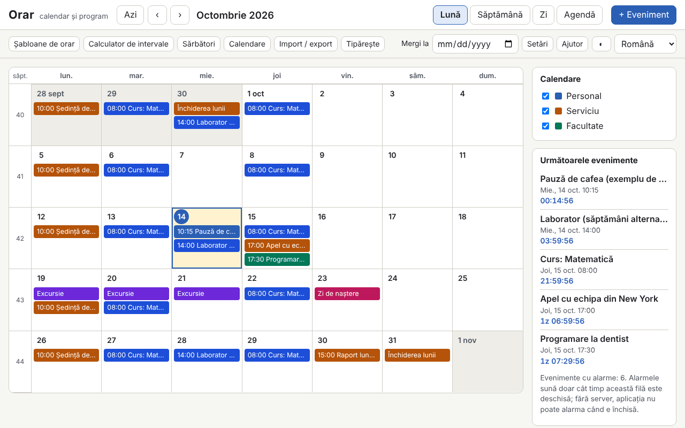

# Orar

[English](README.md) · **Română** · [Français](README.fr.md) · [Italiano](README.it.md) · [Español](README.es.md) · [Português](README.pt.md) · [Deutsch](README.de.md) · [Magyar](README.hu.md)

**Versiune:** 1.0.0 · **Ultima actualizare:** 2026-10-14

Limbile interfeței: **Română, English, Français, Italiano, Español, Português (PT), Deutsch, Magyar**

Orar este un calendar și un program săptămânal care rulează într-un singur fișier HTML, fără server și fără cont. Are vizualizări lună / săptămână / zi / agendă, săptămâni ISO 8601, evenimente cu fus orar (implicit Europe/Bucharest), recurențe în stil RFC 5545 cu editor vizual, alarme cât timp fila e deschisă, sărbătorile legale românești calculate (inclusiv cele mobile, din Paștele ortodox), import și export `.ics`, șabloane de program (ture, curs/laborator), calculator de intervale și numărătoare inversă.

**Live:** https://chiuta.github.io/apps/Orar/

## Cum se folosește

- **Navigare:** butoanele Azi / ‹ / ›, câmpul „Mergi la”, sau tastatura: `m` `w` `d` `a` (lună, săptămână, zi, agendă), `t` (azi), `n` (eveniment nou), săgeți (zi cu zi), `Page Up` / `Page Down` (lună/săptămână/zi anterioară sau următoare), `Home` / `End` (început/sfârșit de săptămână), `Enter` (deschide ziua sau evenimentul), `?` (ajutor), `Esc` (închide dialogul).
- **Eveniment nou:** „+ Eveniment”. Titlu, început/sfârșit sau toată ziua, fus orar, loc, descriere, calendar și categorie (culoarea textului se alege automat, cu contrast AA), alarme (decalaj înainte de eveniment) și recurență.
- **Recurență:** zilnic / săptămânal / lunar / anual, interval, zile ale săptămânii, „a 2-a marți”, „ultima vineri”, „ultima zi a lunii”, sfârșit prin număr de apariții sau dată (`COUNT` / `UNTIL`), date excluse (`EXDATE`) și date adăugate (`RDATE`). Editorul arată următoarele 10 apariții. La editare sau ștergere se alege: doar această apariție, aceasta și următoarele, sau toată seria.
- **Calendare:** mai multe calendare, fiecare cu culoare, pornit/oprit din panoul lateral.
- **Sărbători:** lista legală pentru orice an, cu zilele libere și punțile posibile (doar informativ). Se poate activa și un calendar ortodox (Floriile, Joia Mare, Înălțarea etc.) și se pot adăuga zile libere proprii.
- **Șabloane de orar:** ture 2-2-4, trei schimburi rotative, curs/laborator pe săptămâni pare/impare; generează serii de evenimente până la o dată de sfârșit.
- **Calculator:** zile între două date, zile lucrătoare (fără sărbătorile legale RO, opțional fără zilele libere proprii) și adăugare de zile lucrătoare.
- **Import / export:** `.ics` (import cu detectare de duplicate: omite / suprascrie / importă oricum; export pentru toate calendarele sau pentru unul), copie de siguranță `.fff.json`, import din CLEPSIDRA, buton „Încarcă exemplu” și „Șterge tot”.
- **Tipărire:** butonul „Tipărește” (săptămână, lună sau agendă) folosește un CSS de tipărire fără panouri laterale.
- **Alarme:** vezi mai jos, la limite.

## Ce NU face și limitele

- **Alarmele sună numai cât timp fila Orar este deschisă** (sunet generat cu WebAudio și, doar dacă îl accepți explicit, o notificare a browserului). **Nu există alarme când aplicația e închisă, nici dacă o instalezi ca PWA**: fără server de notificări, un fișier local nu se poate trezi singur. La repornire, alarmele ratate cât a fost închisă apar într-o bandă informativă, fără sunet.
- Sărbătorile și zilele libere sunt **calculate informativ și nu sunt o sursă oficială**. Lista oficială este cea din legislație și din hotărârile Guvernului (zile libere acordate, punți). Verifică-le acolo înainte de orice decizie.
- Nu sincronizează între dispozitive și nu se abonează la calendare online (nu face niciun apel de rețea). Folosește export/import `.ics` sau `.fff.json`.
- Nu trimite invitații: câmpurile `ATTENDEE` / `ORGANIZER` din fișierele importate sunt ignorate (numărul lor este raportat). `VTODO`, `VJOURNAL` și evenimentele anulate nu se importă.
- Recurențe: sunt acceptate `FREQ` DAILY/WEEKLY/MONTHLY/YEARLY, `INTERVAL`, `BYDAY` (cu poziții, ex. `-1FR`), `BYMONTHDAY`, `BYMONTH`, `BYSETPOS`, `WKST`, `COUNT`, `UNTIL`, `EXDATE`, `RDATE`. `BYHOUR`, `BYMINUTE`, `BYWEEKNO`, `BYYEARDAY`, `HOURLY`/`MINUTELY`/`SECONDLY` sunt ignorate la import, cu avertisment. Regulile mai complexe rămân editabile ca text (`RRULE` brut).
- Evenimentele cu oră inexistentă (trecerea la ora de vară) se mută cu decalajul de dinaintea trecerii; la ora ambiguă (trecerea la ora de iarnă) se ia prima apariție. Evenimentele „flotante” (fără fus) rămân la aceeași oră locală.
- `DTSTART` este întotdeauna prima apariție, ca în RFC 5545, chiar dacă nu se potrivește cu regula.
- Fusurile din `VTIMEZONE` care nu sunt nume IANA se potrivesc după reguli cu o zonă IANA, altfel devin decalaj fix. Exportul generează `VTIMEZONE` din tranzițiile browserului (valabil pentru intervalul evenimentelor).
- Import din CLEPSIDRA: acceptă programul (cheia `clepsidra.schedule`: `{"weekday":[{"start":"HH:MM","end":"HH:MM","cat":"somn"}],"weekend":[…]}`) și numărătorile (`clepsidra.events`: `[{"name":"…","ts":ms}]`). Citirea directă din browser merge doar dacă CLEPSIDRA a rulat pe aceeași origine; altfel se lipește JSON-ul în dialog. CLEPSIDRA nu este modificată.
- Performanță măsurată: un fișier `.ics` de 1,2 MB cu 5000 de evenimente se importă în câteva secunde, iar randările durează sub 150 ms; dincolo de câteva zeci de mii de evenimente `localStorage` (≈5 MB) devine limita.

## Confidențialitate

Rulează local, nu trimite nimic. Datele (evenimente, calendare, setări) rămân în `localStorage`, în browserul tău, cu prefixul `fff.orar.`. Nu există analitice, cookie-uri sau cereri de rețea (CSP `connect-src 'none'`). Notificările browserului se cer doar dacă apeși explicit butonul din Setări.

## Formate

- **Import `.ics`** (RFC 5545): `VEVENT`, `VTIMEZONE` (de bază), `RRULE`, `EXDATE`, `RDATE`, `RECURRENCE-ID`, `VALARM`, `LOCATION`, `CATEGORIES`, `DURATION`, `DTSTART;VALUE=DATE`, `TZID` (nume IANA, nume Windows, prefix `/mozilla.org/…`, `X-LIC-LOCATION`), linii pliate, escape-uri, UTF-8 (cu BOM) sau windows-1252, terminatori CRLF sau LF. Verificat cu fișiere în stilul Google Calendar, Outlook și Thunderbird.
- **Export `.ics`:** `UID` stabil, `DTSTAMP`, pliere la 75 de octeți fără a rupe caractere UTF-8, `VTIMEZONE`, `VALARM`, apariții modificate ca `RECURRENCE-ID`. Fișierul este identic la exporturi succesive.
- **Copie de siguranță `.fff.json`:** `{"format":"fff-bundle","schema":1,"app":"orar","version":"1.0.0","updated":"2026-10-14","data":{…}}`.

## Tehnic

- Un singur `index.html`, fără biblioteci externe, fără `eval` și fără handlere inline. CSP: `default-src 'none'; script-src 'sha256-…'` (hash-ul scriptului), `style-src 'unsafe-inline'` (stilurile dinamice ale culorilor de evenimente), `img-src`/`media-src data: blob:` și `worker-src blob:` (doar pentru descărcarea fișierelor generate local), `connect-src 'none'`.
- Motorul de recurență lucrează în ora de perete a fusului evenimentului și convertește la fusul de afișare cu `Intl.DateTimeFormat` (inclusiv DST). Paștele ortodox: algoritmul Meeus (calendar iulian) convertit în gregorian.
- Teste: `node tests/test.mjs` (Playwright, Chromium, rețea blocată). Acoperă Paștele și sărbătorile 2024–2035, 420 de reguli RRULE comparate cu `python-dateutil` (oracol precalculat în `tests/oracle_rrule.json`), recurențe în luni de 31 de zile, an bisect și DST, round-trip `.ics` cu fișiere realiste, validare independentă a exportului (parser scris separat în test, plus `tests/ics_check.py` cu `icalendar` și `dateutil`, opțional), 5000 de evenimente, interfața pe 8 limbi, axe-core, depășire orizontală, tipărire, teme.

## Terți

Nu conține cod terț. În teste se folosesc Playwright, axe-core (injectat doar în teste) și, opțional, `icalendar` și `python-dateutil` (BSD) pentru verificări independente.

## Traduceri

Româna este limba de referință. Engleza este scrisă împreună cu româna, dar nu este verificată de un vorbitor nativ; **franceza, italiana, spaniola, portugheza, maghiara și germana sunt traduceri automate, neverificate de vorbitori nativi.** Corecturile sunt binevenite.

## Licență

Licență: MIT — vezi fișierul `LICENSE` din rădăcina depozitului.

## Istoric

- 1.0.0 — 2026-10-14: prima versiune.
