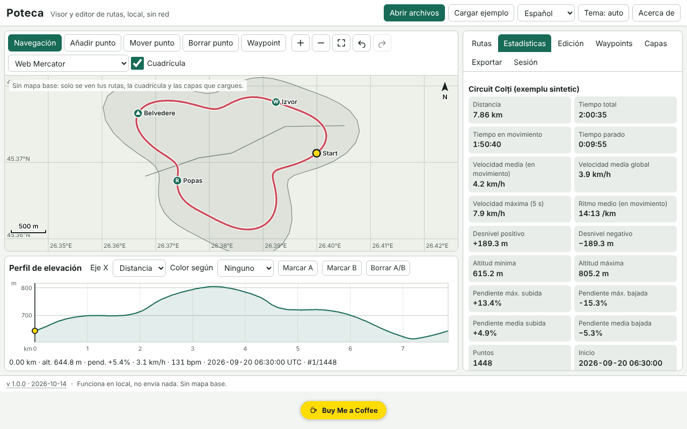

# Poteca — visor y editor de rutas GPX

[English](README.md) · [Română](README.ro.md) · [Français](README.fr.md) · [Italiano](README.it.md) · **Español** · [Português](README.pt.md) · [Deutsch](README.de.md) · [Magyar](README.hu.md)

**Versión:** 1.0.0 · **Última actualización:** 2026-10-14

Idiomas de la interfaz: **Română, English, Français, Italiano, Español, Português (PT), Deutsch, Magyar**

Poteca abre rutas GPX, GeoJSON, KML y CSV, las muestra en un mapa local (sin mapa base), calcula estadísticas (distancia, ascenso/descenso, tiempo en movimiento y parado, velocidades, pendientes, vueltas por kilómetro/milla), presenta un perfil de elevación interactivo sincronizado con el mapa y permite editar las rutas (recortar, dividir, unir, invertir, simplificar, eliminar saltos GPS, puntos manuales, waypoints) y exportarlas. Todo se ejecuta en el navegador, sin conexión.

La captura muestra datos de demostración sintéticos («Cargar ejemplo»), generados localmente; no son rutas reales.

**Aplicación en línea:** https://chiuta.github.io/apps/Poteca/

## Cómo se usa

1. **Abrir archivos** (o arrastrarlos a la página): varios a la vez. El registro de importación indica qué se ha leído, qué se ha ignorado y por qué.
2. Pestaña **Rutas**: visibilidad, color, nombre, eliminación. **Estadísticas**: los valores, la diferencia entre el ascenso suavizado y el bruto, la tabla de vueltas (km o millas) y la tabla de segmentos. Los parámetros (suavizado, umbral de ascenso, umbral de parada) se pueden modificar.
3. **Mapa**: rueda del ratón / pellizco / `+` `−` para el zoom, arrastrar o flechas para desplazarse, `0` para encuadrar. Modos: navegación, añadir punto, mover punto, eliminar punto, waypoint.
4. **Perfil**: clic o flechas (Mayús = paso grande) mueven el cursor, sincronizado con el mapa; colorea según la pendiente, la velocidad o el pulso; marca A y B para recortar/extraer/dividir.
5. Pestaña **Edición**: recorte a un intervalo, división, unión, inversión, simplificación de Douglas–Peucker (mostrando de antemano el número de puntos resultante), eliminación de saltos GPS, desfase horario, comparación de dos rutas.
6. Pestaña **Capas**: capas GeoJSON propias e imágenes georreferenciadas (imagen + 2 puntos de control o recuadro manual).
7. Pestaña **Exportar**: GPX 1.1, GeoJSON, KML, CSV; SVG/PNG para el mapa y el perfil; impresión con leyenda; zona de privacidad (recorta los primeros/últimos N metros al exportar).
8. Pestaña **Sesión**: copia de seguridad `.fff.json`, importación, «Borrar todo».

## Lo que NO hace, y límites

- **No tiene mapa base.** No descarga ninguna tesela (sin red). Solo se ven las rutas, la cuadrícula adaptativa, la barra de escala y las capas que cargues tú.
- Imágenes de fondo: PNG/JPEG/WebP con dos puntos de control o recuadro manual, en proyección Web Mercator; el GeoTIFF **no** se lee, la rotación no se corrige.
- Las estadísticas de ascenso dependen del suavizado y del umbral; los valores son estimaciones (la altitud GPS es ruidosa). Poteca muestra también el valor bruto para comparar.
- La distancia es haversine (esfera R = 6 371 008,8 m); Vincenty (WGS84) es opcional y puede diferir hasta ~0,3 %.
- La eliminación de saltos es heurística: comprueba el resultado en el mapa antes de guardar.
- La comparación de dos rutas solo funciona en los tramos comunes (proximidad espacial); las diferencias de tiempo exigen que ambas rutas tengan hora.
- Archivos muy grandes: 200 000 puntos (~21 MB de GPX) se importan en unos segundos (en nuestra prueba, ≈3 s en la aplicación), pero la interfaz puede bloquearse brevemente (hasta ~2 s) en las operaciones pesadas. Los archivos GPX de más de ~4 MB ya no se comprueban en cuanto a la buena formación XML; se leen de forma tolerante.
- La memoria del navegador limita el número total de puntos; una sesión grande se guarda comprimida en IndexedDB (localStorage solo para sesiones pequeñas). Si el guardado falla, se muestra el estado «sin guardar».
- No tiene conversión de datum, MGRS/UTM, rutas por carretera ni sincronización con dispositivos GPS.
- Las traducciones son automáticas (véase más abajo).

## Privacidad

Se ejecuta en local y no envía nada. La CSP bloquea cualquier conexión de red (`connect-src 'none'`). Tus archivos no salen del dispositivo. Solo se guardan en local la sesión (localStorage/IndexedDB, claves con el prefijo `fff.poteca.`) y las preferencias (idioma, tema). «Borrar todo» lo elimina todo. La zona de privacidad recorta el comienzo y el final de la ruta al exportar (p. ej., para no revelar la dirección de tu domicilio).

## Formatos admitidos

- **GPX 1.0 y 1.1**: `trk`/`trkseg`, `rte`, `wpt`; extensiones Garmin TrackPointExtension (`hr`, `cad`, `atemp`); prefijos de espacios de nombres; sin `time`/`ele`; XML truncado (se recupera lo que se puede).
- **GeoJSON** (Point, LineString, MultiLineString, Polygon → capa), **KML** (Placemark con LineString/Point/gx:Track), **CSV** (delimitador y encabezado detectados, coma decimal, agrupación por ruta).
- Exportación: GPX 1.1 (verificado en las pruebas con un analizador independiente), GeoJSON, KML, CSV, SVG, PNG.

## Aspectos técnicos

Un único archivo `index.html`, sin bibliotecas externas. Proyecciones locales Web Mercator y equirrectangular; dibujo en canvas, con el mismo camino de dibujo para la exportación SVG/PNG y la impresión. Perfil SVG accesible (rol `slider`). Suavizado de la altitud en una ventana de distancia, ascenso/descenso con histéresis, velocidad máxima en una ventana de 5 s, Douglas–Peucker iterativo. Sesión empaquetada en deltas enteros y comprimida con gzip. CSP estricta: `script-src` con hash sha256, sin `eval`, sin manejadores en línea, `connect-src 'none'`; no hizo falta ninguna relajación (`worker-src blob:` e `img-src data: blob:` proceden de la plantilla común). Las pruebas (`tests/test.mjs`, Playwright, red bloqueada, CSP aplicada) comprueban las estadísticas frente a valores analíticos, los viajes de ida y vuelta GPX/GeoJSON/KML, la tolerancia de simplificación, la accesibilidad (axe-core, 0 infracciones) y el rendimiento con 200 000 puntos.

## Terceros

Ningún código de terceros.

## Traducciones

La interfaz tiene 8 idiomas: rumano (predeterminado) e inglés, escritos por el autor; francés, italiano, español, portugués, húngaro y alemán son traducciones automáticas, no verificadas por hablantes nativos.

## Licencia

MIT — véase el archivo `LICENSE` en la raíz del repositorio.

## Historial

- 1.0.0 — 2026-10-14: primera versión.
