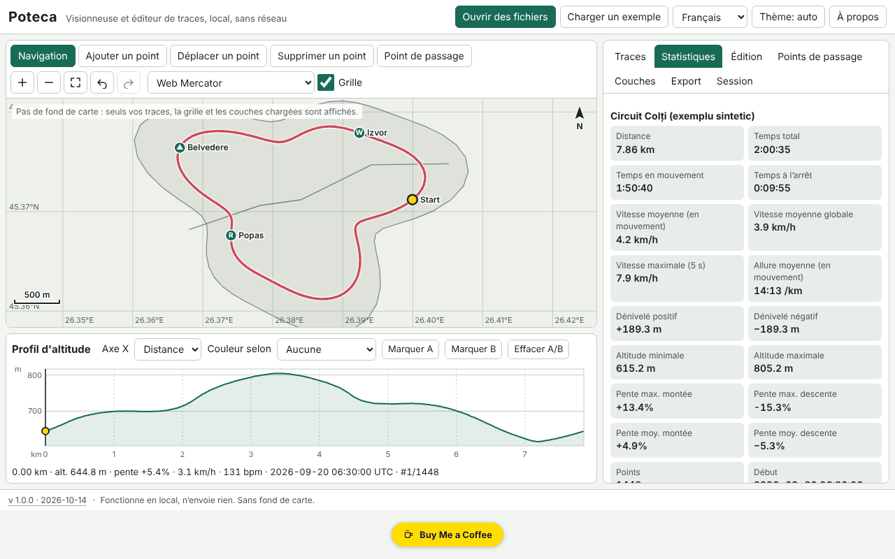

# Poteca — visionneuse et éditeur de traces GPX

[English](README.md) · [Română](README.ro.md) · **Français** · [Italiano](README.it.md) · [Español](README.es.md) · [Português](README.pt.md) · [Deutsch](README.de.md) · [Magyar](README.hu.md)

**Version :** 1.0.0 · **Dernière mise à jour :** 2026-10-14

Langues de l'interface : **Română, English, Français, Italiano, Español, Português (PT), Deutsch, Magyar**

Poteca ouvre des traces GPX, GeoJSON, KML et CSV, les affiche sur une carte locale (sans fond de carte), calcule des statistiques (distance, dénivelé positif/négatif, temps en mouvement et à l'arrêt, vitesses, pentes, tours par kilomètre/mile), présente un profil altimétrique interactif synchronisé avec la carte et permet d'éditer les traces (découpe, scission, fusion, inversion, simplification, suppression des sauts GPS, points manuels, waypoints) et de les exporter. Tout s'exécute dans le navigateur, hors ligne.

La capture montre des données de démonstration synthétiques (« Charger un exemple »), générées localement ; ce ne sont pas des traces réelles.

**Application en ligne :** https://chiuta.github.io/apps/Poteca/

## Mode d'emploi

1. **Ouvrir des fichiers** (ou les glisser dans la page) : plusieurs fichiers à la fois. Le journal d'import indique ce qui a été lu, ce qui a été ignoré et pourquoi.
2. Onglet **Traces** : visibilité, couleur, nom, suppression. **Statistiques** : les valeurs, la différence entre le dénivelé positif lissé et brut, le tableau des tours (km ou miles) et le tableau des segments. Les paramètres (lissage, seuil de montée, seuil d'arrêt) sont modifiables.
3. **Carte** : molette de la souris / pincement / `+` `−` pour zoomer, glisser ou flèches pour se déplacer, `0` pour recadrer. Modes : navigation, ajouter un point, déplacer un point, supprimer un point, waypoint.
4. **Profil** : un clic ou les flèches (Maj = grand pas) déplacent le curseur, en synchronisation avec la carte ; coloration selon la pente, la vitesse ou la fréquence cardiaque ; marquer A et B pour découper/extraire/scinder.
5. Onglet **Édition** : découpe sur un intervalle, scission, fusion, inversion, simplification de Douglas–Peucker (avec affichage préalable du nombre de points obtenu), suppression des sauts GPS, décalage horaire, comparaison de deux traces.
6. Onglet **Couches** : couches GeoJSON personnelles et images géoréférencées (image + 2 points de contrôle ou emprise manuelle).
7. Onglet **Export** : GPX 1.1, GeoJSON, KML, CSV ; SVG/PNG pour la carte et le profil ; impression avec légende ; zone de confidentialité (coupe les N premiers/derniers mètres à l'export).
8. Onglet **Session** : sauvegarde `.fff.json`, import, « Tout supprimer ».

## Ce qu'elle ne fait PAS, et limites

- **Pas de fond de carte.** Elle ne télécharge aucune tuile (pas de réseau). On ne voit que les traces, la grille adaptative, l'échelle et les couches que vous chargez vous-même.
- Images d'arrière-plan : PNG/JPEG/WebP avec deux points de contrôle ou une emprise manuelle, en projection Web Mercator ; le GeoTIFF **n'est pas** lu, la rotation n'est pas corrigée.
- Les statistiques de dénivelé dépendent du lissage et du seuil ; les valeurs sont des estimations (l'altitude GPS est bruitée). Poteca affiche aussi la valeur brute à titre de comparaison.
- La distance est calculée par haversine (sphère R = 6 371 008,8 m) ; Vincenty (WGS84) est optionnel et peut différer jusqu'à ~0,3 %.
- La suppression des sauts est heuristique : vérifiez le résultat sur la carte avant d'enregistrer.
- La comparaison de deux traces ne fonctionne que sur les portions communes (proximité spatiale) ; les écarts de temps exigent que les deux traces comportent l'heure.
- Fichiers très volumineux : 200 000 points (~21 Mo de GPX) s'importent en quelques secondes (dans notre test, ≈3 s dans l'application), mais l'interface peut se figer brièvement (jusqu'à ~2 s) lors des opérations lourdes. Les fichiers GPX de plus de ~4 Mo ne sont plus vérifiés quant à la bonne formation XML ; ils sont lus de façon tolérante.
- La mémoire du navigateur limite le nombre total de points ; une grande session est enregistrée compressée dans IndexedDB (localStorage uniquement pour les petites sessions). Si l'enregistrement échoue, l'état « non enregistré » s'affiche.
- Pas de conversion de datum, de MGRS/UTM, d'itinéraires sur route ni de synchronisation avec des appareils GPS.
- Les traductions sont automatiques (voir plus bas).

## Confidentialité

Elle s'exécute localement et n'envoie rien. La CSP bloque toute connexion réseau (`connect-src 'none'`). Vos fichiers ne quittent pas l'appareil. Seuls la session (localStorage/IndexedDB, clés préfixées `fff.poteca.`) et les préférences (langue, thème) sont enregistrées localement. « Tout supprimer » efface tout. La zone de confidentialité coupe le début et la fin de la trace à l'export (par ex. pour ne pas révéler l'adresse de votre domicile).

## Formats acceptés

- **GPX 1.0 et 1.1** : `trk`/`trkseg`, `rte`, `wpt` ; extensions Garmin TrackPointExtension (`hr`, `cad`, `atemp`) ; préfixes d'espaces de noms ; sans `time`/`ele` ; XML tronqué (on récupère ce qui peut l'être).
- **GeoJSON** (Point, LineString, MultiLineString, Polygon → couche), **KML** (Placemark avec LineString/Point/gx:Track), **CSV** (séparateur et en-tête détectés, virgule décimale, regroupement par trace).
- Export : GPX 1.1 (vérifié dans les tests avec un analyseur indépendant), GeoJSON, KML, CSV, SVG, PNG.

## Aspects techniques

Un seul fichier `index.html`, sans bibliothèque externe. Projections locales Web Mercator et équirectangulaire ; dessin sur canvas, avec le même chemin de dessin pour l'export SVG/PNG et l'impression. Profil SVG accessible (rôle `slider`). Lissage de l'altitude sur une fenêtre de distance, dénivelé positif/négatif avec hystérésis, vitesse maximale sur une fenêtre de 5 s, Douglas–Peucker itératif. Session empaquetée en deltas entiers et compressée en gzip. CSP stricte : `script-src` avec hash sha256, sans `eval`, sans gestionnaires en ligne, `connect-src 'none'` ; aucun assouplissement n'a été nécessaire (`worker-src blob:` et `img-src data: blob:` proviennent du modèle commun). Les tests (`tests/test.mjs`, Playwright, réseau bloqué, CSP appliquée) vérifient les statistiques par rapport à des valeurs analytiques, les allers-retours GPX/GeoJSON/KML, la tolérance de simplification, l'accessibilité (axe-core, 0 violation) et les performances à 200 000 points.

## Tiers

Aucun code tiers.

## Traductions

L'interface existe en 8 langues : le roumain (par défaut) et l'anglais, rédigés par l'auteur ; le français, l'italien, l'espagnol, le portugais, le hongrois et l'allemand sont des traductions automatiques, non vérifiées par des locuteurs natifs.

## Licence

MIT — voir le fichier `LICENSE` à la racine du dépôt.

## Historique

- 1.0.0 — 2026-10-14 : première version.
