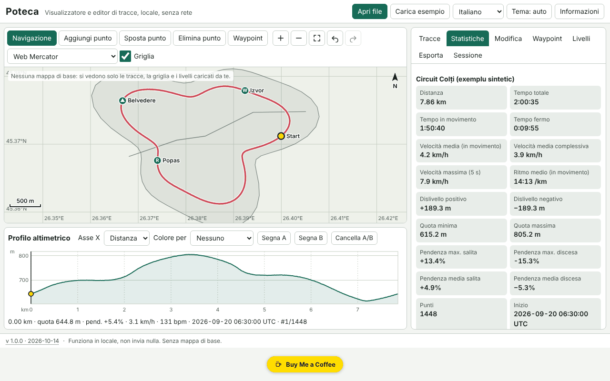

# Poteca — visualizzatore ed editor di tracce GPX

[English](README.md) · [Română](README.ro.md) · [Français](README.fr.md) · **Italiano** · [Español](README.es.md) · [Português](README.pt.md) · [Deutsch](README.de.md) · [Magyar](README.hu.md)

**Versione:** 1.0.0 · **Ultimo aggiornamento:** 2026-10-14

Lingue dell'interfaccia: **Română, English, Français, Italiano, Español, Português (PT), Deutsch, Magyar**

Poteca apre tracce GPX, GeoJSON, KML e CSV, le mostra su una mappa locale (senza mappa di base), calcola statistiche (distanza, salita/discesa, tempo in movimento e da fermo, velocità, pendenze, giri per chilometro/miglio), mostra un profilo altimetrico interattivo sincronizzato con la mappa e permette di modificare le tracce (taglio, divisione, unione, inversione, semplificazione, rimozione dei salti GPS, punti manuali, waypoint) e di esportarle. Tutto gira nel browser, offline.

La schermata mostra dati dimostrativi sintetici («Carica esempio»), generati localmente; non sono tracce reali.

**Applicazione online:** https://chiuta.github.io/apps/Poteca/

## Come si usa

1. **Apri file** (o trascinali nella pagina): più file contemporaneamente. Il registro di importazione indica cosa è stato letto, cosa è stato ignorato e perché.
2. Scheda **Tracce**: visibilità, colore, nome, eliminazione. **Statistiche**: i valori, la differenza tra la salita levigata e quella grezza, la tabella dei giri (km o miglia) e la tabella dei segmenti. I parametri (levigatura, soglia di salita, soglia di sosta) sono modificabili.
3. **Mappa**: rotellina del mouse / pizzico / `+` `−` per lo zoom, trascinamento o frecce per spostarsi, `0` per inquadrare. Modalità: navigazione, aggiungi punto, sposta punto, elimina punto, waypoint.
4. **Profilo**: clic o frecce (Maiusc = passo grande) spostano il cursore, in sincrono con la mappa; colorazione per pendenza, velocità o frequenza cardiaca; segna A e B per tagliare/estrarre/dividere.
5. Scheda **Modifica**: taglio a intervallo, divisione, unione, inversione, semplificazione di Douglas–Peucker (con il numero di punti risultante mostrato in anticipo), rimozione dei salti GPS, scarto orario, confronto di due tracce.
6. Scheda **Livelli**: livelli GeoJSON propri e immagini georeferenziate (immagine + 2 punti di controllo o riquadro manuale).
7. Scheda **Esporta**: GPX 1.1, GeoJSON, KML, CSV; SVG/PNG per mappa e profilo; stampa con legenda; zona di riservatezza (taglia i primi/ultimi N metri all'esportazione).
8. Scheda **Sessione**: copia di sicurezza `.fff.json`, importazione, «Elimina tutto».

## Cosa NON fa e limiti

- **Nessuna mappa di base.** Non scarica alcun tassello (nessuna rete). Si vedono solo le tracce, la griglia adattiva, la barra di scala e i livelli che carichi tu.
- Immagini di sfondo: PNG/JPEG/WebP con due punti di controllo o riquadro manuale, nella proiezione Web Mercator; il GeoTIFF **non** viene letto, la rotazione non viene corretta.
- Le statistiche di salita dipendono dalla levigatura e dalla soglia; i valori sono stime (la quota GPS è rumorosa). Poteca mostra anche il valore grezzo per confronto.
- La distanza è haversine (sfera R = 6 371 008,8 m); Vincenty (WGS84) è facoltativo e può differire fino a ~0,3 %.
- La rimozione dei salti è euristica: controlla il risultato sulla mappa prima di salvare.
- Il confronto di due tracce funziona solo sui tratti comuni (vicinanza spaziale); le differenze di tempo richiedono che entrambe le tracce abbiano l'orario.
- File molto grandi: 200.000 punti (~21 MB di GPX) si importano in pochi secondi (nel nostro test ≈3 s nell'app), ma l'interfaccia può bloccarsi brevemente (fino a ~2 s) durante le operazioni pesanti. I file GPX oltre ~4 MB non vengono più verificati per la buona formazione XML; vengono letti in modo tollerante.
- La memoria del browser limita il numero totale di punti; una sessione grande viene salvata compressa in IndexedDB (localStorage solo per sessioni piccole). Se il salvataggio fallisce, viene mostrato lo stato «non salvato».
- Nessuna conversione di datum, MGRS/UTM, percorsi stradali o sincronizzazione con dispositivi GPS.
- Le traduzioni sono automatiche (vedi sotto).

## Riservatezza

Funziona in locale e non invia nulla. La CSP blocca qualsiasi connessione di rete (`connect-src 'none'`). I tuoi file non lasciano il dispositivo. Vengono salvate in locale solo la sessione (localStorage/IndexedDB, chiavi con prefisso `fff.poteca.`) e le preferenze (lingua, tema). «Elimina tutto» rimuove tutto. La zona di riservatezza taglia l'inizio e la fine della traccia all'esportazione (ad es. per non rivelare l'indirizzo di casa).

## Formati supportati

- **GPX 1.0 e 1.1**: `trk`/`trkseg`, `rte`, `wpt`; estensioni Garmin TrackPointExtension (`hr`, `cad`, `atemp`); prefissi di spazi dei nomi; senza `time`/`ele`; XML troncato (si recupera ciò che si può).
- **GeoJSON** (Point, LineString, MultiLineString, Polygon → livello), **KML** (Placemark con LineString/Point/gx:Track), **CSV** (delimitatore e intestazione rilevati, virgola decimale, raggruppamento per traccia).
- Esportazione: GPX 1.1 (verificato nei test con un parser indipendente), GeoJSON, KML, CSV, SVG, PNG.

## Aspetti tecnici

Un unico file `index.html`, senza librerie esterne. Proiezioni locali Web Mercator ed equirettangolare; disegno su canvas, con lo stesso percorso di disegno per l'esportazione SVG/PNG e la stampa. Profilo SVG accessibile (ruolo `slider`). Levigatura della quota su finestra di distanza, salita/discesa con isteresi, velocità massima su finestra di 5 s, Douglas–Peucker iterativo. Sessione impacchettata in delta interi e compressa gzip. CSP rigorosa: `script-src` con hash sha256, senza `eval`, senza gestori inline, `connect-src 'none'`; non è stato necessario alcun allentamento (`worker-src blob:` e `img-src data: blob:` provengono dal modello comune). I test (`tests/test.mjs`, Playwright, rete bloccata, CSP applicata) verificano le statistiche rispetto a valori analitici, i round-trip GPX/GeoJSON/KML, la tolleranza di semplificazione, l'accessibilità (axe-core, 0 violazioni) e le prestazioni a 200.000 punti.

## Terze parti

Nessun codice di terze parti.

## Traduzioni

L'interfaccia ha 8 lingue: rumeno (predefinita) e inglese, scritte dall'autore; francese, italiano, spagnolo, portoghese, ungherese e tedesco sono traduzioni automatiche, non verificate da madrelingua.

## Licenza

MIT — vedi il file `LICENSE` nella radice del repository.

## Cronologia

- 1.0.0 — 2026-10-14: prima versione.
