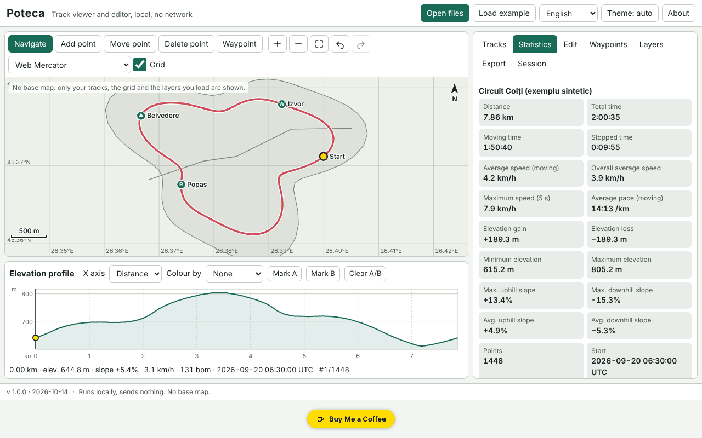

# Poteca — GPX track viewer and editor

**English** · [Română](README.ro.md) · [Français](README.fr.md) · [Italiano](README.it.md) · [Español](README.es.md) · [Português](README.pt.md) · [Deutsch](README.de.md) · [Magyar](README.hu.md)

**Version:** 1.0.0 · **Last updated:** 2026-10-14

Interface languages: **Română, English, Français, Italiano, Español, Português (PT), Deutsch, Magyar**

Poteca opens GPX, GeoJSON, KML and CSV tracks, displays them on a local map (no base map), computes statistics (distance, ascent/descent, moving and stopped time, speeds, gradients, laps per kilometre/mile), shows an interactive elevation profile synchronised with the map, and lets you edit tracks (trim, split, merge, reverse, simplify, remove GPS jumps, manual points, waypoints) and export them. Everything runs in the browser, offline.

The screenshot shows synthetic demo data ("Load example"), generated locally; they are not real tracks.

**Live app:** https://chiuta.github.io/apps/Poteca/

## How to use

1. **Open files** (or drag them onto the page): several files at once. The import log tells you what was read, what was ignored and why.
2. **Tracks** tab: visibility, colour, name, deletion. **Statistics**: the values, the difference between smoothed and raw ascent, the lap table (km or miles) and the segment table. The parameters (smoothing, ascent threshold, stop threshold) can be changed.
3. **Map**: mouse wheel / pinch / `+` `−` to zoom, drag or arrow keys to pan, `0` to fit. Modes: browse, add point, move point, delete point, waypoint.
4. **Profile**: click or arrow keys (Shift = large step) move the cursor, in sync with the map; colour by gradient, speed or heart rate; mark A and B for trimming/extracting/splitting.
5. **Edit** tab: trim to a range, split, merge, reverse, Douglas–Peucker simplification (with the resulting number of points shown beforehand), GPS jump removal, time offset, comparison of two tracks.
6. **Layers** tab: your own GeoJSON layers and georeferenced images (image + 2 control points or a manual bounding box).
7. **Export** tab: GPX 1.1, GeoJSON, KML, CSV; SVG/PNG for the map and the profile; printing with a legend; privacy zone (cuts the first/last N metres on export).
8. **Session** tab: `.fff.json` backup, import, "Delete all".

## What it does NOT do, and limits

- **No base map.** It downloads no tiles (no network). You only see the tracks, the adaptive grid, the scale bar and the layers you load yourself.
- Background images: PNG/JPEG/WebP with two control points or a manual bounding box, in the Web Mercator projection; GeoTIFF is **not** read, rotation is not corrected.
- Ascent statistics depend on smoothing and threshold; the values are estimates (GPS elevation is noisy). Poteca also shows the raw value for comparison.
- Distance is haversine (sphere R = 6,371,008.8 m); Vincenty (WGS84) is optional and may differ by up to ~0.3%.
- Jump removal is heuristic: check the result on the map before saving.
- Comparing two tracks works only on the shared portions (spatial proximity); time differences require both tracks to have time.
- Very large files: 200,000 points (~21 MB GPX) import in a few seconds (in our test, ≈3 s in the app), but the interface may freeze briefly (up to ~2 s) during heavy operations. GPX files above ~4 MB are no longer checked for XML well-formedness; they are read tolerantly.
- Browser memory limits the total number of points; a large session is saved compressed in IndexedDB (localStorage only for small sessions). If saving fails, the "unsaved" state is shown.
- No datum conversion, MGRS/UTM, road routing, or synchronisation with GPS devices.
- Translations are automatic (see below).

## Privacy

It runs locally and sends nothing. The CSP blocks every network connection (`connect-src 'none'`). Your files never leave the device. Only the session (localStorage/IndexedDB, keys prefixed `fff.poteca.`) and the preferences (language, theme) are saved locally. "Delete all" removes everything. The privacy zone cuts the beginning and end of the track on export (e.g. so as not to reveal your home address).

## Supported formats

- **GPX 1.0 and 1.1**: `trk`/`trkseg`, `rte`, `wpt`; Garmin TrackPointExtension extensions (`hr`, `cad`, `atemp`); namespace prefixes; without `time`/`ele`; truncated XML (whatever can be recovered is recovered).
- **GeoJSON** (Point, LineString, MultiLineString, Polygon → layer), **KML** (Placemark with LineString/Point/gx:Track), **CSV** (delimiter and header detected, decimal comma, grouping by track).
- Export: GPX 1.1 (verified in tests with an independent parser), GeoJSON, KML, CSV, SVG, PNG.

## Technical notes

A single `index.html` file, with no external libraries. Local Web Mercator and equirectangular projections; canvas drawing, with the same drawing path for SVG/PNG export and printing. Accessible SVG profile (`slider` role). Elevation smoothing over a distance window, ascent/descent with hysteresis, maximum speed over a 5 s window, iterative Douglas–Peucker. Session packed into integer deltas and gzip-compressed. Strict CSP: `script-src` with a sha256 hash, no `eval`, no inline handlers, `connect-src 'none'`; no relaxation was needed (`worker-src blob:` and `img-src data: blob:` come from the shared template). The tests (`tests/test.mjs`, Playwright, network blocked, CSP enforced) check statistics against analytical values, GPX/GeoJSON/KML round-trips, simplification tolerance, accessibility (axe-core, 0 violations) and performance at 200,000 points.

## Third parties

No third-party code.

## Translations

The interface has 8 languages: Romanian (default) and English, written by the author; French, Italian, Spanish, Portuguese, Hungarian and German are automatic translations, not verified by native speakers.

## License

MIT — see the `LICENSE` file in the repository root.

## History

- 1.0.0 — 2026-10-14: first release.
