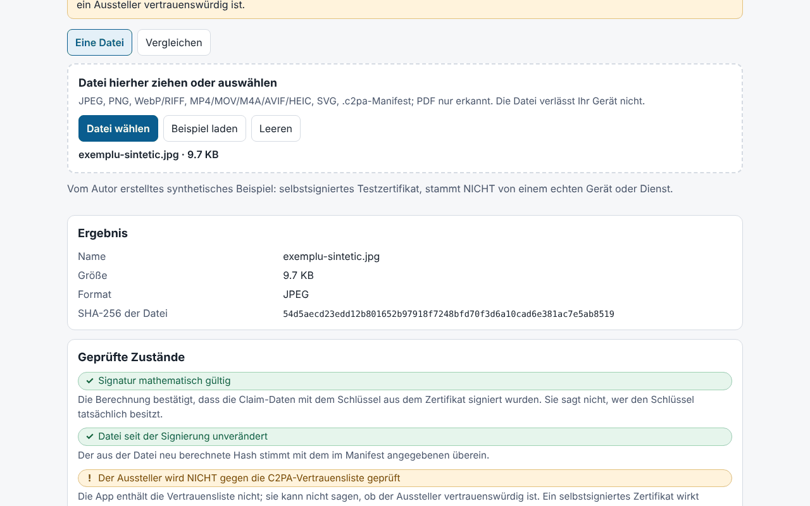

# Proveniență (Provenienta)

[English](README.md) · [Română](README.ro.md) · [Français](README.fr.md) · [Italiano](README.it.md) · [Español](README.es.md) · [Português](README.pt.md) · **Deutsch** · [Magyar](README.hu.md)

**Version:** 1.0.0 · **Zuletzt aktualisiert:** 2026-10-14

Oberflächensprachen: **Română, English, Français, Italiano, Español, Português (PT), Deutsch, Magyar**

Proveniență ist ein **lokaler, experimenteller** Prüfer für C2PA-Manifeste / Content Credentials. Er liest das in eine Datei eingebettete Manifest (oder ein separates `.c2pa`-Manifest), zeigt es in einfacher Sprache an (wer signiert hat, welche Bearbeitungen deklariert wurden, ob eine KI-Erzeugung deklariert wird), in einer Zeitleiste und als technischen Baum, und prüft anschließend im Browser mit Web Crypto die COSE-Signatur, die in der Datei enthaltene Zertifikatskette, die Hashes der Assertions und die **harte Bindung** (Hard Binding) an die Bytes der Datei (er erkennt eine nach der Signierung veränderte Datei). Außerdem gibt es einen Vergleichsmodus für zwei Dateien und den Export eines JSON-/Markdown-Berichts ohne den Inhalt der Datei.

**Live-App:** https://chiuta.github.io/apps/Provenienta/

## Bedienung

1. Ziehe eine Datei auf die Fläche oder klicke auf „Datei wählen“ (oder „Beispiel laden“, eine eingebaute synthetische Datei).
2. Lies „Geprüfte Zustände“ (Signatur, Bindung an die Datei, Aussteller) und „Kurzfassung“.
3. Öffne die Zeitleiste, die Hashes, die Zertifikate und den technischen Baum für Details.
4. „Vergleich“: wähle zwei Dateien aus; die Unterschiede werden hervorgehoben.
5. Exportiere den Bericht (JSON/Markdown); standardmäßig enthält er den Dateinamen, aber weder die Werte der Assertions noch Vorschaubilder oder den Inhalt.

## Was er NICHT tut, und seine Grenzen

- **Er enthält nicht die C2PA-Vertrauensliste.** Der Zustand „Der Aussteller ist NICHT gegen die C2PA-Vertrauensliste geprüft“ erscheint immer: Die Anwendung kann nicht sagen, ob ein Aussteller vertrauenswürdig ist. Ein selbstsigniertes Zertifikat ergibt dieselbe „mathematisch gültige Signatur“.
- Er prüft weder den Widerruf (OCSP/CRL) noch die Signatur der Zeitstempelstelle; der Zeitstempel wird nur gelesen und als nicht validiert angezeigt.
- Das Fehlen eines Manifests bedeutet **nicht**, dass das Bild gefälscht oder echt ist: Metadaten können entfernt werden (Screenshot, Skalierung, Hochladen auf Plattformen).
- Ein gültiges Manifest sagt, was der Unterzeichner deklariert hat und dass sich die Daten seit der Signierung nicht verändert haben; es beweist nicht, dass das Gezeigte tatsächlich geschehen ist. KI-Systeme können Inhalte signieren; der Unterzeichner kann beliebige Angaben deklarieren (zum Beispiel `digitalSourceType`).
- **Experimentell, nicht an echten Dateien getestet.** Die Tests verwenden ausschließlich **synthetische**, **vom Autor geschriebene** C2PA-Dateien nach der Beschreibung der Spezifikation (keine offiziellen Beispiele); an Dateien von echten Geräten oder Diensten wurde nicht getestet. Abweichungen von den Referenzimplementierungen sind möglich.
- Bei ISO BMFF (MP4/MOV/AVIF/HEIC) wird die harte Bindung nur für Ausschlüsse der obersten Ebene berechnet; fragmentierte Dateien, Dateien mit Merkle-Strukturen oder mit verschachtelten Ausschlüssen werden als „nicht bewertet“ markiert. Eine BMFF-Abweichung kann auch eine Grenze der Anwendung sein.
- PDF: nur eine oberflächliche Erkennung eines Manifest-Hinweises; es wird nicht geparst und nicht geprüft. GIF, TIFF, MP3, FLAC usw. werden nicht unterstützt. Nicht bewertet werden `c2pa.hash.collection.data`, `c2pa.hash.boxes`, CAWG (nur angezeigt) und Verifiable Credentials.
- Geprüft werden die Bytes, nicht der Sinngehalt des Bildes. Der Zustand „Signatur“ und der Zustand „Datei“ sind voneinander unabhängig.
- Größenbeschränkung: 400 MB (die Datei wird in den Speicher gelesen).

## Datenschutz

Läuft lokal und sendet nichts: CSP mit `connect-src 'none'`, keine externen Skripte oder Schriften. In `localStorage` werden nur Sprache und Design (Theme) gespeichert (`fff.provenienta.lang`, `fff.provenienta.theme`); die Schaltfläche „Gespeicherte Einstellungen löschen“ entfernt sie. Es gibt keine weiteren Nutzerdaten, daher auch keinen `.fff.json`-Export/-Import. Die CSP ist die Standard-CSP des Katalogs, ohne Anpassungen (`img-src blob:` wird für die Vorschaubilder aus dem Manifest verwendet).

## Unterstützte Formate

JPEG (APP11-Segmente `JP`, Zusammensetzen aus Fragmenten), PNG (`caBX`), WebP und andere RIFF (`C2PA`), ISO BMFF: MP4/MOV/M4A/AVIF/HEIC (`uuid`-Box C2PA oder `c2pa`), SVG (`c2pa:manifest`, Base64), separates `.c2pa`-Manifest (JUMBF); PDF nur erkannt.

## Technik

Eine einzige `index.html` (HTML, CSS, JS inline), ohne Bibliotheken. Vom Autor geschrieben: ein JUMBF-Parser (`jumb`/`jumd`/`cbor`/`json`/`bidb`/`bfdb`/`uuid`), ein **CBOR-Decoder** (Typen 0–7, Tags, unbestimmte Länge, Text-/Ganzzahl-Schlüssel, Tiefenbegrenzungen), ein **ASN.1/DER- und X.509**-Parser, COSE_Sign1 (ES256/384/512, PS256/384/512, Ed25519, sofern der Browser es unterstützt), die Prüfung der Kette zwischen den Zertifikaten in der Datei, `c2pa.hash.data` (ausgeschlossene Bereiche) und `c2pa.hash.bmff` (einfache Variante). Claims v1 und v2, Assertions `c2pa.actions`/`.v2` (mit Hervorhebung der IPTC-Werte `digitalSourceType`), `c2pa.ingredient`, `stds.exif`, Vorschaubilder. Die Oberfläche gibt es in 8 Sprachen.

Tests: `node tests/test.mjs` (Playwright; `tests/synth.mjs` erzeugt ES256-/ES384-/ES512-/RSA-/Ed25519-Schlüssel, von Hand mit `node:crypto` geschriebene X.509-Zertifikate und ein JUMBF-Manifest mit echter COSE-Signatur, eingefügt in JPEG/PNG/WebP/SVG/MP4). Abgedeckt sind: Parsing, gültige/ungültige Signatur, Änderung eines Pixel-Bytes, abgelaufenes/ungültiges Zertifikat, vollständige/unterbrochene/fehlende Kette, fehlendes Manifest, abgeschnittenes JUMBF, fehlerhaftes CBOR, 400 zufällige Beschädigungen (ohne Ausnahmen), Vergleich, Export, 8 Sprachen, axe 0, kein Überlauf bei 360 und 1280 px, 0 Netzwerkanfragen.

## Drittanbieter

Kein Drittanbieter-Code.

## Übersetzungen

Die Übersetzungen ins Französische, Italienische, Spanische, Portugiesische, Ungarische und Deutsche (fr, it, es, pt, hu, de) sind maschinell erstellt und **nicht von Muttersprachlern geprüft**.

## Lizenz

MIT — siehe die Datei `LICENSE` im Stammverzeichnis des Repositorys.

## Verlauf

- 1.0.0 — 2026-10-14: erste Version.
