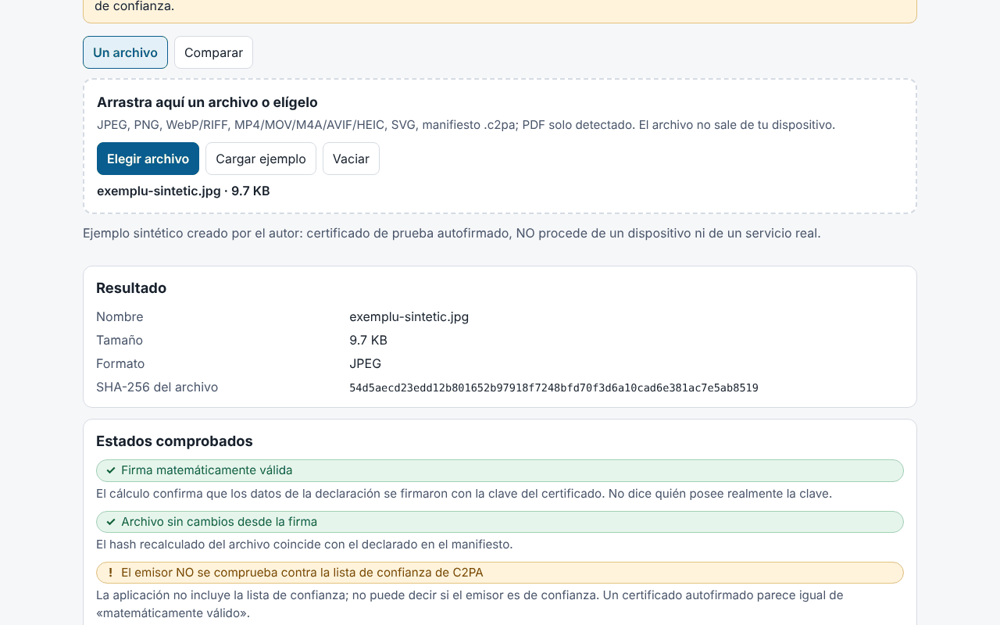

# Proveniență (Provenienta)

[English](README.md) · [Română](README.ro.md) · [Français](README.fr.md) · [Italiano](README.it.md) · **Español** · [Português](README.pt.md) · [Deutsch](README.de.md) · [Magyar](README.hu.md)

**Versión:** 1.0.0 · **Última actualización:** 2026-10-14

Idiomas de la interfaz: **Română, English, Français, Italiano, Español, Português (PT), Deutsch, Magyar**

Proveniență es un verificador **local y experimental** de manifiestos C2PA / Content Credentials. Lee el manifiesto incrustado en un archivo (o un manifiesto `.c2pa` independiente), lo muestra en lenguaje sencillo (quién firmó, qué ediciones declaró, si declara generación con IA), en una cronología y como árbol técnico, y luego verifica en el navegador, con Web Crypto, la firma COSE, la cadena de certificados contenida en el archivo, los hashes de las aserciones y el **enlace fuerte** (hard binding) con los bytes del archivo (detecta un archivo modificado después de la firma). También tiene un modo de comparación entre dos archivos y exporta un informe JSON/Markdown sin el contenido del archivo.

**Aplicación en línea:** https://chiuta.github.io/apps/Provenienta/

## Cómo se usa

1. Arrastra un archivo a la zona o pulsa «Elegir archivo» (o «Cargar ejemplo», un archivo sintético incorporado).
2. Lee «Estados verificados» (firma, vínculo con el archivo, emisor) y «En resumen».
3. Abre la cronología, los hashes, los certificados y el árbol técnico para ver los detalles.
4. «Comparar»: elige dos archivos; se resaltan las diferencias.
5. Exporta el informe (JSON/Markdown); por defecto incluye el nombre del archivo, pero no los valores de las aserciones, las miniaturas ni el contenido.

## Lo que NO hace y sus límites

- **No incluye la lista de confianza de C2PA.** El estado «El emisor NO está verificado frente a la lista de confianza de C2PA» aparece siempre: la aplicación no puede decir si un emisor es de confianza. Un certificado autofirmado produce la misma «firma matemáticamente válida».
- No comprueba la revocación (OCSP/CRL) ni la firma de la autoridad de sellado de tiempo; el sello de tiempo solo se lee y se muestra como no validado.
- La ausencia de un manifiesto **no** significa que la imagen sea falsa o auténtica: los metadatos pueden eliminarse (captura de pantalla, cambio de tamaño, subida a plataformas).
- Un manifiesto válido indica lo que declaró el firmante y que los datos no han cambiado desde la firma; no demuestra que lo que se ve haya ocurrido realmente. Los sistemas de IA pueden firmar contenido; el firmante puede declarar cualquier cosa (por ejemplo, `digitalSourceType`).
- **Experimental, no probado con archivos reales.** Las pruebas usan exclusivamente archivos C2PA **sintéticos, escritos por el autor** según la descripción de la especificación (no muestras oficiales); no se ha probado con archivos producidos por dispositivos o servicios reales. Puede haber diferencias con las implementaciones de referencia.
- Para ISO BMFF (MP4/MOV/AVIF/HEIC) el enlace fuerte se calcula solo para exclusiones de nivel superior; los archivos fragmentados, con Merkle o con exclusiones anidadas se marcan como «no evaluado». Una discrepancia en BMFF también puede ser una limitación de la aplicación.
- PDF: solo detección superficial de un indicio de manifiesto; no se analiza ni se verifica. No se admiten GIF, TIFF, MP3, FLAC, etc. No se evalúan `c2pa.hash.collection.data`, `c2pa.hash.boxes`, CAWG (solo se muestra) ni las credenciales verificables.
- Se verifican los bytes, no el sentido de la imagen. El estado «firma» y el estado «archivo» son independientes.
- Límite de tamaño: 400 MB (el archivo se lee en memoria).

## Privacidad

Se ejecuta en local y no envía nada: CSP con `connect-src 'none'`, sin scripts ni fuentes externos. En `localStorage` solo se guardan el idioma y el tema (`fff.provenienta.lang`, `fff.provenienta.theme`); el botón «Borrar las preferencias guardadas» los elimina. No hay otros datos del usuario, por lo que tampoco hay exportación/importación `.fff.json`. La CSP es la estándar del catálogo, sin adaptaciones (`img-src blob:` se usa para las miniaturas del manifiesto).

## Formatos admitidos

JPEG (segmentos APP11 `JP`, reensamblado a partir de fragmentos), PNG (`caBX`), WebP y otros RIFF (`C2PA`), ISO BMFF: MP4/MOV/M4A/AVIF/HEIC (caja `uuid` C2PA o `c2pa`), SVG (`c2pa:manifest`, base64), manifiesto `.c2pa` independiente (JUMBF); PDF solo detectado.

## Aspectos técnicos

Un único `index.html` (HTML, CSS y JS en línea), sin bibliotecas. Escritos por el autor: un analizador JUMBF (`jumb`/`jumd`/`cbor`/`json`/`bidb`/`bfdb`/`uuid`), un **decodificador CBOR** (tipos 0–7, etiquetas, longitud indefinida, claves de texto/enteras, límites de profundidad), un analizador **ASN.1/DER y X.509**, COSE_Sign1 (ES256/384/512, PS256/384/512, Ed25519 si el navegador lo admite), la verificación de la cadena entre los certificados del archivo, `c2pa.hash.data` (rangos excluidos) y `c2pa.hash.bmff` (variante simple). Reclamaciones (claims) v1 y v2, aserciones `c2pa.actions`/`.v2` (con resaltado de los valores IPTC `digitalSourceType`), `c2pa.ingredient`, `stds.exif`, miniaturas. La interfaz está en 8 idiomas.

Pruebas: `node tests/test.mjs` (Playwright; `tests/synth.mjs` genera claves ES256/ES384/ES512/RSA/Ed25519, certificados X.509 escritos a mano con `node:crypto`, un manifiesto JUMBF con una firma COSE real, insertado en JPEG/PNG/WebP/SVG/MP4). Cobertura: análisis sintáctico, firma válida/no válida, modificación de un byte de píxel, certificado caducado/no válido, cadena completa/rota/ausente, manifiesto ausente, JUMBF truncado, CBOR mal formado, 400 corrupciones aleatorias (sin excepciones), comparación, exportación, 8 idiomas, axe 0, sin desbordamiento a 360 y 1280 px, 0 solicitudes de red.

## Terceros

Ningún código de terceros.

## Traducciones

Las traducciones al fr, it, es, pt, hu y de son automáticas y **no han sido verificadas por hablantes nativos**.

## Licencia

MIT — véase el archivo `LICENSE` en la raíz del repositorio.

## Historial

- 1.0.0 — 2026-10-14: primera versión.
