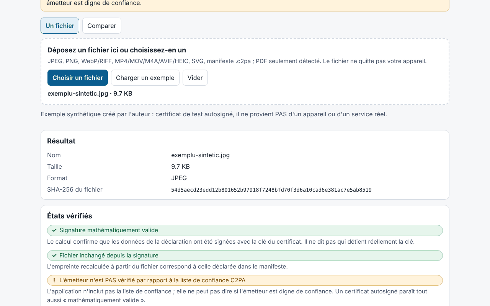

# Proveniență (Provenienta)

[English](README.md) · [Română](README.ro.md) · **Français** · [Italiano](README.it.md) · [Español](README.es.md) · [Português](README.pt.md) · [Deutsch](README.de.md) · [Magyar](README.hu.md)

**Version :** 1.0.0 · **Dernière mise à jour :** 2026-10-14

Langues de l'interface : **Română, English, Français, Italiano, Español, Português (PT), Deutsch, Magyar**

Proveniență est un vérificateur **local et expérimental** de manifestes C2PA / Content Credentials. Il lit le manifeste intégré à un fichier (ou un manifeste `.c2pa` distinct), l'affiche en langage clair (qui a signé, quelles modifications ont été déclarées, si une génération par IA est déclarée), sous forme de chronologie et d'arbre technique, puis vérifie dans le navigateur, avec Web Crypto, la signature COSE, la chaîne de certificats contenue dans le fichier, les empreintes des assertions et la **liaison forte** avec les octets du fichier (il détecte un fichier modifié après la signature). Il propose aussi un mode de comparaison entre deux fichiers et l'export d'un rapport JSON/Markdown sans le contenu du fichier.

**Application en ligne :** https://chiuta.github.io/apps/Provenienta/

## Mode d'emploi

1. Faites glisser un fichier sur la zone ou cliquez sur « Choisir un fichier » (ou « Charger un exemple », un fichier synthétique intégré).
2. Lisez « États vérifiés » (signature, liaison avec le fichier, émetteur) et « En bref ».
3. Ouvrez la chronologie, les empreintes, les certificats et l'arbre technique pour les détails.
4. « Comparer » : choisissez deux fichiers ; les différences sont mises en évidence.
5. Exportez le rapport (JSON/Markdown) ; par défaut il inclut le nom du fichier, mais pas les valeurs des assertions, les miniatures ni le contenu.

## Ce qu'il NE fait PAS, et ses limites

- **Il n'inclut pas la liste de confiance C2PA.** L'état « L'émetteur n'est PAS vérifié par rapport à la liste de confiance C2PA » apparaît toujours : l'application ne peut pas dire si un émetteur est digne de confiance. Un certificat auto-signé produit la même « signature mathématiquement valide ».
- Il ne vérifie ni la révocation (OCSP/CRL) ni la signature de l'autorité d'horodatage ; l'horodatage est seulement lu et affiché comme non validé.
- L'absence de manifeste ne signifie **pas** que l'image est fausse ou authentique : les métadonnées peuvent être supprimées (capture d'écran, redimensionnement, téléversement sur des plateformes).
- Un manifeste valide indique ce que le signataire a déclaré et que les données n'ont pas changé depuis la signature ; il ne prouve pas que ce que l'on voit s'est réellement produit. Des systèmes d'IA peuvent signer du contenu ; le signataire peut déclarer n'importe quoi (par exemple `digitalSourceType`).
- **Expérimental, non testé sur des fichiers réels.** Les tests utilisent exclusivement des fichiers C2PA **synthétiques, écrits par l'auteur** d'après la description de la spécification (pas des échantillons officiels) ; il n'a pas été testé sur des fichiers produits par des appareils ou services réels. Des différences avec les implémentations de référence sont possibles.
- Pour l'ISO BMFF (MP4/MOV/AVIF/HEIC), la liaison forte n'est calculée que pour les exclusions de niveau supérieur ; les fichiers fragmentés, avec Merkle ou avec exclusions imbriquées sont marqués « non évalué ». Une non-concordance BMFF peut aussi être une limite de l'application.
- PDF : simple détection superficielle d'un indice de manifeste ; il n'est ni analysé ni vérifié. GIF, TIFF, MP3, FLAC, etc. ne sont pas pris en charge. Ne sont pas évalués : `c2pa.hash.collection.data`, `c2pa.hash.boxes`, CAWG (seulement affiché), justificatifs vérifiables.
- Ce sont les octets qui sont vérifiés, pas le sens de l'image. L'état « signature » et l'état « fichier » sont indépendants.
- Limite de taille : 400 Mo (le fichier est lu en mémoire).

## Confidentialité

Il s'exécute localement et n'envoie rien : CSP avec `connect-src 'none'`, aucun script ni police externe. Seules la langue et le thème sont conservés dans `localStorage` (`fff.provenienta.lang`, `fff.provenienta.theme`) ; le bouton « Supprimer les préférences enregistrées » les efface. Il n'y a aucune autre donnée utilisateur, donc pas non plus d'export/import `.fff.json`. La CSP est la CSP standard du catalogue, sans adaptation (`img-src blob:` sert aux miniatures du manifeste).

## Formats pris en charge

JPEG (segments APP11 `JP`, réassemblage à partir de fragments), PNG (`caBX`), WebP et autres RIFF (`C2PA`), ISO BMFF : MP4/MOV/M4A/AVIF/HEIC (boîte `uuid` C2PA ou `c2pa`), SVG (`c2pa:manifest`, base64), manifeste `.c2pa` distinct (JUMBF) ; PDF seulement détecté.

## Technique

Un seul `index.html` (HTML, CSS, JS en ligne), sans bibliothèques. Écrits par l'auteur : un analyseur JUMBF (`jumb`/`jumd`/`cbor`/`json`/`bidb`/`bfdb`/`uuid`), un **décodeur CBOR** (types 0–7, étiquettes, longueur indéfinie, clés textuelles/entières, limites de profondeur), un analyseur **ASN.1/DER et X.509**, COSE_Sign1 (ES256/384/512, PS256/384/512, Ed25519 si le navigateur le prend en charge), la vérification de la chaîne entre les certificats du fichier, `c2pa.hash.data` (plages exclues) et `c2pa.hash.bmff` (variante simple). Déclarations (claims) v1 et v2, assertions `c2pa.actions`/`.v2` (avec mise en évidence des valeurs IPTC `digitalSourceType`), `c2pa.ingredient`, `stds.exif`, miniatures. L'interface est disponible en 8 langues.

Tests : `node tests/test.mjs` (Playwright ; `tests/synth.mjs` génère des clés ES256/ES384/ES512/RSA/Ed25519, des certificats X.509 écrits à la main avec `node:crypto`, un manifeste JUMBF avec une vraie signature COSE, inséré dans JPEG/PNG/WebP/SVG/MP4). Couverture : analyse, signature valide/invalide, modification d'un octet de pixel, certificat expiré/non valide, chaîne complète/rompue/absente, manifeste manquant, JUMBF tronqué, CBOR mal formé, 400 corruptions aléatoires (sans exception), comparaison, export, 8 langues, axe 0, aucun débordement à 360 et 1280 px, 0 requête réseau.

## Tiers

Aucun code tiers.

## Traductions

Les traductions en fr, it, es, pt, hu et de sont automatiques et **non vérifiées par des locuteurs natifs**.

## Licence

MIT — voir le fichier `LICENSE` à la racine du dépôt.

## Historique

- 1.0.0 — 2026-10-14 : première version.
