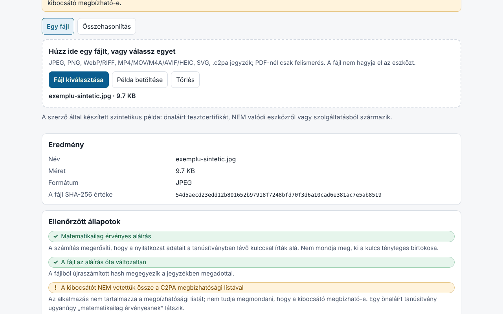

# Proveniență (Provenienta)

[English](README.md) · [Română](README.ro.md) · [Français](README.fr.md) · [Italiano](README.it.md) · [Español](README.es.md) · [Português](README.pt.md) · [Deutsch](README.de.md) · **Magyar**

**Verzió:** 1.0.0 · **Utolsó frissítés:** 2026-10-14

A felület nyelvei: **Română, English, Français, Italiano, Español, Português (PT), Deutsch, Magyar**

A Proveniență egy **helyi és kísérleti** ellenőrző C2PA-manifesztekhez / Content Credentials adatokhoz. Beolvassa a fájlba ágyazott manifesztet (vagy egy különálló `.c2pa` manifesztet), közérthető nyelven jeleníti meg (ki írta alá, milyen szerkesztéseket deklaráltak, deklarálnak-e MI-generálást), idővonalon és műszaki fa formájában, majd a böngészőben, a Web Crypto segítségével ellenőrzi a COSE-aláírást, a fájlban található tanúsítványláncot, az állítások (assertions) hash-eit és a fájl bájtjaihoz való **erős kötést** (hard binding) – így észleli az aláírás után módosított fájlt. Két fájl összehasonlító módja is van, és a fájl tartalma nélküli JSON/Markdown jelentést tud exportálni.

**Online alkalmazás:** https://chiuta.github.io/apps/Provenienta/

## Használat

1. Húzz egy fájlt a területre, vagy nyomd meg a „Fájl kiválasztása” gombot (illetve a „Példa betöltése” gombot, amely egy beépített szintetikus fájlt tölt be).
2. Olvasd el az „Ellenőrzött állapotok” (aláírás, kötés a fájllal, kibocsátó) és a „Röviden” részt.
3. A részletekért nyisd meg az idővonalat, a hash-eket, a tanúsítványokat és a műszaki fát.
4. „Összehasonlítás”: válassz két fájlt; a különbségek kiemelve jelennek meg.
5. Exportáld a jelentést (JSON/Markdown); alapértelmezés szerint tartalmazza a fájlnevet, de nem tartalmazza az állítások értékeit, az előnézeti képeket és a tartalmat.

## Amit NEM tud, és a korlátai

- **Nem tartalmazza a C2PA megbízhatósági listáját.** A „A kibocsátót NEM ellenőrizték a C2PA megbízhatósági listájával szemben” állapot mindig megjelenik: az alkalmazás nem tudja megmondani, hogy egy kibocsátó megbízható-e. Egy önaláírt tanúsítvány ugyanazt a „matematikailag érvényes aláírást” eredményezi.
- Nem ellenőrzi a visszavonást (OCSP/CRL), sem az időbélyegző hatóság aláírását; az időbélyeget csak beolvassa, és nem validáltként jeleníti meg.
- A manifeszt hiánya **nem** jelenti, hogy a kép hamis vagy hiteles: a metaadatok eltávolíthatók (képernyőkép, átméretezés, platformokra való feltöltés).
- Egy érvényes manifeszt azt mondja meg, mit deklarált az aláíró, és hogy az adatok az aláírás óta nem változtak; nem bizonyítja, hogy amit látunk, valóban megtörtént. MI-rendszerek is aláírhatnak tartalmat; az aláíró bármit deklarálhat (például a `digitalSourceType` értékét).
- **Kísérleti, valódi fájlokon nem tesztelt.** A tesztek kizárólag **szintetikus, a szerző által írt** C2PA-fájlokat használnak, a specifikáció leírása alapján (nem hivatalos minták); valódi eszközök vagy szolgáltatások által előállított fájlokon nem tesztelték. Eltérések lehetnek a referencia-implementációktól.
- Az ISO BMFF (MP4/MOV/AVIF/HEIC) esetén az erős kötést csak a legfelső szintű kizárásokra számítja ki; a töredezett, Merkle-fás vagy beágyazott kizárásokat tartalmazó fájlok „nem értékelt” jelölést kapnak. A BMFF-eltérés az alkalmazás korlátja is lehet.
- PDF: csak a manifesztre utaló jel felületes észlelése; nem elemzi és nem ellenőrzi. A GIF, TIFF, MP3, FLAC stb. nem támogatott. Nem értékeli a következőket: `c2pa.hash.collection.data`, `c2pa.hash.boxes`, CAWG (csak megjelenítve), ellenőrizhető hitelesítő adatok (verifiable credentials).
- A bájtokat ellenőrzi, nem a kép jelentését. Az „aláírás” állapot és a „fájl” állapot egymástól független.
- Méretkorlát: 400 MB (a fájlt a memóriába olvassa be).

## Adatvédelem

Helyben fut, és semmit nem küld el: CSP `connect-src 'none'` beállítással, külső szkriptek és betűtípusok nélkül. A `localStorage`-ban csak a nyelv és a téma marad meg (`fff.provenienta.lang`, `fff.provenienta.theme`); a „Mentett beállítások törlése” gomb eltávolítja őket. Más felhasználói adat nincs, ezért `.fff.json` export/import sincs. A CSP a katalógus szabványos CSP-je, módosítás nélkül (az `img-src blob:` a manifesztben található előnézeti képekhez szükséges).

## Támogatott formátumok

JPEG (APP11 `JP` szegmensek, töredékekből újraösszeállítva), PNG (`caBX`), WebP és más RIFF (`C2PA`), ISO BMFF: MP4/MOV/M4A/AVIF/HEIC (`uuid` C2PA vagy `c2pa` doboz), SVG (`c2pa:manifest`, base64), különálló `.c2pa` manifeszt (JUMBF); PDF esetén csak észlelés.

## Műszaki részletek

Egyetlen `index.html` (beágyazott HTML, CSS, JS), függvénykönyvtárak nélkül. A szerző által írt komponensek: JUMBF-értelmező (`jumb`/`jumd`/`cbor`/`json`/`bidb`/`bfdb`/`uuid`), **CBOR-dekódoló** (0–7. típusok, címkék, határozatlan hossz, szöveges/egész kulcsok, mélységi korlátok), **ASN.1/DER és X.509** értelmező, COSE_Sign1 (ES256/384/512, PS256/384/512, Ed25519, ha a böngésző támogatja), a fájlban lévő tanúsítványok közötti lánc ellenőrzése, `c2pa.hash.data` (kizárt tartományok) és `c2pa.hash.bmff` (egyszerű változat). v1 és v2 claim-ek, `c2pa.actions`/`.v2` állítások (az IPTC `digitalSourceType` értékeinek kiemelésével), `c2pa.ingredient`, `stds.exif`, előnézeti képek. A felület 8 nyelvű.

Tesztek: `node tests/test.mjs` (Playwright; a `tests/synth.mjs` ES256/ES384/ES512/RSA/Ed25519 kulcsokat, `node:crypto`-val kézzel írt X.509 tanúsítványokat és valódi COSE-aláírású JUMBF-manifesztet generál, amelyet JPEG/PNG/WebP/SVG/MP4 fájlokba illeszt). Lefedett területek: értelmezés, érvényes/érvénytelen aláírás, egyetlen képpont-bájt módosítása, lejárt/még nem érvényes tanúsítvány, teljes/megszakadt/hiányzó lánc, hiányzó manifeszt, csonkolt JUMBF, hibás CBOR, 400 véletlen sérülés (kivételek nélkül), összehasonlítás, export, 8 nyelv, axe 0, túlcsordulás nélkül 360 és 1280 px-en, 0 hálózati kérés.

## Harmadik felek

Nincs harmadik féltől származó kód.

## Fordítások

A francia, olasz, spanyol, portugál, magyar és német (fr, it, es, pt, hu, de) fordítások gépiek, és **anyanyelvi beszélők nem ellenőrizték őket**.

## Licenc

MIT — lásd a `LICENSE` fájlt a tároló gyökerében.

## Előzmények

- 1.0.0 — 2026-10-14: első verzió.
