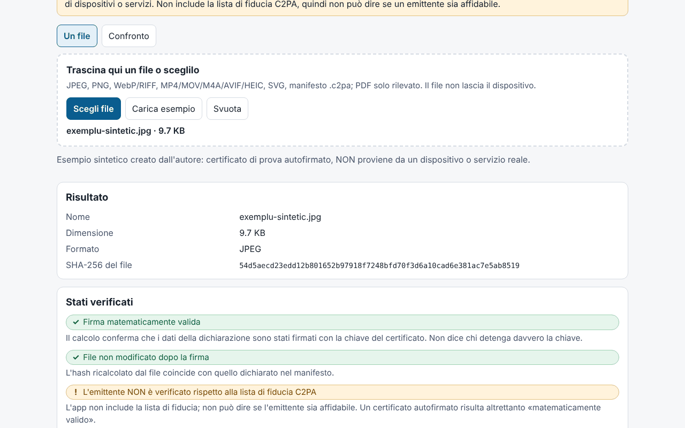

# Proveniență (Provenienta)

[English](README.md) · [Română](README.ro.md) · [Français](README.fr.md) · **Italiano** · [Español](README.es.md) · [Português](README.pt.md) · [Deutsch](README.de.md) · [Magyar](README.hu.md)

**Versione:** 1.0.0 · **Ultimo aggiornamento:** 2026-10-14

Lingue dell'interfaccia: **Română, English, Français, Italiano, Español, Português (PT), Deutsch, Magyar**

Proveniență è un verificatore **locale e sperimentale** di manifest C2PA / Content Credentials. Legge il manifest incorporato in un file (o un manifest `.c2pa` separato), lo mostra in linguaggio semplice (chi ha firmato, quali modifiche sono state dichiarate, se è dichiarata una generazione con IA), in una cronologia e come albero tecnico, poi verifica nel browser, con Web Crypto, la firma COSE, la catena di certificati contenuta nel file, gli hash delle asserzioni e il **legame forte** (hard binding) con i byte del file (rileva un file modificato dopo la firma). Ha anche una modalità di confronto tra due file e l'esportazione di un report JSON/Markdown senza il contenuto del file.

**App online:** https://chiuta.github.io/apps/Provenienta/

## Come si usa

1. Trascina un file sull'area o premi «Scegli file» (oppure «Carica esempio», un file sintetico incorporato).
2. Leggi «Stati verificati» (firma, legame con il file, emittente) e «In breve».
3. Apri la cronologia, gli hash, i certificati e l'albero tecnico per i dettagli.
4. «Confronto»: scegli due file; le differenze vengono evidenziate.
5. Esporta il report (JSON/Markdown); per impostazione predefinita include il nome del file, ma non i valori delle asserzioni, le miniature né il contenuto.

## Cosa NON fa e i suoi limiti

- **Non include la lista di fiducia C2PA.** Lo stato «L'emittente NON è verificato rispetto alla lista di fiducia C2PA» compare sempre: l'applicazione non può dire se un emittente sia affidabile. Un certificato autofirmato produce la stessa «firma matematicamente valida».
- Non verifica la revoca (OCSP/CRL) né la firma dell'autorità di marcatura temporale; la marca temporale viene solo letta e mostrata come non convalidata.
- L'assenza di un manifest **non** significa che l'immagine sia falsa o autentica: i metadati si possono rimuovere (screenshot, ridimensionamento, caricamento su piattaforme).
- Un manifest valido dice cosa ha dichiarato il firmatario e che i dati non sono cambiati dalla firma; non dimostra che ciò che si vede sia realmente accaduto. I sistemi di IA possono firmare contenuti; il firmatario può dichiarare qualsiasi cosa (ad esempio `digitalSourceType`).
- **Sperimentale, non testato su file reali.** I test usano esclusivamente file C2PA **sintetici, scritti dall'autore** secondo la descrizione della specifica (non campioni ufficiali); non è stato testato su file prodotti da dispositivi o servizi reali. Possono esserci differenze rispetto alle implementazioni di riferimento.
- Per l'ISO BMFF (MP4/MOV/AVIF/HEIC) il legame forte viene calcolato solo per le esclusioni di livello superiore; i file frammentati, con Merkle o con esclusioni annidate sono contrassegnati «non valutato». Una mancata corrispondenza BMFF può essere anche un limite dell'applicazione.
- PDF: solo un rilevamento superficiale di un indizio di manifest; non viene analizzato né verificato. GIF, TIFF, MP3, FLAC ecc. non sono supportati. Non vengono valutati `c2pa.hash.collection.data`, `c2pa.hash.boxes`, CAWG (solo mostrato), credenziali verificabili.
- Si verificano i byte, non il significato dell'immagine. Lo stato «firma» e lo stato «file» sono indipendenti.
- Limite di dimensione: 400 MB (il file viene letto in memoria).

## Privacy

Funziona in locale e non invia nulla: CSP con `connect-src 'none'`, nessuno script o font esterno. In `localStorage` si conservano solo la lingua e il tema (`fff.provenienta.lang`, `fff.provenienta.theme`); il pulsante «Elimina le preferenze salvate» li rimuove. Non esistono altri dati dell'utente, quindi nemmeno esportazione/importazione `.fff.json`. La CSP è quella standard del catalogo, senza adattamenti (`img-src blob:` serve per le miniature del manifest).

## Formati supportati

JPEG (segmenti APP11 `JP`, riassemblaggio da frammenti), PNG (`caBX`), WebP e altri RIFF (`C2PA`), ISO BMFF: MP4/MOV/M4A/AVIF/HEIC (box `uuid` C2PA oppure `c2pa`), SVG (`c2pa:manifest`, base64), manifest `.c2pa` separato (JUMBF); PDF solo rilevato.

## Aspetti tecnici

Un unico `index.html` (HTML, CSS, JS inline), senza librerie. Scritti dall'autore: un parser JUMBF (`jumb`/`jumd`/`cbor`/`json`/`bidb`/`bfdb`/`uuid`), un **decodificatore CBOR** (tipi 0–7, tag, lunghezza indefinita, chiavi testuali/intere, limiti di profondità), un parser **ASN.1/DER e X.509**, COSE_Sign1 (ES256/384/512, PS256/384/512, Ed25519 se il browser lo supporta), la verifica della catena tra i certificati del file, `c2pa.hash.data` (intervalli esclusi) e `c2pa.hash.bmff` (variante semplice). Claim v1 e v2, asserzioni `c2pa.actions`/`.v2` (con evidenziazione dei valori IPTC `digitalSourceType`), `c2pa.ingredient`, `stds.exif`, miniature. L'interfaccia è in 8 lingue.

Test: `node tests/test.mjs` (Playwright; `tests/synth.mjs` genera chiavi ES256/ES384/ES512/RSA/Ed25519, certificati X.509 scritti a mano con `node:crypto`, un manifest JUMBF con una vera firma COSE, inserito in JPEG/PNG/WebP/SVG/MP4). Copertura: parsing, firma valida/non valida, modifica di un byte di pixel, certificato scaduto/non valido, catena completa/interrotta/mancante, manifest assente, JUMBF troncato, CBOR malformato, 400 corruzioni casuali (senza eccezioni), confronto, esportazione, 8 lingue, axe 0, nessun overflow a 360 e 1280 px, 0 richieste di rete.

## Terze parti

Nessun codice di terze parti.

## Traduzioni

Le traduzioni in fr, it, es, pt, hu e de sono automatiche e **non verificate da madrelingua**.

## Licenza

MIT — vedi il file `LICENSE` nella radice del repository.

## Cronologia

- 1.0.0 — 2026-10-14: prima versione.
