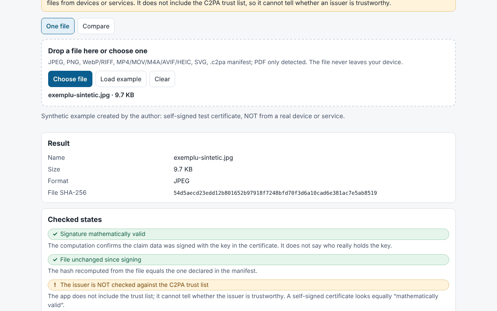

# Proveniență (Provenienta)

**English** · [Română](README.ro.md) · [Français](README.fr.md) · [Italiano](README.it.md) · [Español](README.es.md) · [Português](README.pt.md) · [Deutsch](README.de.md) · [Magyar](README.hu.md)

**Version:** 1.0.0 · **Last updated:** 2026-10-14

Interface languages: **Română, English, Français, Italiano, Español, Português (PT), Deutsch, Magyar**

Proveniență is a **local, experimental** checker for C2PA manifests / Content Credentials. It reads the manifest embedded in a file (or a separate `.c2pa` manifest), presents it in plain language (who signed it, which edits were declared, whether AI generation is declared), in a timeline and as a technical tree, then verifies in the browser, using Web Crypto, the COSE signature, the certificate chain contained in the file, the assertion hashes and the **hard binding** to the file's bytes (it detects a file modified after signing). It also has a two-file comparison mode and exports a JSON/Markdown report without the file's content.

**Live app:** https://chiuta.github.io/apps/Provenienta/

## How to use

1. Drag a file onto the drop area or press "Choose file" (or "Load example", a built-in synthetic file).
2. Read "Verified statuses" (signature, binding to the file, issuer) and "At a glance".
3. Open the timeline, the hashes, the certificates and the technical tree for details.
4. "Compare": choose two files; the differences are highlighted.
5. Export the report (JSON/Markdown); by default it includes the file name, but not the assertion values, thumbnails or content.

## What it does NOT do, and its limits

- **It does not include the C2PA trust list.** The status "The issuer is NOT verified against the C2PA trust list" is always shown: the app cannot tell whether an issuer is trustworthy. A self-signed certificate produces the same "mathematically valid signature".
- It does not check revocation (OCSP/CRL) nor the signature of the timestamping authority; the timestamp is only read and displayed as unvalidated.
- The absence of a manifest does **not** mean the image is fake or genuine: metadata can be stripped (screenshot, resizing, uploading to platforms).
- A valid manifest tells you what the signer declared and that the data has not changed since signing; it does not prove that what you see actually happened. AI systems can sign content; the signer can declare anything (for example `digitalSourceType`).
- **Experimental, not tested on real files.** The tests use only **synthetic** C2PA files, **written by the author** after the description in the specification (not official samples); it was not tested on files produced by real devices or services. There may be differences from the reference implementations.
- For ISO BMFF (MP4/MOV/AVIF/HEIC) the hard binding is computed only for top-level exclusions; fragmented files, files with Merkle trees or with nested exclusions are marked "not evaluated". A BMFF mismatch may also be a limitation of the app.
- PDF: only a superficial detection of a manifest hint; it is not parsed or verified. GIF, TIFF, MP3, FLAC etc. are not supported. `c2pa.hash.collection.data`, `c2pa.hash.boxes`, CAWG (only displayed) and verifiable credentials are not evaluated.
- The bytes are verified, not the meaning of the image. The "signature" status and the "file" status are independent.
- Size limit: 400 MB (the file is read into memory).

## Privacy

It runs locally and sends nothing: CSP with `connect-src 'none'`, no external scripts or fonts. Only the language and theme are kept in `localStorage` (`fff.provenienta.lang`, `fff.provenienta.theme`); the "Delete saved preferences" button removes them. There is no other user data, hence no `.fff.json` export/import either. The CSP is the catalogue's standard one, without adaptations (`img-src blob:` is used for the thumbnails in the manifest).

## Supported formats

JPEG (APP11 `JP` segments, reassembled from fragments), PNG (`caBX`), WebP and other RIFF (`C2PA`), ISO BMFF: MP4/MOV/M4A/AVIF/HEIC (`uuid` C2PA box or `c2pa`), SVG (`c2pa:manifest`, base64), separate `.c2pa` manifest (JUMBF); PDF only detected.

## Technical

A single `index.html` (inline HTML, CSS, JS), no libraries. Written by the author: a JUMBF parser (`jumb`/`jumd`/`cbor`/`json`/`bidb`/`bfdb`/`uuid`), a **CBOR decoder** (types 0–7, tags, indefinite length, text/integer keys, depth limits), an **ASN.1/DER and X.509** parser, COSE_Sign1 (ES256/384/512, PS256/384/512, Ed25519 if the browser supports it), chain verification between the certificates in the file, `c2pa.hash.data` (excluded ranges) and `c2pa.hash.bmff` (simple variant). Claims v1 and v2, `c2pa.actions`/`.v2` assertions (with highlighting of the IPTC `digitalSourceType` values), `c2pa.ingredient`, `stds.exif`, thumbnails. The interface is in 8 languages.

Tests: `node tests/test.mjs` (Playwright; `tests/synth.mjs` generates ES256/ES384/ES512/RSA/Ed25519 keys, X.509 certificates hand-written with `node:crypto`, a JUMBF manifest with a real COSE signature, inserted into JPEG/PNG/WebP/SVG/MP4). Coverage: parsing, valid/invalid signature, modification of a single pixel byte, expired/not-yet-valid certificate, complete/broken/missing chain, missing manifest, truncated JUMBF, malformed CBOR, 400 random corruptions (no exceptions), comparison, export, 8 languages, axe 0, no overflow at 360 and 1280 px, 0 network requests.

## Third parties

No third-party code.

## Translations

The translations into fr, it, es, pt, hu and de are machine translations and **have not been verified by native speakers**.

## License

MIT — see the `LICENSE` file at the repository root.

## History

- 1.0.0 — 2026-10-14: first release.
