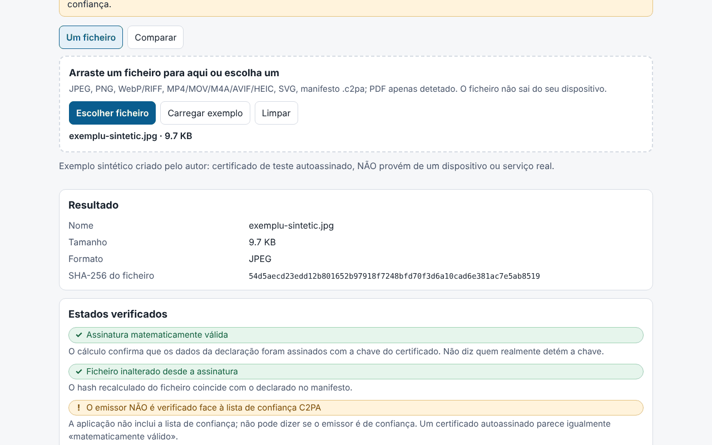

# Proveniență (Provenienta)

[English](README.md) · [Română](README.ro.md) · [Français](README.fr.md) · [Italiano](README.it.md) · [Español](README.es.md) · **Português** · [Deutsch](README.de.md) · [Magyar](README.hu.md)

**Versão:** 1.0.0 · **Última atualização:** 2026-10-14

Idiomas da interface: **Română, English, Français, Italiano, Español, Português (PT), Deutsch, Magyar**

O Proveniență é um verificador **local e experimental** de manifestos C2PA / Content Credentials. Lê o manifesto incorporado num ficheiro (ou um manifesto `.c2pa` separado), apresenta-o em linguagem simples (quem assinou, que edições declarou, se declara geração com IA), numa cronologia e como árvore técnica, e depois verifica no navegador, com Web Crypto, a assinatura COSE, a cadeia de certificados contida no ficheiro, os hashes das asserções e a **ligação forte** (hard binding) aos bytes do ficheiro (deteta um ficheiro modificado depois de assinado). Tem também um modo de comparação entre dois ficheiros e exporta um relatório JSON/Markdown sem o conteúdo do ficheiro.

**Aplicação online:** https://chiuta.github.io/apps/Provenienta/

## Como se utiliza

1. Arraste um ficheiro para a zona ou prima «Escolher ficheiro» (ou «Carregar exemplo», um ficheiro sintético incorporado).
2. Leia «Estados verificados» (assinatura, ligação ao ficheiro, emissor) e «Em resumo».
3. Abra a cronologia, os hashes, os certificados e a árvore técnica para ver os detalhes.
4. «Comparar»: escolha dois ficheiros; as diferenças ficam realçadas.
5. Exporte o relatório (JSON/Markdown); por predefinição inclui o nome do ficheiro, mas não os valores das asserções, as miniaturas nem o conteúdo.

## O que NÃO faz e os seus limites

- **Não inclui a lista de confiança C2PA.** O estado «O emissor NÃO está verificado face à lista de confiança C2PA» aparece sempre: a aplicação não consegue dizer se um emissor é de confiança. Um certificado autoassinado produz a mesma «assinatura matematicamente válida».
- Não verifica a revogação (OCSP/CRL) nem a assinatura da autoridade de selo temporal; o selo temporal é apenas lido e apresentado como não validado.
- A ausência de um manifesto **não** significa que a imagem seja falsa ou autêntica: os metadados podem ser removidos (captura de ecrã, redimensionamento, carregamento para plataformas).
- Um manifesto válido indica o que o signatário declarou e que os dados não se alteraram desde a assinatura; não prova que aquilo que se vê tenha acontecido. Sistemas de IA podem assinar conteúdo; o signatário pode declarar qualquer coisa (por exemplo, `digitalSourceType`).
- **Experimental, não testado com ficheiros reais.** Os testes usam exclusivamente ficheiros C2PA **sintéticos, escritos pelo autor** segundo a descrição da especificação (não amostras oficiais); não foi testado com ficheiros produzidos por dispositivos ou serviços reais. Podem existir diferenças relativamente às implementações de referência.
- Para ISO BMFF (MP4/MOV/AVIF/HEIC) a ligação forte só é calculada para exclusões de nível superior; os ficheiros fragmentados, com Merkle ou com exclusões aninhadas são assinalados como «não avaliado». Uma discrepância em BMFF pode também ser uma limitação da aplicação.
- PDF: apenas deteção superficial de um indício de manifesto; não é analisado nem verificado. GIF, TIFF, MP3, FLAC, etc. não são suportados. Não são avaliados `c2pa.hash.collection.data`, `c2pa.hash.boxes`, CAWG (apenas apresentado) nem credenciais verificáveis.
- Verificam-se os bytes, não o sentido da imagem. O estado «assinatura» e o estado «ficheiro» são independentes.
- Limite de tamanho: 400 MB (o ficheiro é lido para a memória).

## Privacidade

Funciona localmente e não envia nada: CSP com `connect-src 'none'`, sem scripts nem tipos de letra externos. Só o idioma e o tema são guardados em `localStorage` (`fff.provenienta.lang`, `fff.provenienta.theme`); o botão «Apagar as preferências guardadas» elimina-os. Não existem outros dados do utilizador, pelo que também não há exportação/importação `.fff.json`. A CSP é a padrão do catálogo, sem adaptações (`img-src blob:` é usado para as miniaturas do manifesto).

## Formatos suportados

JPEG (segmentos APP11 `JP`, remontagem a partir de fragmentos), PNG (`caBX`), WebP e outros RIFF (`C2PA`), ISO BMFF: MP4/MOV/M4A/AVIF/HEIC (caixa `uuid` C2PA ou `c2pa`), SVG (`c2pa:manifest`, base64), manifesto `.c2pa` separado (JUMBF); PDF apenas detetado.

## Aspetos técnicos

Um único `index.html` (HTML, CSS e JS inline), sem bibliotecas. Escritos pelo autor: um analisador JUMBF (`jumb`/`jumd`/`cbor`/`json`/`bidb`/`bfdb`/`uuid`), um **descodificador CBOR** (tipos 0–7, etiquetas, comprimento indefinido, chaves de texto/inteiras, limites de profundidade), um analisador **ASN.1/DER e X.509**, COSE_Sign1 (ES256/384/512, PS256/384/512, Ed25519 se o navegador o suportar), a verificação da cadeia entre os certificados do ficheiro, `c2pa.hash.data` (intervalos excluídos) e `c2pa.hash.bmff` (variante simples). Declarações (claims) v1 e v2, asserções `c2pa.actions`/`.v2` (com realce dos valores IPTC `digitalSourceType`), `c2pa.ingredient`, `stds.exif`, miniaturas. A interface está em 8 idiomas.

Testes: `node tests/test.mjs` (Playwright; `tests/synth.mjs` gera chaves ES256/ES384/ES512/RSA/Ed25519, certificados X.509 escritos à mão com `node:crypto`, um manifesto JUMBF com uma assinatura COSE real, inserido em JPEG/PNG/WebP/SVG/MP4). Cobertura: análise sintática, assinatura válida/inválida, modificação de um byte de píxel, certificado expirado/inválido, cadeia completa/quebrada/em falta, manifesto em falta, JUMBF truncado, CBOR malformado, 400 corrupções aleatórias (sem exceções), comparação, exportação, 8 idiomas, axe 0, sem transbordo a 360 e 1280 px, 0 pedidos de rede.

## Terceiros

Nenhum código de terceiros.

## Traduções

As traduções para fr, it, es, pt, hu e de são automáticas e **não foram verificadas por falantes nativos**.

## Licença

MIT — ver o ficheiro `LICENSE` na raiz do repositório.

## Histórico

- 1.0.0 — 2026-10-14: primeira versão.
