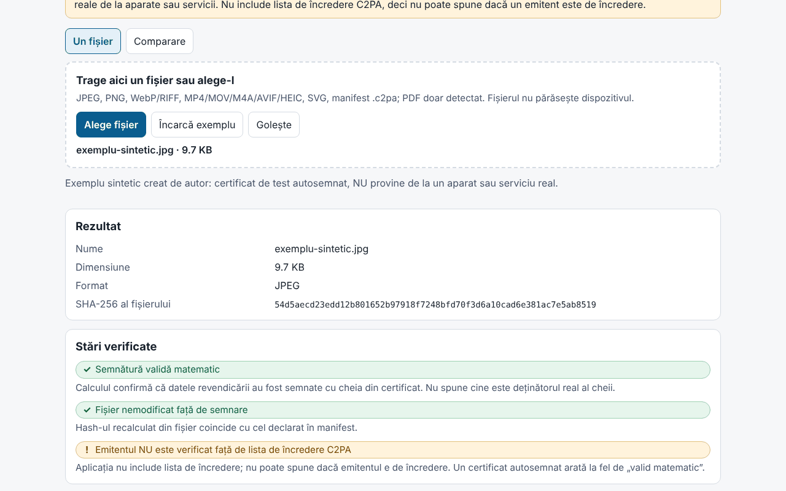

# Proveniență (Provenienta)

[English](README.md) · **Română** · [Français](README.fr.md) · [Italiano](README.it.md) · [Español](README.es.md) · [Português](README.pt.md) · [Deutsch](README.de.md) · [Magyar](README.hu.md)

**Versiune:** 1.0.0 · **Ultima actualizare:** 2026-10-14

Limbile interfeței: **Română, English, Français, Italiano, Español, Português (PT), Deutsch, Magyar**

Proveniență este un verificator **local și experimental** de manifeste C2PA / Content Credentials. Citește manifestul încorporat într-un fișier (sau un manifest `.c2pa` separat), îl afișează în limbaj simplu (cine a semnat, ce editări a declarat, dacă declară generare cu AI), în cronologie și ca arbore tehnic, apoi verifică în browser, cu Web Crypto, semnătura COSE, lanțul de certificate din fișier, hash-urile afirmațiilor și **legătura dură** cu octeții fișierului (detectează un fișier modificat după semnare). Are și mod de comparare între două fișiere și export de raport JSON/Markdown fără conținutul fișierului.

**Live:** https://chiuta.github.io/apps/Provenienta/

## Cum se folosește

1. Trage un fișier pe zonă sau apasă „Alege fișier” (ori „Încarcă exemplu”, un fișier sintetic încorporat).
2. Citește „Stări verificate” (semnătură, legătura cu fișierul, emitent) și „Pe scurt”.
3. Deschide cronologia, hash-urile, certificatele și arborele tehnic pentru detalii.
4. „Comparare”: alege două fișiere; diferențele sunt evidențiate.
5. Exportă raportul (JSON/Markdown); implicit include numele fișierului, nu include valorile afirmațiilor, miniaturile sau conținutul.

## Ce NU face și limitele

- **Nu include lista de încredere C2PA.** Starea „Emitentul NU este verificat față de lista de încredere C2PA” apare întotdeauna: aplicația nu poate spune dacă un emitent e de încredere. Un certificat autosemnat produce același „semnătură validă matematic”.
- Nu verifică revocarea (OCSP/CRL) și nici semnătura autorității de marcare temporală; marcajul temporal este doar citit și afișat ca nevalidat.
- Absența unui manifest **nu** înseamnă că imaginea e falsă sau reală: metadatele se pot elimina (captură de ecran, redimensionare, încărcare pe platforme).
- Un manifest valid spune ce a declarat semnatarul și că datele nu s-au schimbat de la semnare; nu dovedește că ce se vede s-a întâmplat. Sisteme AI pot semna conținut; semnatarul poate declara orice (de exemplu `digitalSourceType`).
- **Experimental, netestat pe fișiere reale.** Testele folosesc exclusiv fișiere C2PA **sintetice, scrise de autor** după descrierea specificației (nu eșantioane oficiale); nu s-a testat pe fișiere produse de aparate sau servicii reale. Pot exista diferențe față de implementările de referință.
- Pentru ISO BMFF (MP4/MOV/AVIF/HEIC) legătura dură se calculează doar pentru excluderi de nivel superior; fișierele fragmentate, cu Merkle sau cu excluderi imbricate sunt marcate „neevaluat”. O nepotrivire BMFF poate fi și o limită a aplicației.
- PDF: doar detectare superficială a unui indiciu de manifest; nu se parsează și nu se verifică. GIF, TIFF, MP3, FLAC etc. nu sunt acceptate. Nu se evaluează `c2pa.hash.collection.data`, `c2pa.hash.boxes`, CAWG (doar afișat), credențiale verificabile.
- Se verifică octeții, nu sensul imaginii. Starea „semnătură” și starea „fișier” sunt independente.
- Limită de dimensiune: 400 MB (fișierul se citește în memorie).

## Confidențialitate

Rulează local, nu trimite nimic: CSP cu `connect-src 'none'`, fără scripturi sau fonturi externe. Se păstrează în `localStorage` doar limba și tema (`fff.provenienta.lang`, `fff.provenienta.theme`); butonul „Șterge preferințele salvate” le elimină. Nu există alte date ale utilizatorului, deci nici export/import `.fff.json`. CSP-ul este cel standard al catalogului, fără adaptări (`img-src blob:` este folosit pentru miniaturile din manifest).

## Formate acceptate

JPEG (segmente APP11 `JP`, reasamblare pe fragmente), PNG (`caBX`), WebP și alte RIFF (`C2PA`), ISO BMFF: MP4/MOV/M4A/AVIF/HEIC (cutia `uuid` C2PA sau `c2pa`), SVG (`c2pa:manifest`, base64), manifest `.c2pa` separat (JUMBF); PDF doar detectat.

## Tehnic

Un singur `index.html` (HTML, CSS, JS inline), fără biblioteci. Scris de autor: parser JUMBF (`jumb`/`jumd`/`cbor`/`json`/`bidb`/`bfdb`/`uuid`), **decodor CBOR** (tipuri 0–7, taguri, lungime nedefinită, chei text/întregi, limite de adâncime), parser **ASN.1/DER și X.509**, COSE_Sign1 (ES256/384/512, PS256/384/512, Ed25519 dacă browserul o suportă), verificarea lanțului între certificatele din fișier, `c2pa.hash.data` (intervale excluse) și `c2pa.hash.bmff` (variantă simplă). Revendicări v1 și v2, afirmații `c2pa.actions`/`.v2` (cu evidențierea valorilor IPTC `digitalSourceType`), `c2pa.ingredient`, `stds.exif`, miniaturi. Interfața e în 8 limbi.

Teste: `node tests/test.mjs` (Playwright; `tests/synth.mjs` generează cheie ES256/ES384/ES512/RSA/Ed25519, certificate X.509 scrise de mână cu `node:crypto`, manifest JUMBF cu semnătură COSE reală, inserat în JPEG/PNG/WebP/SVG/MP4). Acoperă: parsare, semnătură validă/invalidă, modificarea unui octet de pixel, certificat expirat/nevalabil, lanț complet/rupt/lipsă, manifest lipsit, JUMBF trunchiat, CBOR malformat, 400 de corupții aleatoare (fără excepții), comparare, export, 8 limbi, axe 0, fără depășire la 360 și 1280 px, 0 cereri de rețea.

## Terți

Niciun cod terț.

## Traduceri

Traducerile în fr, it, es, pt, hu și de sunt automate și **neverificate de vorbitori nativi**.

## Licență

MIT — vezi fișierul `LICENSE` din rădăcina depozitului.

## Istoric

- 1.0.0 — 2026-10-14: prima versiune.
