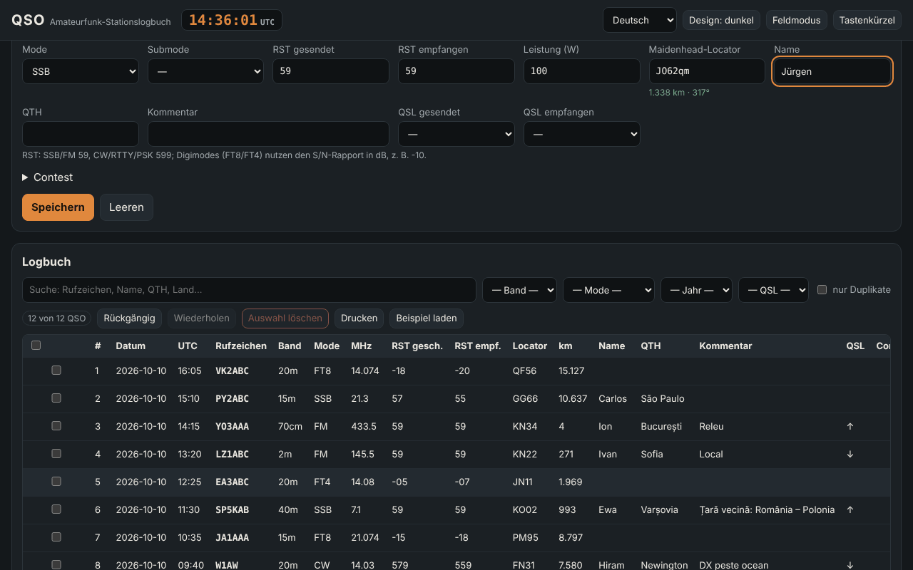

# QSO — Stationslogbuch für Funkamateure

[English](README.md) · [Română](README.ro.md) · [Français](README.fr.md) · [Italiano](README.it.md) · [Español](README.es.md) · [Português](README.pt.md) · **Deutsch** · [Magyar](README.hu.md)

**Version:** 1.0.7 · **Zuletzt aktualisiert:** 2026-10-26

Oberflächensprachen: **Română, English, Français, Italiano, Español, Português (PT), Deutsch, Magyar**

QSO ist ein inoffizielles Offline-Stationslogbuch für Funkamateure: Du erfasst Verbindungen (Datum/Uhrzeit in UTC, Rufzeichen, Band, Betriebsart, RST, Locator, QSL, Contest), berechnest Entfernungen und Azimute aus Maidenhead-Locatoren, erkennst Doppelverbindungen, importierst und exportierst ADIF 3.1 (außerdem ADX, CSV, JSON, einfaches Cabrillo 3.0) und siehst Statistiken sowie eine einfache Azimutalkarte. Es ergänzt **ETER** (Enzyklopädie des Amateurfunks) und **INDICATIV** (Trainer für die ANCOM-Prüfung) mit derselben Terminologie; es verändert sie nicht und hängt nicht von ihnen ab.

**Live:** https://chiuta.github.io/apps/QSO/

## Anwendung

1. **Station und Einstellungen** → fülle das Profil aus (Rufzeichen, eigener Locator, Leistung, Operator). Du kannst mehrere Profile anlegen.
2. **Logbuch** → fülle das Formular aus und drücke „Speichern“ (oder `Strg+Eingabe`). Die UTC-Uhr steht dauerhaft in der Kopfzeile; „Live-Uhr“ hält Datum/Uhrzeit aktuell, „Jetzt“ setzt sie zurück. Die Frequenz wählt das Band; die Betriebsart wählt den Standard-RST (59 / 599 / −10 für FT8, FT4).
3. Das Rufzeichen wird sofort formal geprüft (YO/YP/YQ/YR + Ziffer + 1–3 Buchstaben; allgemeine internationale Formate, portable Präfixe `OH0/YO3ABC`, Suffixe `/P`, `/M`, `/MM`); das Land (aus der internen Tabelle) und die Doppelverbindungswarnung erscheinen.
4. **Contest** → setze den Haken bei „Contest-Modus“, trage CONTEST_ID ein; die laufende Nummer (STX) wird automatisch ausgefüllt, und „Dupe“ wird pro Contest beurteilt (gleiche Station, gleiches Band und gleiche Betriebsartengruppe CW/PH/DG).
5. Die Tabelle: Suche ohne Diakritika, Filter (Band, Betriebsart, Jahr, QSL, Dupes), Sortierung, **Bearbeitung in der Zeile** (Schaltfläche „Bearbeiten“ oder Doppelklick), Details (einschließlich unbekannter ADIF-Felder), Löschen mit Bestätigung, Löschen der Auswahl, **Rückgängig/Wiederholen**, Drucken (Druck-CSS).
6. **Feldmodus** (`Alt+K`): großes Formular, bedienbar ohne Maus (`Alt+C` Rufzeichen, `Alt+B`/`Alt+M` Band/Betriebsart, `Strg+Eingabe` speichern, `Alt+Z`/`Alt+Y` rückgängig/wiederholen, `Alt+1…5` Abschnitte, `Alt+H` vollständige Liste), dauerhaft große UTC-Uhr und Schutz vor versehentlichem Schließen der Seite.
7. **Berechnungen**: Entfernung/Azimut zwischen zwei Locatoren, Locator ↔ Koordinaten, ungefähre Ortszeit sowie Sonnenauf-/-untergang, Präfix → Land.
8. **Statistiken**: nach Band, Betriebsart, Land, Jahr; QSO-pro-Stunde-Diagramm (UTC); Azimutalkarte, zentriert auf die eigene Station (lokal erzeugtes SVG).
9. **Import / Export** und `.fff.json`-**Sicherung**; „Alles löschen“.

## Was es NICHT tut, und seine Grenzen

- **Die Präfixtabelle** ist intern, unvollständig (~220 Entitäten) und **NICHT die vollständige DXCC-Liste** oder ein offizielles Werkzeug. CQ-/ITU-Zonen erscheinen nur dort, wo sie für die gesamte Entität sicher sind; wo sie innerhalb eines Landes variieren (USA, Kanada, Russland, Australien, China usw.), erscheint „unbekannt“. Seltene/eigenständige DXCC-Entitäten fehlen; ein nicht abgedecktes Rufzeichen erscheint als „unbekanntes Land“.
- Es prüft weder die Lizenz noch die tatsächliche Gültigkeit eines Rufzeichens noch die Gültigkeit einer Verbindung für Diplome oder Contests. Es verbindet sich nicht mit QRZ, LoTW, eQSL, Club Log usw. (es hat kein Netzwerk).
- **Sonnenauf-/-untergang**: einfache Formel (vereinfachte NOAA, Refraktion 0,833°), typischer Fehler von einigen Minuten; die Ortszeit ist die mittlere Sonnenzeit (Längengrad/15), nicht die offizielle Zeitzone, und enthält keine Sommerzeit.
- **Entfernungen**: Kugel R = 6371,0088 km, vom Mittelpunkt des Locator-Feldes; bei 4 Zeichen kann der Fehler zehn bis hundert km erreichen. Es ist keine Entfernung auf dem Ellipsoid.
- **Cabrillo** 3.0: nur Kopfzeile + QSO-Zeilen in generischer Form (Frequenz in kHz, Betriebsart CW/PH/FM/RY/DG, Austausch aus STX/SRX oder STX_STRING/SRX_STRING). Die Austauschformate unterscheiden sich von Contest zu Contest; prüfe die Ausschreibung und korrigiere von Hand. Es berechnet keine Punkte.
- **ADIF**: Längen werden in UTF-8-Bytes gelesen (mit Rückfall auf Zeichen, wenn die Datei inkonsistent ist, im Bericht vermerkt). Unbekannte Felder und `APP_*` bleiben erhalten und werden wieder exportiert; USERDEFs im Header werden nicht interpretiert, und nicht alle Aufzählungen werden validiert (z. B. DXCC, STATE). `*_INTL`-Felder werden nicht gesondert behandelt. ADX: grundlegender Import/Export.
- Keine Karte mit Kontinentumrissen (es werden keine externen Daten geladen): Die Karte zeigt die QSO-Punkte nach Richtung und Entfernung.
- Die Daten liegen in `localStorage`; das Löschen der Websitedaten im Browser löscht das Logbuch. Mache regelmäßig Sicherungen (`.fff.json` oder ADIF). Bei Zehntausenden QSOs kann die Browsergrenze (~5 MB) zum Problem werden.

## Datenschutz

Läuft lokal und sendet nichts über das Netzwerk (CSP mit `connect-src 'none'`; 0 externe Anfragen, in den Tests verifiziert). Logbuch, Profile und Einstellungen werden nur in deinem Browser unter den Schlüsseln `fff.qso.*` gespeichert.

## Unterstützte Formate

- Import: `.adi`/`.adif` (mit oder ohne Header, `<EOH>`, `<EOR>`, Tags in Kleinbuchstaben, Typkennzeichen `<FREQ:9:N>`), `.adx`, `.csv` (Kopfzeile mit ADIF-Feldnamen), `.json` (Liste von Datensätzen) und `.fff.json` (Sicherung, `{"format":"fff-bundle","schema":1,"app":"qso",…}`).
- Export: `.adi` (ADIF 3.1.4, Header mit `ADIF_VER`, `PROGRAMID`), `.adx`, `.csv` (UTF-8 mit BOM), `.json`, Cabrillo 3.0, `.fff.json`.
- Geschriebene ADIF-Felder: STATION_CALLSIGN, OPERATOR, CALL, QSO_DATE, TIME_ON, BAND, FREQ, MODE, SUBMODE, RST_SENT, RST_RCVD, TX_PWR, MY_GRIDSQUARE, GRIDSQUARE, NAME, QTH, COMMENT, QSL_SENT, QSL_RCVD, CONTEST_ID, STX, SRX, STX_STRING, SRX_STRING, dazu jedes weitere importierte Feld.
- Bänder (ADIF 3.1): 2190m, 630m, 560m, 160m … 10m, 8m, 6m, 5m, 4m, 2m, 1.25m, 70cm, 33cm, 23cm, 13cm, 9cm, 6cm, 3cm, mit den Grenzen aus der ADIF-Aufzählung.

## Technik

Eine einzige `index.html` (Inline-HTML + CSS + JS, ohne Bibliotheken, ohne externe Schriften), ~165 KB. CSP: `default-src 'none'; script-src 'sha256-…'; style-src 'unsafe-inline'; img-src data: blob:; …; connect-src 'none'; worker-src blob:` — `style-src 'unsafe-inline'` und `blob:` sind für die Inline-Stile und für das Herunterladen lokal erzeugter Dateien (Blob) nötig. Keine Inline-Handler, kein `eval`. Datensätze sind unveränderlich, was Rückgängig/Wiederholen billig macht (100 Schritte). Die Tabelle ist paginiert (100 Zeilen/Seite); die Suche nutzt einen Cache mit normalisiertem Text; Dupes werden nur innerhalb desselben Rufzeichens verglichen. Tests: `node tests/test.mjs` (Playwright, Netzwerk blockiert; axe-core wird aus einem lokalen Pfad der Entwicklungsumgebung gelesen): positive/negative Rufzeichen, Entfernungen gegen eine unabhängige Implementierung (Kosinussatz, separate Locator-Dekodierung), ADIF/ADX/CSV/JSON/`.fff.json`-Rundläufe mit Diakritika und Bytelängen, 3000 QSOs für die Performance, Feldmodus per Tastatur, 8 Sprachen, axe 0 Verstöße bei 360 px und 1280 px in beiden Designs.

## Drittanbieter

Kein Drittanbietercode.

## Übersetzungen

Die Oberfläche ist auf Rumänisch (Standard), Englisch, Französisch, Italienisch, Spanisch, Portugiesisch, Ungarisch und Deutsch verfügbar. Die Übersetzungen fr/it/es/pt/hu/de sind **maschinell erstellt und nicht von Muttersprachlern geprüft**; Fachbegriffe (ADIF, Cabrillo, QSO, RST, Maidenhead, DXCC) behalten ihren Namen. Die Ländernamen in der Präfixtabelle werden auf Rumänisch angezeigt.

## Lizenz

MIT — siehe Datei `LICENSE` im Stammverzeichnis des Repositorys.

## Verlauf

- **1.0.0 — 2026-10-14:** erste Version.
- **1.0.1 — 2026-10-19:** Schaltfläche „In TerRa ansehen“ im Dialog QSO-Details (Locator der Gegenstation + QSO-Zeit, ohne Netzwerkanfragen).
- **1.0.2 — 2026-10-22:** Meldung in der Fußzeile und Hinweis „Bereit für die Offline-Nutzung“, sobald der Service Worker die App zwischengespeichert hat (erster Aufruf); der CSV-Export entschärft Zellen, die mit = + - @ (und Tab/CR) beginnen, gegen Formelinjektion, und der CSV-Import entfernt das Apostroph wieder; Text von mindestens 12 px; Touch-Ziele von mindestens 24 px; das technische Label listet alle 8 Sprachen.
- **1.0.3 — 2026-10-22:** fff-kit 1.1.2: PBKDF2 mit 600.000 Iterationen, Schutz vor Clickjacking.
- **1.0.4 — 2026-10-22:** fff-kit 1.1.4: Touch-Ziele und Mindestschriftgröße in der gemeinsamen Oberfläche.
- **1.0.6 — 2026-10-23:** Hinweistext bei deaktiviertem JavaScript (noscript).
