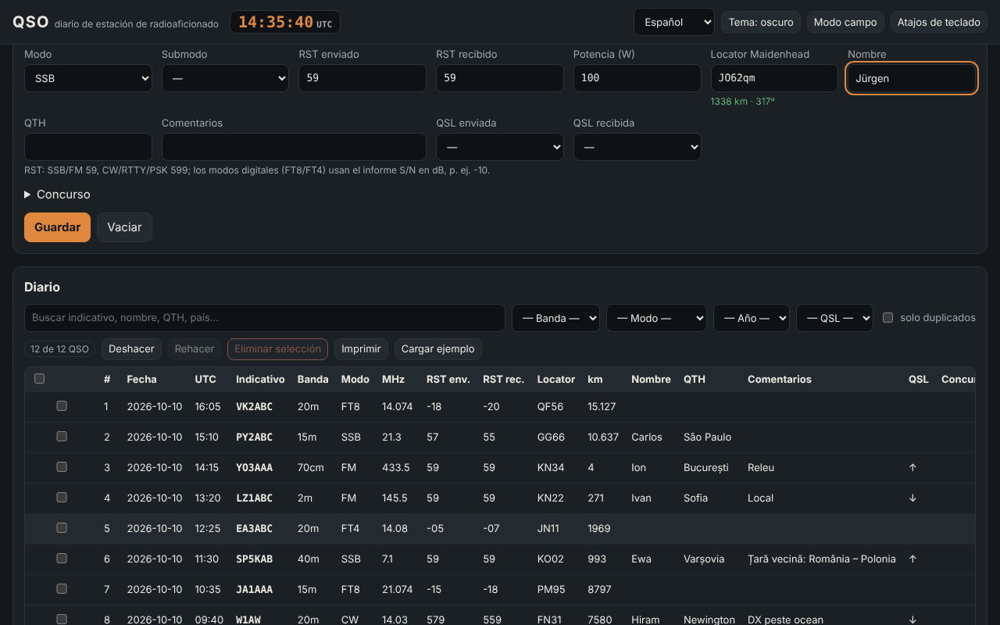

# QSO — diario de estación de radioaficionado

[English](README.md) · [Română](README.ro.md) · [Français](README.fr.md) · [Italiano](README.it.md) · **Español** · [Português](README.pt.md) · [Deutsch](README.de.md) · [Magyar](README.hu.md)

**Versión:** 1.0.6 · **Última actualización:** 2026-10-23

Idiomas de la interfaz: **Română, English, Français, Italiano, Español, Português (PT), Deutsch, Magyar**

QSO es un diario de estación sin conexión y no oficial para radioaficionados: registras los contactos (fecha/hora UTC, indicativo, banda, modo, RST, locator, QSL, concurso), calculas distancias y acimutes a partir de locators Maidenhead, detectas duplicados, importas y exportas ADIF 3.1 (además de ADX, CSV, JSON, Cabrillo 3.0 básico) y ves estadísticas y un mapa acimutal sencillo. Complementa a **ETER** (enciclopedia de radioafición) e **INDICATIV** (entrenador para el examen de ANCOM), con la misma terminología; no los modifica ni depende de ellos.

**En línea:** https://chiuta.github.io/apps/QSO/

## Cómo se usa

1. **Estación y ajustes** → rellena el perfil (indicativo, locator propio, potencia, operador). Puedes tener varios perfiles.
2. **Diario** → rellena el formulario y pulsa «Guardar» (o `Ctrl+Intro`). El reloj UTC está siempre en la cabecera; «Reloj en vivo» mantiene la fecha/hora al día, «Ahora» las restablece. La frecuencia elige la banda; el modo elige el RST predeterminado (59 / 599 / −10 para FT8, FT4).
3. El indicativo se valida formalmente al instante (YO/YP/YQ/YR + cifra + 1–3 letras; formatos internacionales generales, prefijos portátiles `OH0/YO3ABC`, sufijos `/P`, `/M`, `/MM`); aparecen el país (de la tabla interna) y el aviso de duplicado.
4. **Concurso** → marca «Modo concurso», escribe CONTEST_ID; el número de orden (STX) se rellena automáticamente y el «dupe» se juzga por concurso (misma estación, banda y grupo de modos CW/PH/DG).
5. La tabla: búsqueda sin diacríticos, filtros (banda, modo, año, QSL, duplicados), ordenación, **edición en la fila** (botón «Editar» o doble clic), detalles (incluidos los campos ADIF desconocidos), eliminación con confirmación, eliminación de la selección, **deshacer/rehacer**, impresión (CSS de impresión).
6. **Modo campo** (`Alt+K`): formulario grande, funciona sin ratón (`Alt+C` indicativo, `Alt+B`/`Alt+M` banda/modo, `Ctrl+Intro` guardar, `Alt+Z`/`Alt+Y` deshacer/rehacer, `Alt+1…5` secciones, `Alt+H` lista completa), reloj UTC grande permanente y protección contra el cierre accidental de la página.
7. **Cálculos**: distancia/acimut entre dos locators, locator ↔ coordenadas, hora local y salida/puesta del sol aproximadas, prefijo → país.
8. **Estadísticas**: por banda, modo, país, año; gráfico de QSO por hora (UTC); mapa acimutal centrado en la propia estación (SVG generado localmente).
9. **Importar / Exportar** y **copia de seguridad** `.fff.json`; «Borrar todo».

## Lo que NO hace y sus límites

- **La tabla de prefijos** es interna, parcial (~220 entidades) y **NO es la lista DXCC completa** ni una herramienta oficial. Las zonas CQ/ITU aparecen solo donde son seguras para toda la entidad; donde varían dentro de un país (EE. UU., Canadá, Rusia, Australia, China, etc.) aparece «desconocido». Faltan las entidades DXCC raras/distintas; un indicativo no cubierto aparece como «país desconocido».
- No comprueba la licencia, la validez real de un indicativo ni la validez de un contacto para diplomas o concursos. No se conecta a QRZ, LoTW, eQSL, Club Log, etc. (no tiene red).
- **Salida/puesta del sol**: fórmula sencilla (NOAA simplificada, refracción 0,833°), error típico de unos minutos; la hora local es la hora solar media (longitud/15), no el huso horario oficial, y no incluye el horario de verano.
- **Distancias**: esfera R = 6371,0088 km, desde el centro del cuadrado del locator; con 4 caracteres el error puede alcanzar decenas o cientos de km. No es una distancia sobre el elipsoide.
- **Cabrillo** 3.0: solo cabecera + líneas QSO en forma genérica (frecuencia en kHz, modo CW/PH/FM/RY/DG, intercambio de STX/SRX o STX_STRING/SRX_STRING). Los formatos de intercambio difieren de un concurso a otro; consulta el reglamento y corrige a mano. No calcula puntuaciones.
- **ADIF**: las longitudes se leen en bytes UTF-8 (con recurso a caracteres si el archivo es incoherente, señalado en el informe). Los campos desconocidos y `APP_*` se conservan y se reexportan; no se interpretan los USERDEF de la cabecera y no se validan todas las enumeraciones (p. ej., DXCC, STATE). Los campos `*_INTL` no reciben un tratamiento especial. ADX: importación/exportación básica.
- Sin mapa con contornos de continentes (no se cargan datos externos): el mapa muestra los puntos QSO por dirección y distancia.
- Los datos están en `localStorage`; borrar los datos del sitio en el navegador elimina el diario. Haz copias de seguridad periódicas (`.fff.json` o ADIF). Para decenas de miles de QSO el límite del navegador (~5 MB) puede convertirse en un problema.

## Privacidad

Se ejecuta localmente y no envía nada por la red (CSP con `connect-src 'none'`; 0 peticiones externas, verificado en las pruebas). El diario, los perfiles y los ajustes se guardan solo en tu navegador, bajo las claves `fff.qso.*`.

## Formatos admitidos

- Importación: `.adi`/`.adif` (con o sin cabecera, `<EOH>`, `<EOR>`, etiquetas en minúsculas, indicador de tipo `<FREQ:9:N>`), `.adx`, `.csv` (cabecera con nombres de campos ADIF), `.json` (lista de registros) y `.fff.json` (copia de seguridad, `{"format":"fff-bundle","schema":1,"app":"qso",…}`).
- Exportación: `.adi` (ADIF 3.1.4, cabecera con `ADIF_VER`, `PROGRAMID`), `.adx`, `.csv` (UTF-8 con BOM), `.json`, Cabrillo 3.0, `.fff.json`.
- Campos ADIF escritos: STATION_CALLSIGN, OPERATOR, CALL, QSO_DATE, TIME_ON, BAND, FREQ, MODE, SUBMODE, RST_SENT, RST_RCVD, TX_PWR, MY_GRIDSQUARE, GRIDSQUARE, NAME, QTH, COMMENT, QSL_SENT, QSL_RCVD, CONTEST_ID, STX, SRX, STX_STRING, SRX_STRING, además de cualquier otro campo importado.
- Bandas (ADIF 3.1): 2190m, 630m, 560m, 160m … 10m, 8m, 6m, 5m, 4m, 2m, 1.25m, 70cm, 33cm, 23cm, 13cm, 9cm, 6cm, 3cm, con los límites de la enumeración ADIF.

## Técnica

Un único `index.html` (HTML + CSS + JS en línea, sin bibliotecas, sin fuentes externas), ~310 KB. CSP: `default-src 'none'; script-src 'sha256-…'; style-src 'unsafe-inline'; img-src data: blob:; …; connect-src 'none'; worker-src blob:` — `style-src 'unsafe-inline'` y `blob:` son necesarios para los estilos en línea y para la descarga de archivos generados localmente (Blob). Sin manejadores en línea, sin `eval`. Los registros son inmutables, lo que abarata deshacer/rehacer (100 pasos). La tabla está paginada (100 filas/página); la búsqueda usa una caché de texto normalizado; los duplicados se comparan solo dentro del mismo indicativo. Pruebas: `node tests/test.mjs` (Playwright, red bloqueada; axe-core se lee desde una ruta local del entorno de desarrollo): indicativos positivos/negativos, distancias frente a una implementación independiente (ley de los cosenos, decodificación separada de los locators), ida y vuelta ADIF/ADX/CSV/JSON/`.fff.json` con diacríticos y longitudes en bytes, 3000 QSO para rendimiento, modo campo desde el teclado, 8 idiomas, axe 0 violaciones a 360 px y 1280 px en ambos temas.

## Terceros

Ningún código de terceros.

## Traducciones

La interfaz está disponible en rumano (predeterminado), inglés, francés, italiano, español, portugués, húngaro y alemán. Las traducciones fr/it/es/pt/hu/de son **automáticas y no verificadas por hablantes nativos**; los términos técnicos (ADIF, Cabrillo, QSO, RST, Maidenhead, DXCC) conservan su nombre. Los nombres de países de la tabla de prefijos se muestran en rumano.

## Licencia

MIT — consulta el archivo `LICENSE` en la raíz del repositorio.

## Historial

- **1.0.0 — 2026-10-14:** primera versión.
- **1.0.1 — 2026-10-19:** botón «Ver en TerRa» en el diálogo Detalles del QSO (locator del corresponsal + hora del QSO, sin peticiones de red).
- **1.0.2 — 2026-10-22:** mensaje en el pie y aviso «Listo para usar sin conexión» cuando el service worker ha guardado la aplicación en caché (primera carga); la exportación CSV neutraliza las celdas que empiezan por = + - @ (y tabulación/CR) contra la inyección de fórmulas, y la importación CSV vuelve a quitar el apóstrofo; texto de al menos 12 px; áreas táctiles de al menos 24 px; la etiqueta técnica lista los 8 idiomas.
- **1.0.3 — 2026-10-22:** fff-kit 1.1.2: PBKDF2 con 600.000 iteraciones, protección anti-clickjacking.
- **1.0.4 — 2026-10-22:** fff-kit 1.1.4: áreas táctiles y tamaño mínimo del texto en la interfaz común.
- **1.0.6 — 2026-10-23:** auditoría adversaria: la importación ADIF con longitudes en caracteres (diacríticos) ya no es cuadrática (decenas de segundos para unos miles de QSO); un `_id` hostil de una copia/localStorage ya no puede inyectar HTML y se normaliza; los datos guardados ilegibles se conservan en `fff.qso.data.bak` (antes se sobrescribían al cerrar la página) y se avisa al usuario; editar un QSO antiguo ya no sustituye el indicativo/operador/locator de la estación por los del perfil actual; la importación JSON acepta valores numéricos; cargar cientos de miles de registros ya no desborda la pila; el ADX sigue siendo válido aunque haya nombres de campo no válidos o caracteres de control; la cabecera ADIF/ADX/Cabrillo y el `.fff.json` llevan la versión real; objetivos táctiles de 44 px en pantallas táctiles.
- **1.0.6 — 2026-10-23:** mensaje alternativo cuando JavaScript está desactivado (noscript).
