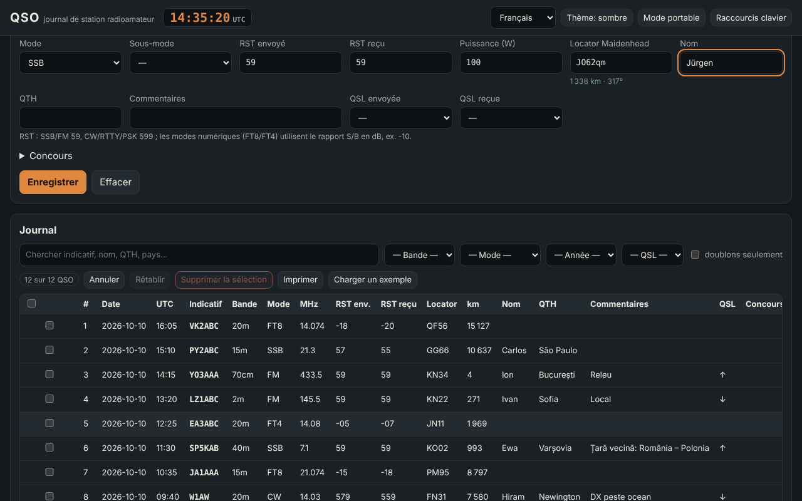

# QSO — journal de station de radioamateur

[English](README.md) · [Română](README.ro.md) · **Français** · [Italiano](README.it.md) · [Español](README.es.md) · [Português](README.pt.md) · [Deutsch](README.de.md) · [Magyar](README.hu.md)

**Version :** 1.0.6 · **Dernière mise à jour :** 2026-10-23

Langues de l'interface : **Română, English, Français, Italiano, Español, Português (PT), Deutsch, Magyar**

QSO est un journal de station hors ligne et non officiel pour les radioamateurs : vous enregistrez les liaisons (date/heure UTC, indicatif, bande, mode, RST, locator, QSL, concours), calculez des distances et des azimuts à partir de locators Maidenhead, détectez les doublons, importez et exportez de l'ADIF 3.1 (ainsi que ADX, CSV, JSON, Cabrillo 3.0 de base), et consultez des statistiques et une carte azimutale simple. Il complète **ETER** (encyclopédie du radioamateurisme) et **INDICATIV** (entraîneur pour l'examen de l'ANCOM), avec la même terminologie ; il ne les modifie pas et n'en dépend pas.

**En ligne :** https://chiuta.github.io/apps/QSO/

## Mode d'emploi

1. **Station et réglages** → renseignez le profil (indicatif, locator personnel, puissance, opérateur). Vous pouvez avoir plusieurs profils.
2. **Journal** → remplissez le formulaire et appuyez sur « Enregistrer » (ou `Ctrl+Entrée`). L'horloge UTC est en permanence dans l'en-tête ; « Horloge en direct » maintient la date/l'heure à jour, « Maintenant » les réinitialise. La fréquence choisit la bande ; le mode choisit le RST par défaut (59 / 599 / −10 pour FT8, FT4).
3. L'indicatif est validé formellement sur-le-champ (YO/YP/YQ/YR + chiffre + 1 à 3 lettres ; formats internationaux généraux, préfixes portables `OH0/YO3ABC`, suffixes `/P`, `/M`, `/MM`) ; le pays (d'après la table interne) et l'avertissement de doublon apparaissent.
4. **Concours** → cochez « Mode concours », saisissez CONTEST_ID ; le numéro d'ordre (STX) se remplit automatiquement et le « doublon » est jugé par concours (même station, même bande et même groupe de modes CW/PH/DG).
5. Le tableau : recherche sans diacritiques, filtres (bande, mode, année, QSL, doublons), tri, **édition en ligne** (bouton « Modifier » ou double-clic), détails (y compris les champs ADIF inconnus), suppression avec confirmation, suppression de la sélection, **annuler/rétablir**, impression (CSS d'impression).
6. **Mode terrain** (`Alt+K`) : grand formulaire, utilisable sans souris (`Alt+C` indicatif, `Alt+B`/`Alt+M` bande/mode, `Ctrl+Entrée` enregistrer, `Alt+Z`/`Alt+Y` annuler/rétablir, `Alt+1…5` sections, `Alt+H` liste complète), grande horloge UTC permanente et protection contre la fermeture accidentelle de la page.
7. **Calculs** : distance/azimut entre deux locators, locator ↔ coordonnées, heure locale et lever/coucher du soleil approximatifs, préfixe → pays.
8. **Statistiques** : par bande, mode, pays, année ; graphique des QSO par heure (UTC) ; carte azimutale centrée sur votre propre station (SVG généré localement).
9. **Import / Export** et **sauvegarde** `.fff.json` ; « Tout supprimer ».

## Ce qu'il ne fait PAS et ses limites

- **La table des préfixes** est interne, partielle (~220 entités) et **n'est PAS la liste DXCC complète** ni un outil officiel. Les zones CQ/ITU n'apparaissent que là où elles sont sûres pour toute l'entité ; là où elles varient à l'intérieur d'un pays (États-Unis, Canada, Russie, Australie, Chine, etc.), « inconnu » s'affiche. Les entités DXCC rares/distinctes manquent ; un indicatif non couvert apparaît comme « pays inconnu ».
- Il ne vérifie ni la licence, ni la validité réelle d'un indicatif, ni la validité d'une liaison pour des diplômes ou des concours. Il ne se connecte pas à QRZ, LoTW, eQSL, Club Log, etc. (il n'a pas de réseau).
- **Lever/coucher du soleil** : formule simple (NOAA simplifiée, réfraction 0,833°), erreur typique de quelques minutes ; l'heure locale est l'heure solaire moyenne (longitude/15), pas le fuseau horaire officiel, et n'inclut pas l'heure d'été.
- **Distances** : sphère R = 6371,0088 km, depuis le centre du carré du locator ; avec 4 caractères, l'erreur peut atteindre des dizaines à des centaines de km. Ce n'est pas une distance sur l'ellipsoïde.
- **Cabrillo** 3.0 : seulement l'en-tête + des lignes QSO sous forme générique (fréquence en kHz, mode CW/PH/FM/RY/DG, échange issu de STX/SRX ou STX_STRING/SRX_STRING). Les formats d'échange diffèrent d'un concours à l'autre ; vérifiez le règlement et corrigez à la main. Il ne calcule pas les points.
- **ADIF** : les longueurs sont lues en octets UTF-8 (avec repli sur les caractères si le fichier est incohérent, signalé dans le rapport). Les champs inconnus et `APP_*` sont conservés et réexportés ; les USERDEF de l'en-tête ne sont pas interprétés et toutes les énumérations ne sont pas validées (p. ex. DXCC, STATE). Les champs `*_INTL` ne sont pas traités spécialement. ADX : import/export de base.
- Pas de carte avec contours des continents (aucune donnée externe n'est chargée) : la carte montre les points QSO par direction et par distance.
- Les données résident dans `localStorage` ; effacer les données du site dans le navigateur supprime le journal. Faites des sauvegardes régulières (`.fff.json` ou ADIF). Pour des dizaines de milliers de QSO, la limite du navigateur (~5 Mo) peut devenir un problème.

## Confidentialité

Il s'exécute localement et n'envoie rien sur le réseau (CSP avec `connect-src 'none'` ; 0 requête externe, vérifié dans les tests). Le journal, les profils et les réglages sont conservés uniquement dans votre navigateur, sous les clés `fff.qso.*`.

## Formats pris en charge

- Import : `.adi`/`.adif` (avec ou sans en-tête, `<EOH>`, `<EOR>`, balises en minuscules, indicateur de type `<FREQ:9:N>`), `.adx`, `.csv` (en-tête avec noms de champs ADIF), `.json` (liste d'enregistrements) et `.fff.json` (sauvegarde, `{"format":"fff-bundle","schema":1,"app":"qso",…}`).
- Export : `.adi` (ADIF 3.1.4, en-tête avec `ADIF_VER`, `PROGRAMID`), `.adx`, `.csv` (UTF-8 avec BOM), `.json`, Cabrillo 3.0, `.fff.json`.
- Champs ADIF écrits : STATION_CALLSIGN, OPERATOR, CALL, QSO_DATE, TIME_ON, BAND, FREQ, MODE, SUBMODE, RST_SENT, RST_RCVD, TX_PWR, MY_GRIDSQUARE, GRIDSQUARE, NAME, QTH, COMMENT, QSL_SENT, QSL_RCVD, CONTEST_ID, STX, SRX, STX_STRING, SRX_STRING, ainsi que tout autre champ importé.
- Bandes (ADIF 3.1) : 2190m, 630m, 560m, 160m … 10m, 8m, 6m, 5m, 4m, 2m, 1.25m, 70cm, 33cm, 23cm, 13cm, 9cm, 6cm, 3cm, avec les limites de l'énumération ADIF.

## Technique

Un seul `index.html` (HTML + CSS + JS en ligne, sans bibliothèques, sans polices externes), ~310 Ko. CSP : `default-src 'none'; script-src 'sha256-…'; style-src 'unsafe-inline'; img-src data: blob:; …; connect-src 'none'; worker-src blob:` — `style-src 'unsafe-inline'` et `blob:` sont nécessaires pour les styles en ligne et pour le téléchargement de fichiers générés localement (Blob). Pas de gestionnaires en ligne, pas d'`eval`. Les enregistrements sont immuables, ce qui rend l'annulation/le rétablissement peu coûteux (100 pas). Le tableau est paginé (100 lignes/page) ; la recherche utilise un cache de texte normalisé ; les doublons ne sont comparés qu'au sein d'un même indicatif. Tests : `node tests/test.mjs` (Playwright, réseau bloqué ; axe-core est lu depuis un chemin local de l'environnement de développement) : indicatifs positifs/négatifs, distances face à une implémentation indépendante (loi des cosinus, décodage séparé des locators), allers-retours ADIF/ADX/CSV/JSON/`.fff.json` avec diacritiques et longueurs en octets, 3000 QSO pour la performance, mode terrain au clavier, 8 langues, axe 0 violation à 360 px et 1280 px dans les deux thèmes.

## Tiers

Aucun code tiers.

## Traductions

L'interface est disponible en roumain (par défaut), anglais, français, italien, espagnol, portugais, hongrois et allemand. Les traductions fr/it/es/pt/hu/de sont **automatiques et non vérifiées par des locuteurs natifs** ; les termes techniques (ADIF, Cabrillo, QSO, RST, Maidenhead, DXCC) conservent leur nom. Les noms de pays de la table des préfixes sont affichés en roumain.

## Licence

MIT — voir le fichier `LICENSE` à la racine du dépôt.

## Historique

- **1.0.0 — 2026-10-14 :** première version.
- **1.0.1 — 2026-10-19 :** bouton « Voir dans TerRa » dans la boîte de dialogue Détails du QSO (locator du correspondant + heure du QSO, sans requêtes réseau).
- **1.0.2 — 2026-10-22:** message dans le pied de page et notification « Prêt pour l’usage hors ligne » une fois l’application mise en cache par le service worker (premier chargement) ; l’export CSV neutralise les cellules commençant par = + - @ (et tabulation/CR) contre l’injection de formules, et l’import CSV retire de nouveau l’apostrophe ; texte d’au moins 12 px ; cibles tactiles d’au moins 24 px ; l’étiquette technique liste les 8 langues.
- **1.0.3 — 2026-10-22:** fff-kit 1.1.2 : PBKDF2 à 600 000 itérations, protection anti-clickjacking.
- **1.0.4 — 2026-10-22:** fff-kit 1.1.4 : cibles tactiles et taille minimale du texte dans l’interface commune.
- **1.0.6 — 2026-10-23 :** audit adverse : l’import ADIF avec longueurs en caractères (diacritiques) n’est plus quadratique (des dizaines de secondes pour quelques milliers de QSO) ; un `_id` hostile venant d’une sauvegarde/du localStorage ne peut plus injecter de HTML et est normalisé ; les données illisibles sont conservées dans `fff.qso.data.bak` (elles étaient écrasées à la fermeture de la page) et l’utilisateur est prévenu ; modifier un ancien QSO ne remplace plus l’indicatif/opérateur/locator de la station par ceux du profil courant ; l’import JSON accepte les valeurs numériques ; charger des centaines de milliers d’enregistrements ne fait plus déborder la pile ; l’ADX reste valide même avec des noms de champs invalides ou des caractères de contrôle ; l’en-tête ADIF/ADX/Cabrillo et le `.fff.json` portent la vraie version ; cibles tactiles de 44 px sur écran tactile.
