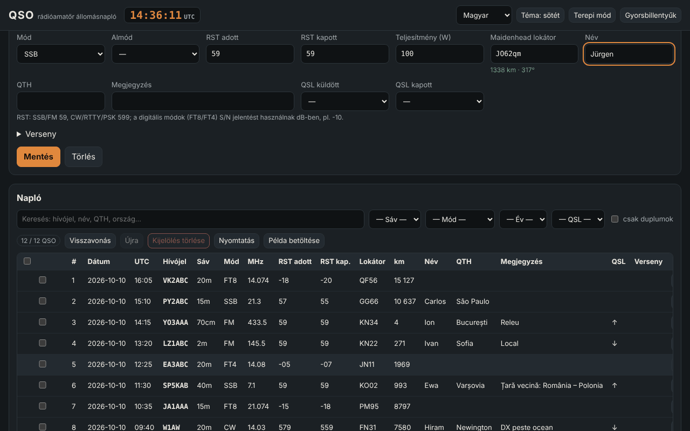

# QSO — rádióamatőr állomásnapló

[English](README.md) · [Română](README.ro.md) · [Français](README.fr.md) · [Italiano](README.it.md) · [Español](README.es.md) · [Português](README.pt.md) · [Deutsch](README.de.md) · **Magyar**

**Verzió:** 1.0.7 · **Utolsó frissítés:** 2026-10-26

A felület nyelvei: **Română, English, Français, Italiano, Español, Português (PT), Deutsch, Magyar**

A QSO egy nem hivatalos, offline állomásnapló rádióamatőröknek: rögzíted az összeköttetéseket (UTC dátum/idő, hívójel, sáv, üzemmód, RST, lokátor, QSL, verseny), Maidenhead-lokátorokból távolságot és azimutot számolsz, felismered a duplikátumokat, ADIF 3.1-et (valamint ADX-et, CSV-t, JSON-t, alap Cabrillo 3.0-t) importálsz és exportálsz, és statisztikákat meg egy egyszerű azimutális térképet látsz. Kiegészíti az **ETER**-t (rádióamatőr-enciklopédia) és az **INDICATIV**-ot (felkészítő az ANCOM-vizsgára) ugyanazzal a terminológiával; nem módosítja őket, és nem függ tőlük.

**Élő verzió:** https://chiuta.github.io/apps/QSO/

## Használat

1. **Állomás és beállítások** → töltsd ki a profilt (hívójel, saját lokátor, teljesítmény, operátor). Több profilod is lehet.
2. **Napló** → töltsd ki az űrlapot, és nyomd meg a „Mentés” gombot (vagy `Ctrl+Enter`). Az UTC-óra folyamatosan a fejlécben van; az „Élő óra” naprakészen tartja a dátumot/időt, a „Most” visszaállítja őket. A frekvencia választja ki a sávot; az üzemmód az alapértelmezett RST-t (59 / 599 / −10 FT8, FT4 esetén).
3. A hívójelet azonnal formailag ellenőrzi (YO/YP/YQ/YR + számjegy + 1–3 betű; általános nemzetközi formátumok, hordozható előtagok `OH0/YO3ABC`, utótagok `/P`, `/M`, `/MM`); megjelenik az ország (a belső táblázatból) és a duplikátum-figyelmeztetés.
4. **Verseny** → jelöld be a „Versenymód” négyzetet, írd be a CONTEST_ID-t; a sorszám (STX) automatikusan kitöltődik, a „dupe” elbírálása versenyenként történik (azonos állomás, sáv és CW/PH/DG üzemmódcsoport).
5. A táblázat: ékezetek nélküli keresés, szűrők (sáv, üzemmód, év, QSL, duplikátumok), rendezés, **soron belüli szerkesztés** („Szerkesztés” gomb vagy dupla kattintás), részletek (az ismeretlen ADIF-mezőkkel együtt), törlés megerősítéssel, a kijelölés törlése, **visszavonás/újra**, nyomtatás (nyomtatási CSS).
6. **Terepi mód** (`Alt+K`): nagy űrlap, egér nélkül is használható (`Alt+C` hívójel, `Alt+B`/`Alt+M` sáv/üzemmód, `Ctrl+Enter` mentés, `Alt+Z`/`Alt+Y` visszavonás/újra, `Alt+1…5` szakaszok, `Alt+H` teljes lista), állandó nagy UTC-óra és védelem az oldal véletlen bezárása ellen.
7. **Számítások**: távolság/azimut két lokátor között, lokátor ↔ koordináták, hozzávetőleges helyi idő és napkelte/napnyugta, előtag → ország.
8. **Statisztikák**: sáv, üzemmód, ország, év szerint; QSO-k óránként diagram (UTC); a saját állomásra középített azimutális térkép (helyben generált SVG).
9. **Import / Export** és `.fff.json` **biztonsági mentés**; „Összes törlése”.

## Mit NEM tud, és korlátai

- **Az előtagtáblázat** belső, részleges (~220 entitás), és **NEM a teljes DXCC-lista**, nem hivatalos eszköz. A CQ/ITU-zónák csak ott jelennek meg, ahol az egész entitásra biztosak; ahol egy országon belül változnak (USA, Kanada, Oroszország, Ausztrália, Kína stb.), „ismeretlen” látható. A ritka/különálló DXCC-entitások hiányoznak; egy le nem fedett hívójel „ismeretlen országként” jelenik meg.
- Nem ellenőrzi az engedélyt, a hívójel valós érvényességét, sem azt, hogy egy összeköttetés érvényes-e oklevelekhez vagy versenyekhez. Nem csatlakozik a QRZ-hez, LoTW-hez, eQSL-hez, Club Loghoz stb. (nincs hálózata).
- **Napkelte/napnyugta**: egyszerű képlet (egyszerűsített NOAA, refrakció 0,833°), jellemzően néhány perces hibával; a helyi idő a közép napidő (hosszúság/15), nem a hivatalos időzóna, és nem tartalmazza a nyári időszámítást.
- **Távolságok**: gömb, R = 6371,0088 km, a lokátornégyzet középpontjától; 4 karakterrel a hiba elérheti a több tíz–száz km-t. Nem ellipszoidon mért távolság.
- **Cabrillo** 3.0: csak a fejléc + QSO-sorok általános formában (frekvencia kHz-ben, üzemmód CW/PH/FM/RY/DG, csere az STX/SRX vagy STX_STRING/SRX_STRING mezőkből). A csereformátumok versenyenként eltérnek; ellenőrizd a versenykiírást, és javítsd kézzel. Nem számol pontszámot.
- **ADIF**: a hosszakat UTF-8 bájtokban olvassa (ha a fájl következetlen, karakterekre tér vissza, és ezt jelzi a jelentésben). Az ismeretlen mezők és az `APP_*` megmaradnak és újra exportálódnak; a fejléc USERDEF-jeit nem értelmezi, és nem minden felsorolást érvényesít (pl. DXCC, STATE). A `*_INTL` mezőket nem kezeli külön. ADX: alap import/export.
- Nincs kontinenskontúrokat tartalmazó térkép (külső adatot nem tölt be): a térkép a QSO-pontokat irány és távolság szerint mutatja.
- Az adatok a `localStorage`-ban vannak; a webhelyadatok törlése a böngészőben törli a naplót. Készíts rendszeres biztonsági mentést (`.fff.json` vagy ADIF). Több tízezer QSO esetén a böngésző korlátja (~5 MB) gondot okozhat.

## Adatvédelem

Helyben fut, és semmit nem küld a hálózaton (CSP `connect-src 'none'`-nal; 0 külső kérés, a tesztekben ellenőrizve). A napló, a profilok és a beállítások csak a böngésződben maradnak, az `fff.qso.*` kulcsok alatt.

## Támogatott formátumok

- Import: `.adi`/`.adif` (fejléccel vagy anélkül, `<EOH>`, `<EOR>`, kisbetűs címkék, típusjelző `<FREQ:9:N>`), `.adx`, `.csv` (ADIF-mezőneveket tartalmazó fejléc), `.json` (rekordok listája) és `.fff.json` (biztonsági mentés, `{"format":"fff-bundle","schema":1,"app":"qso",…}`).
- Export: `.adi` (ADIF 3.1.4, `ADIF_VER`, `PROGRAMID` fejléccel), `.adx`, `.csv` (UTF-8 BOM-mal), `.json`, Cabrillo 3.0, `.fff.json`.
- Írt ADIF-mezők: STATION_CALLSIGN, OPERATOR, CALL, QSO_DATE, TIME_ON, BAND, FREQ, MODE, SUBMODE, RST_SENT, RST_RCVD, TX_PWR, MY_GRIDSQUARE, GRIDSQUARE, NAME, QTH, COMMENT, QSL_SENT, QSL_RCVD, CONTEST_ID, STX, SRX, STX_STRING, SRX_STRING, valamint bármely más importált mező.
- Sávok (ADIF 3.1): 2190m, 630m, 560m, 160m … 10m, 8m, 6m, 5m, 4m, 2m, 1.25m, 70cm, 33cm, 23cm, 13cm, 9cm, 6cm, 3cm, az ADIF-felsorolás határaival.

## Műszaki adatok

Egyetlen `index.html` (beágyazott HTML + CSS + JS, könyvtárak és külső betűtípusok nélkül), ~165 KB. CSP: `default-src 'none'; script-src 'sha256-…'; style-src 'unsafe-inline'; img-src data: blob:; …; connect-src 'none'; worker-src blob:` — a `style-src 'unsafe-inline'` és a `blob:` a beágyazott stílusokhoz és a helyben generált fájlok (Blob) letöltéséhez szükséges. Nincsenek beágyazott eseménykezelők, nincs `eval`. A rekordok megváltoztathatatlanok, ami olcsóvá teszi a visszavonást/újrát (100 lépés). A táblázat lapozott (100 sor/oldal); a keresés normalizált szöveg gyorsítótárat használ; a duplikátumokat csak ugyanazon hívójelen belül hasonlítja össze. Tesztek: `node tests/test.mjs` (Playwright, letiltott hálózat; az axe-core a fejlesztői környezet egy helyi útvonaláról töltődik be): pozitív/negatív hívójelek, távolságok egy független megvalósítással összevetve (koszinusztétel, külön lokátordekódolás), ADIF/ADX/CSV/JSON/`.fff.json` körút ékezetekkel és bájthosszakkal, 3000 QSO a teljesítményhez, terepi mód billentyűzetről, 8 nyelv, axe 0 szabálysértés 360 px és 1280 px mellett mindkét témában.

## Harmadik felek

Nincs harmadik féltől származó kód.

## Fordítások

A felület elérhető románul (alapértelmezett), angolul, franciául, olaszul, spanyolul, portugálul, magyarul és németül. Az fr/it/es/pt/hu/de fordítások **gépiek, anyanyelvi beszélők nem ellenőrizték őket**; a szakkifejezések (ADIF, Cabrillo, QSO, RST, Maidenhead, DXCC) megtartják nevüket. Az előtagtáblázat országnevei románul jelennek meg.

## Licenc

MIT — lásd a tároló gyökerében lévő `LICENSE` fájlt.

## Előzmények

- **1.0.0 — 2026-10-14:** első verzió.
- **1.0.1 — 2026-10-19:** „Megnézem a TerRában” gomb a QSO-részletek párbeszédablakban (a levelező fél lokátora + a QSO ideje, hálózati kérések nélkül).
- **1.0.2 — 2026-10-22:** lábléc-üzenet és „Offline használatra kész” értesítés, miután a service worker gyorsítótárba tette az alkalmazást (első betöltés); a CSV-export semlegesíti a = + - @ (és tab/CR) karakterrel kezdődő cellákat a táblázatkezelő-képletek befecskendezése ellen, a CSV-import pedig ismét eltávolítja az aposztrófot; legalább 12 px-es szöveg; legalább 24 px-es érintési célok; a műszaki címke mind a 8 nyelvet felsorolja.
- **1.0.3 — 2026-10-22:** fff-kit 1.1.2: PBKDF2 600 000 iterációval, clickjacking elleni védelem.
- **1.0.4 — 2026-10-22:** fff-kit 1.1.4: érintési célok és minimális szövegméret a közös felületen.
- **1.0.6 — 2026-10-23:** tartalék üzenet kikapcsolt JavaScript esetén (noscript).
