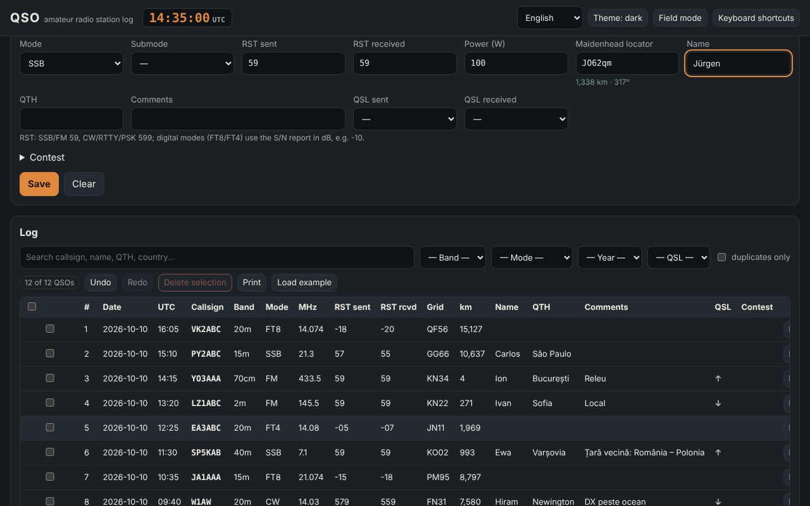

# QSO — amateur radio station log

**English** · [Română](README.ro.md) · [Français](README.fr.md) · [Italiano](README.it.md) · [Español](README.es.md) · [Português](README.pt.md) · [Deutsch](README.de.md) · [Magyar](README.hu.md)

**Version:** 1.0.6 · **Last updated:** 2026-10-23

Interface languages: **Română, English, Français, Italiano, Español, Português (PT), Deutsch, Magyar**

QSO is an unofficial, offline station log for radio amateurs: you record contacts (UTC date/time, callsign, band, mode, RST, locator, QSL, contest), compute distances and bearings from Maidenhead locators, detect duplicates, import and export ADIF 3.1 (plus ADX, CSV, JSON, basic Cabrillo 3.0), and see statistics and a simple azimuthal map. It complements **ETER** (an amateur radio encyclopedia) and **INDICATIV** (a trainer for the ANCOM exam), using the same terminology; it does not modify them and does not depend on them.

**Live:** https://chiuta.github.io/apps/QSO/

## How to use it

1. **Station and settings** → fill in the profile (callsign, own locator, power, operator). You can have several profiles.
2. **Log** → fill in the form and press "Save" (or `Ctrl+Enter`). The UTC clock is permanently in the header; "Live clock" keeps the date/time up to date, "Now" resets them. The frequency picks the band; the mode picks the default RST (59 / 599 / −10 for FT8, FT4).
3. The callsign is formally validated on the spot (YO/YP/YQ/YR + digit + 1–3 letters; general international formats, portable prefixes `OH0/YO3ABC`, suffixes `/P`, `/M`, `/MM`); the country (from the internal table) and the duplicate warning appear.
4. **Contest** → tick "Contest mode", enter CONTEST_ID; the serial number (STX) is filled in automatically, and "dupe" is judged per contest (same station, band and mode group CW/PH/DG).
5. The table: search without diacritics, filters (band, mode, year, QSL, duplicates), sorting, **in-row editing** ("Edit" button or double-click), details (including unknown ADIF fields), deletion with confirmation, deletion of the selection, **undo/redo**, printing (print CSS).
6. **Field mode** (`Alt+K`): large form, works without a mouse (`Alt+C` callsign, `Alt+B`/`Alt+M` band/mode, `Ctrl+Enter` save, `Alt+Z`/`Alt+Y` undo/redo, `Alt+1…5` sections, `Alt+H` full list), a permanent large UTC clock and protection against accidentally closing the page.
7. **Calculations**: distance/bearing between two locators, locator ↔ coordinates, approximate local time and sunrise/sunset, prefix → country.
8. **Statistics**: by band, mode, country, year; QSOs-per-hour chart (UTC); azimuthal map centred on your own station (SVG generated locally).
9. **Import / Export** and `.fff.json` **backup**; "Delete all".

## What it does NOT do, and its limits

- **The prefix table** is internal, partial (~220 entities) and **is NOT the complete DXCC list** or an official tool. CQ/ITU zones appear only where they are certain for the whole entity; where they vary within a country (USA, Canada, Russia, Australia, China, etc.) "unknown" appears. Rare/distinct DXCC entities are missing; an uncovered callsign appears as "unknown country".
- It does not check the licence, the real-world validity of a callsign, or the validity of a contact for awards or contests. It does not connect to QRZ, LoTW, eQSL, Club Log, etc. (it has no network).
- **Sunrise/sunset**: a simple formula (simplified NOAA, refraction 0.833°), typical error of a few minutes; the local time is mean solar time (longitude/15), not the official time zone, and does not include daylight saving time.
- **Distances**: sphere R = 6371.0088 km, from the centre of the locator square; with 4 characters the error can reach tens to hundreds of km. It is not a distance on the ellipsoid.
- **Cabrillo** 3.0: only the header + QSO lines in a generic form (frequency in kHz, mode CW/PH/FM/RY/DG, exchange from STX/SRX or STX_STRING/SRX_STRING). Exchange formats differ from contest to contest; check the rules and correct manually. It does not compute scores.
- **ADIF**: lengths are read in UTF-8 bytes (with a fallback to characters if the file is inconsistent, flagged in the report). Unknown fields and `APP_*` are kept and re-exported; the USERDEFs in the header are not interpreted and not all enumerations are validated (e.g. DXCC, STATE). `*_INTL` fields are not treated specially. ADX: basic import/export.
- No map with continent outlines (no external data is loaded): the map shows the QSO points by direction and distance.
- The data lives in `localStorage`; clearing the site data in the browser deletes the log. Make regular backups (`.fff.json` or ADIF). For tens of thousands of QSOs the browser limit (~5 MB) can become a problem.

## Privacy

It runs locally and sends nothing over the network (CSP with `connect-src 'none'`; 0 external requests, verified in the tests). The log, the profiles and the settings are kept only in your browser, under the `fff.qso.*` keys.

## Supported formats

- Import: `.adi`/`.adif` (with or without a header, `<EOH>`, `<EOR>`, lowercase tags, type indicator `<FREQ:9:N>`), `.adx`, `.csv` (header with ADIF field names), `.json` (a list of records) and `.fff.json` (backup, `{"format":"fff-bundle","schema":1,"app":"qso",…}`).
- Export: `.adi` (ADIF 3.1.4, header with `ADIF_VER`, `PROGRAMID`), `.adx`, `.csv` (UTF-8 with BOM), `.json`, Cabrillo 3.0, `.fff.json`.
- ADIF fields written: STATION_CALLSIGN, OPERATOR, CALL, QSO_DATE, TIME_ON, BAND, FREQ, MODE, SUBMODE, RST_SENT, RST_RCVD, TX_PWR, MY_GRIDSQUARE, GRIDSQUARE, NAME, QTH, COMMENT, QSL_SENT, QSL_RCVD, CONTEST_ID, STX, SRX, STX_STRING, SRX_STRING, plus any other imported field.
- Bands (ADIF 3.1): 2190m, 630m, 560m, 160m … 10m, 8m, 6m, 5m, 4m, 2m, 1.25m, 70cm, 33cm, 23cm, 13cm, 9cm, 6cm, 3cm, with the limits from the ADIF enumeration.

## Technical

A single `index.html` (inline HTML + CSS + JS, no libraries, no external fonts), ~310 KB. CSP: `default-src 'none'; script-src 'sha256-…'; style-src 'unsafe-inline'; img-src data: blob:; …; connect-src 'none'; worker-src blob:` — `style-src 'unsafe-inline'` and `blob:` are needed for the inline styles and for downloading locally generated files (Blob). No inline handlers, no `eval`. Records are immutable, which makes undo/redo cheap (100 steps). The table is paginated (100 rows/page); search uses a normalized-text cache; duplicates are compared only within the same callsign. Tests: `node tests/test.mjs` (Playwright, network blocked; axe-core is read from a local path of the development environment): positive/negative callsigns, distances against an independent implementation (law of cosines, separate locator decoding), ADIF/ADX/CSV/JSON/`.fff.json` round trips with diacritics and byte lengths, 3000 QSOs for performance, field mode from the keyboard, 8 languages, axe 0 violations at 360 px and 1280 px in both themes.

## Third parties

No third-party code.

## Translations

The interface is available in Romanian (default), English, French, Italian, Spanish, Portuguese, Hungarian and German. The fr/it/es/pt/hu/de translations are **machine-generated and not checked by native speakers**; technical terms (ADIF, Cabrillo, QSO, RST, Maidenhead, DXCC) keep their names. The country names in the prefix table are displayed in Romanian.

## License

MIT — see the `LICENSE` file at the root of the repository.

## History

- **1.0.0 — 2026-10-14:** first version.
- **1.0.1 — 2026-10-19:** "See in TerRa" button in the QSO Details dialog (the correspondent's locator + the QSO time, no network requests).
- **1.0.2 — 2026-10-22:** footer message and notice “Ready for offline use” once the service worker has precached the app (first load); CSV export neutralises cells starting with = + - @ (and tab/CR) against spreadsheet formula injection, and CSV import removes that apostrophe again; text of at least 12 px; touch targets of at least 24 px; the technical label lists all 8 languages.
- **1.0.3 — 2026-10-22:** fff-kit 1.1.2: PBKDF2 with 600,000 iterations, anti-clickjacking protection.
- **1.0.4 — 2026-10-22:** fff-kit 1.1.4: touch targets and minimum text size in the shared interface.
- **1.0.6 — 2026-10-23:** adversarial audit: ADIF import with character-based lengths (diacritics) is no longer quadratic (tens of seconds for a few thousand QSOs); a hostile `_id` from a backup/localStorage can no longer inject HTML and is normalised; unreadable stored data is kept in `fff.qso.data.bak` (it used to be overwritten when the page closed) and the user is told; editing an old QSO no longer replaces the station callsign/operator/locator with those of the current profile; JSON import accepts numeric values; loading hundreds of thousands of records no longer overflows the stack; ADX stays valid even with invalid field names or control characters; the ADIF/ADX/Cabrillo header and `.fff.json` carry the real app version; 44 px touch targets on touch screens.
- **1.0.6 — 2026-10-23:** fallback message when JavaScript is disabled (noscript).
