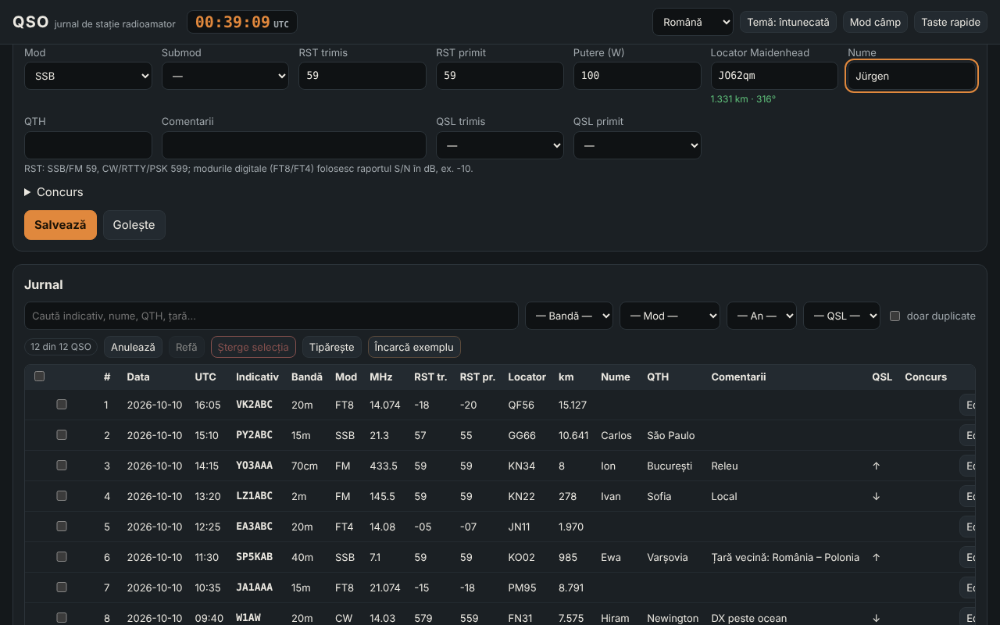

# QSO — diário de estação de radioamador

[English](README.md) · [Română](README.ro.md) · [Français](README.fr.md) · [Italiano](README.it.md) · [Español](README.es.md) · **Português** · [Deutsch](README.de.md) · [Magyar](README.hu.md)

**Versão:** 1.0.1 · **Última atualização:** 2026-10-19

Idiomas da interface: **Română, English, Français, Italiano, Español, Português (PT), Deutsch, Magyar**

O QSO é um diário de estação offline e não oficial para radioamadores: regista os contactos (data/hora UTC, indicativo, banda, modo, RST, locator, QSL, concurso), calcula distâncias e azimutes a partir de locators Maidenhead, deteta duplicados, importa e exporta ADIF 3.1 (além de ADX, CSV, JSON, Cabrillo 3.0 básico) e vê estatísticas e um mapa azimutal simples. Complementa o **ETER** (enciclopédia de radioamadorismo) e o **INDICATIV** (treinador para o exame da ANCOM), com a mesma terminologia; não os modifica nem depende deles.

**Online:** https://chiuta.github.io/apps/QSO/

## Como se utiliza

1. **Estação e definições** → preencha o perfil (indicativo, locator próprio, potência, operador). Pode ter vários perfis.
2. **Diário** → preencha o formulário e prima «Guardar» (ou `Ctrl+Enter`). O relógio UTC está sempre no cabeçalho; «Relógio em direto» mantém a data/hora atualizadas, «Agora» repõe-nas. A frequência escolhe a banda; o modo escolhe o RST predefinido (59 / 599 / −10 para FT8, FT4).
3. O indicativo é validado formalmente no momento (YO/YP/YQ/YR + algarismo + 1–3 letras; formatos internacionais gerais, prefixos portáteis `OH0/YO3ABC`, sufixos `/P`, `/M`, `/MM`); surgem o país (a partir da tabela interna) e o aviso de duplicado.
4. **Concurso** → marque «Modo de concurso», escreva CONTEST_ID; o número de ordem (STX) é preenchido automaticamente e o «dupe» é apreciado por concurso (mesma estação, banda e grupo de modos CW/PH/DG).
5. A tabela: pesquisa sem diacríticos, filtros (banda, modo, ano, QSL, duplicados), ordenação, **edição na linha** (botão «Editar» ou duplo clique), detalhes (incluindo os campos ADIF desconhecidos), eliminação com confirmação, eliminação da seleção, **anular/refazer**, impressão (CSS de impressão).
6. **Modo de campo** (`Alt+K`): formulário grande, funciona sem rato (`Alt+C` indicativo, `Alt+B`/`Alt+M` banda/modo, `Ctrl+Enter` guardar, `Alt+Z`/`Alt+Y` anular/refazer, `Alt+1…5` secções, `Alt+H` lista completa), relógio UTC grande permanente e proteção contra o fecho acidental da página.
7. **Cálculos**: distância/azimute entre dois locators, locator ↔ coordenadas, hora local e nascer/pôr do sol aproximados, prefixo → país.
8. **Estatísticas**: por banda, modo, país, ano; gráfico de QSO por hora (UTC); mapa azimutal centrado na própria estação (SVG gerado localmente).
9. **Importar / Exportar** e **cópia de segurança** `.fff.json`; «Eliminar tudo».

## O que NÃO faz e os seus limites

- **A tabela de prefixos** é interna, parcial (~220 entidades) e **NÃO é a lista DXCC completa** nem uma ferramenta oficial. As zonas CQ/ITU surgem apenas onde são seguras para toda a entidade; onde variam dentro de um país (EUA, Canadá, Rússia, Austrália, China, etc.) surge «desconhecido». Faltam as entidades DXCC raras/distintas; um indicativo não coberto surge como «país desconhecido».
- Não verifica a licença, a validade real de um indicativo nem a validade de um contacto para diplomas ou concursos. Não se liga ao QRZ, LoTW, eQSL, Club Log, etc. (não tem rede).
- **Nascer/pôr do sol**: fórmula simples (NOAA simplificada, refração 0,833°), erro típico de alguns minutos; a hora local é a hora solar média (longitude/15), não o fuso horário oficial, e não inclui a hora de verão.
- **Distâncias**: esfera R = 6371,0088 km, a partir do centro do quadrado do locator; com 4 caracteres o erro pode chegar a dezenas ou centenas de km. Não é uma distância no elipsoide.
- **Cabrillo** 3.0: apenas cabeçalho + linhas QSO em forma genérica (frequência em kHz, modo CW/PH/FM/RY/DG, troca de STX/SRX ou STX_STRING/SRX_STRING). Os formatos de troca diferem de concurso para concurso; consulte o regulamento e corrija manualmente. Não calcula pontuações.
- **ADIF**: os comprimentos são lidos em bytes UTF-8 (com recurso a caracteres se o ficheiro for inconsistente, assinalado no relatório). Os campos desconhecidos e `APP_*` são mantidos e reexportados; os USERDEF do cabeçalho não são interpretados e nem todas as enumerações são validadas (p. ex., DXCC, STATE). Os campos `*_INTL` não têm tratamento especial. ADX: importação/exportação básica.
- Sem mapa com contornos de continentes (não são carregados dados externos): o mapa mostra os pontos QSO por direção e distância.
- Os dados ficam em `localStorage`; apagar os dados do site no navegador elimina o diário. Faça cópias de segurança regulares (`.fff.json` ou ADIF). Para dezenas de milhares de QSO, o limite do navegador (~5 MB) pode tornar-se um problema.

## Privacidade

Corre localmente e não envia nada pela rede (CSP com `connect-src 'none'`; 0 pedidos externos, verificado nos testes). O diário, os perfis e as definições são guardados apenas no seu navegador, sob as chaves `fff.qso.*`.

## Formatos suportados

- Importação: `.adi`/`.adif` (com ou sem cabeçalho, `<EOH>`, `<EOR>`, etiquetas em minúsculas, indicador de tipo `<FREQ:9:N>`), `.adx`, `.csv` (cabeçalho com nomes de campos ADIF), `.json` (lista de registos) e `.fff.json` (cópia de segurança, `{"format":"fff-bundle","schema":1,"app":"qso",…}`).
- Exportação: `.adi` (ADIF 3.1.4, cabeçalho com `ADIF_VER`, `PROGRAMID`), `.adx`, `.csv` (UTF-8 com BOM), `.json`, Cabrillo 3.0, `.fff.json`.
- Campos ADIF escritos: STATION_CALLSIGN, OPERATOR, CALL, QSO_DATE, TIME_ON, BAND, FREQ, MODE, SUBMODE, RST_SENT, RST_RCVD, TX_PWR, MY_GRIDSQUARE, GRIDSQUARE, NAME, QTH, COMMENT, QSL_SENT, QSL_RCVD, CONTEST_ID, STX, SRX, STX_STRING, SRX_STRING, além de qualquer outro campo importado.
- Bandas (ADIF 3.1): 2190m, 630m, 560m, 160m … 10m, 8m, 6m, 5m, 4m, 2m, 1.25m, 70cm, 33cm, 23cm, 13cm, 9cm, 6cm, 3cm, com os limites da enumeração ADIF.

## Técnica

Um único `index.html` (HTML + CSS + JS em linha, sem bibliotecas, sem tipos de letra externos), ~165 KB. CSP: `default-src 'none'; script-src 'sha256-…'; style-src 'unsafe-inline'; img-src data: blob:; …; connect-src 'none'; worker-src blob:` — `style-src 'unsafe-inline'` e `blob:` são necessários para os estilos em linha e para a transferência de ficheiros gerados localmente (Blob). Sem manipuladores em linha, sem `eval`. Os registos são imutáveis, o que torna barato anular/refazer (100 passos). A tabela é paginada (100 linhas/página); a pesquisa usa uma cache de texto normalizado; os duplicados são comparados apenas dentro do mesmo indicativo. Testes: `node tests/test.mjs` (Playwright, rede bloqueada; o axe-core é lido de um caminho local do ambiente de desenvolvimento): indicativos positivos/negativos, distâncias face a uma implementação independente (lei dos cossenos, descodificação separada dos locators), ida e volta ADIF/ADX/CSV/JSON/`.fff.json` com diacríticos e comprimentos em bytes, 3000 QSO para desempenho, modo de campo pelo teclado, 8 idiomas, axe 0 violações a 360 px e 1280 px nos dois temas.

## Terceiros

Nenhum código de terceiros.

## Traduções

A interface está disponível em romeno (predefinição), inglês, francês, italiano, espanhol, português, húngaro e alemão. As traduções fr/it/es/pt/hu/de são **automáticas e não verificadas por falantes nativos**; os termos técnicos (ADIF, Cabrillo, QSO, RST, Maidenhead, DXCC) mantêm o seu nome. Os nomes dos países na tabela de prefixos são apresentados em romeno.

## Licença

MIT — consulte o ficheiro `LICENSE` na raiz do repositório.

## Histórico

- **1.0.0 — 2026-10-14:** primeira versão.
- **1.0.1 — 2026-10-19:** botão «Ver no TerRa» na caixa de diálogo Detalhes do QSO (locator do correspondente + hora do QSO, sem pedidos de rede).
