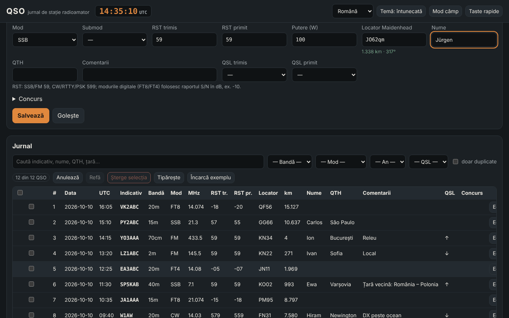

# QSO — jurnal de stație radioamator

[English](README.md) · **Română** · [Français](README.fr.md) · [Italiano](README.it.md) · [Español](README.es.md) · [Português](README.pt.md) · [Deutsch](README.de.md) · [Magyar](README.hu.md)

**Versiune:** 1.0.6 · **Ultima actualizare:** 2026-10-23

Limbile interfeței: **Română, English, Français, Italiano, Español, Português (PT), Deutsch, Magyar**

QSO este un jurnal de stație offline, neoficial, pentru radioamatori: înregistrezi legăturile (data/ora UTC, indicativ, bandă, mod, RST, locator, QSL, concurs), calculezi distanțe și azimuturi din locatori Maidenhead, detectezi duplicatele, importi și exporți ADIF 3.1 (plus ADX, CSV, JSON, Cabrillo 3.0 de bază), vezi statistici și o hartă azimutală simplă. Completează **ETER** (enciclopedie de radioamatorism) și **INDICATIV** (antrenor pentru examenul ANCOM), cu aceeași terminologie; nu le modifică și nu depinde de ele.

**Live:** https://chiuta.github.io/apps/QSO/

## Cum se folosește

1. **Stație și setări** → completează profilul (indicativ, locator propriu, putere, operator). Poți avea mai multe profiluri.
2. **Jurnal** → completează formularul și apasă „Salvează” (sau `Ctrl+Enter`). Ceasul UTC este permanent în antet; „Ceas live” ține data/ora la zi, „Acum” le resetează. Frecvența alege banda; modul alege RST-ul implicit (59 / 599 / −10 pentru FT8, FT4).
3. Indicativul este validat formal pe loc (YO/YP/YQ/YR + cifră + 1–3 litere; formate internaționale generale, prefixe portabile `OH0/YO3ABC`, sufixe `/P`, `/M`, `/MM`); apar țara (din tabelul intern) și avertizarea de duplicat.
4. **Concurs** → bifează „Mod concurs”, scrie CONTEST_ID; numărul de ordine (STX) se completează automat, iar „dupe” se judecă pe concurs (aceeași stație, bandă și grup de moduri CW/PH/DG).
5. Tabelul: căutare fără diacritice, filtre (bandă, mod, an, QSL, duplicate), sortare, **editare în rând** (buton „Editează” sau dublu clic), detalii (inclusiv câmpurile ADIF necunoscute), ștergere cu confirmare, ștergerea selecției, **anulare/refacere**, tipărire (CSS de print).
6. **Mod câmp** (`Alt+K`): formular mare, funcționează fără mouse (`Alt+C` indicativ, `Alt+B`/`Alt+M` bandă/mod, `Ctrl+Enter` salvare, `Alt+Z`/`Alt+Y` anulare/refacere, `Alt+1…5` secțiuni, `Alt+H` lista completă), ceas UTC mare permanent și protecție la închiderea accidentală a paginii.
7. **Calcule**: distanță/azimut între doi locatori, locator ↔ coordonate, ora locală și răsărit/apus aproximative, prefix → țară.
8. **Statistici**: pe bandă, mod, țară, an; grafic QSO pe oră (UTC); hartă azimutală centrată pe stația proprie (SVG generat local).
9. **Import / Export** și **copie de siguranță** `.fff.json`; „Șterge tot”.

## Ce NU face și limitele

- **Tabelul de prefixe** este intern, parțial (~220 de entități) și **NU este lista DXCC completă** ori un instrument oficial. Zonele CQ/ITU apar doar unde sunt sigure pentru întreaga entitate; acolo unde variază în interiorul țării (SUA, Canada, Rusia, Australia, China etc.) apare „necunoscut”. Entitățile DXCC rare/distincte lipsesc; un indicativ neacoperit apare ca „țară necunoscută”.
- Nu verifică licența, valabilitatea unui indicativ în realitate, nici validitatea unei legături pentru diplome sau concursuri. Nu se conectează la QRZ, LoTW, eQSL, Club Log etc. (nu are rețea).
- **Răsărit/apus**: formulă simplă (NOAA simplificată, refracție 0,833°), eroare tipică de câteva minute; ora locală este ora solară medie (longitudine/15), nu fusul oficial și nu include ora de vară.
- **Distanțele**: sferă R = 6371,0088 km, din centrul pătratului de locator; cu 4 caractere eroarea poate atinge zeci–sute de km. Nu e distanță pe elipsoid.
- **Cabrillo** 3.0: doar antet + linii QSO în formă generică (frecvență în kHz, mod CW/PH/FM/RY/DG, schimb din STX/SRX sau STX_STRING/SRX_STRING). Formatele de schimb diferă de la concurs la concurs; verifică regulamentul și corectează manual. Nu calculează punctaje.
- **ADIF**: lungimile se citesc în octeți UTF-8 (cu rezervă în caractere dacă fișierul e inconsistent, semnalat în raport). Câmpurile necunoscute și `APP_*` se păstrează și se reexportă; nu se interpretează USERDEF-urile din antet și nu se validează toate enumerările (ex. DXCC, STATE). Câmpurile `*_INTL` nu sunt tratate special. ADX: import/export de bază.
- Fără hartă cu contururi de continente (nu se încarcă date externe): harta arată punctele QSO pe direcție și distanță.
- Datele stau în `localStorage`; ștergerea datelor site-ului din browser șterge jurnalul. Fă copii de siguranță regulate (`.fff.json` sau ADIF). Pentru zeci de mii de QSO limita browserului (~5 MB) poate deveni o problemă.

## Confidențialitate

Rulează local, nu trimite nimic în rețea (CSP cu `connect-src 'none'`; 0 cereri externe, verificat în teste). Jurnalul, profilurile și setările sunt păstrate doar în browserul tău, sub cheile `fff.qso.*`.

## Formate acceptate

- Import: `.adi`/`.adif` (cu sau fără antet, `<EOH>`, `<EOR>`, etichete cu litere mici, indicator de tip `<FREQ:9:N>`), `.adx`, `.csv` (antet cu nume de câmpuri ADIF), `.json` (listă de înregistrări) și `.fff.json` (copie de siguranță, `{"format":"fff-bundle","schema":1,"app":"qso",…}`).
- Export: `.adi` (ADIF 3.1.4, antet cu `ADIF_VER`, `PROGRAMID`), `.adx`, `.csv` (UTF-8 cu BOM), `.json`, Cabrillo 3.0, `.fff.json`.
- Câmpuri ADIF scrise: STATION_CALLSIGN, OPERATOR, CALL, QSO_DATE, TIME_ON, BAND, FREQ, MODE, SUBMODE, RST_SENT, RST_RCVD, TX_PWR, MY_GRIDSQUARE, GRIDSQUARE, NAME, QTH, COMMENT, QSL_SENT, QSL_RCVD, CONTEST_ID, STX, SRX, STX_STRING, SRX_STRING, plus orice alt câmp importat.
- Benzi (ADIF 3.1): 2190m, 630m, 560m, 160m … 10m, 8m, 6m, 5m, 4m, 2m, 1.25m, 70cm, 33cm, 23cm, 13cm, 9cm, 6cm, 3cm, cu limitele din enumerarea ADIF.

## Tehnic

Un singur `index.html` (HTML + CSS + JS inline, fără biblioteci, fără fonturi externe), ~310 KB. CSP: `default-src 'none'; script-src 'sha256-…'; style-src 'unsafe-inline'; img-src data: blob:; …; connect-src 'none'; worker-src blob:` — `style-src 'unsafe-inline'` și `blob:` sunt necesare pentru stilurile inline și pentru descărcarea fișierelor generate local (Blob). Fără handlere inline, fără `eval`. Înregistrările sunt imutabile, ceea ce face ieftine anularea/refacerea (100 de pași). Tabelul este paginat (100 rânduri/pagină); căutarea folosește un cache de text normalizat; duplicatele se compară doar în interiorul aceluiași indicativ. Teste: `node tests/test.mjs` (Playwright, rețea blocată; axe-core se citește dintr-o cale locală a mediului de dezvoltare): indicative pozitive/negative, distanțe față de o implementare independentă (legea cosinusurilor, decodare separată a locatorilor), round-trip ADIF/ADX/CSV/JSON/`.fff.json` cu diacritice și lungimi în octeți, 3000 de QSO la performanță, mod câmp de la tastatură, 8 limbi, axe 0 violări la 360 px și 1280 px în ambele teme.

## Terți

Niciun cod terț.

## Traduceri

Interfața este disponibilă în română (implicit), engleză, franceză, italiană, spaniolă, portugheză, maghiară și germană. Traducerile fr/it/es/pt/hu/de sunt **automate și neverificate nativ**; termenii tehnici (ADIF, Cabrillo, QSO, RST, Maidenhead, DXCC) își păstrează numele. Numele țărilor din tabelul de prefixe sunt afișate în română.

## Licență

MIT — vezi fișierul `LICENSE` din rădăcina depozitului.

## Istoric

- **1.0.0 — 2026-10-14:** prima versiune.
- **1.0.1 — 2026-10-19:** buton „Vezi în TerRa” în dialogul Detalii QSO (locatorul corespondentului + ora QSO, fără cereri de rețea).
- **1.0.2 — 2026-10-22:** mesaj în subsol și notificare „Gata pentru offline” după ce service worker-ul a pus aplicația în cache (prima încărcare); exportul CSV neutralizează celulele care încep cu = + - @ (și tab/CR) împotriva injecției de formule în foi de calcul, iar importul CSV scoate din nou apostroful; text de cel puțin 12 px; ținte tactile de cel puțin 24 px; eticheta tehnică listează cele 8 limbi.
- **1.0.3 — 2026-10-22:** fff-kit 1.1.2: PBKDF2 cu 600.000 de iterații, protecție anti-clickjacking.
- **1.0.4 — 2026-10-22:** fff-kit 1.1.4: ținte tactile și text minim în interfața comună.
- **1.0.6 — 2026-10-23:** audit adversarial: importul ADIF cu lungimi în caractere (diacritice) nu mai este pătratic (zeci de secunde pentru câteva mii de QSO); `_id` ostil dintr-o copie de siguranță/localStorage nu mai poate injecta HTML și este normalizat; datele salvate ilizibile se păstrează în `fff.qso.data.bak` (înainte erau suprascrise la închiderea paginii) și utilizatorul este anunțat; editarea unui QSO vechi nu mai înlocuiește indicativul/operatorul/locatorul stației cu cele ale profilului curent; importul JSON acceptă valori numerice; încărcarea a sute de mii de înregistrări nu mai depășește stiva; ADX valid chiar și cu nume de câmp invalide sau caractere de control; antetul ADIF/ADX/Cabrillo și `.fff.json` poartă versiunea reală a aplicației; ținte tactile de 44 px pe ecrane tactile.
- **1.0.6 — 2026-10-23:** mesaj de rezervă când JavaScript este dezactivat (noscript).
